# Capítulo VI: Product Verification & Validation

## 6.1. Testing Suites & Validation

### 6.1.1. Core Entities Unit Tests

En esta sección se detallan las pruebas unitarias realizadas sobre las entidades y agregados core del sistema Restock, asegurando la integridad de las reglas de negocio y la consistencia de los datos.

#### IAM (Identity and Access Management) Bounded Context Unit Tests

Se validaron las entidades `User` asegurando la correcta asignación de roles y la integridad de los datos de perfil de usuario.

<div align="center">
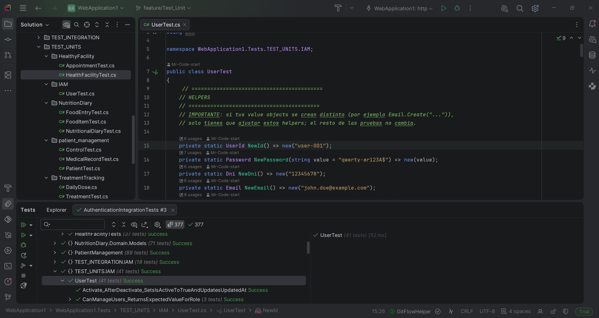
</div>

#### Subscriptions Bounded Context Unit Tests

Se realizaron pruebas sobre el agregado `Subscription`, verificando la lógica de cambio de planes, estados de suscripción y fechas de vigencia.


#### Resource Bounded Context Unit Tests

Se validaron las entidades `Order` y `Alert`, incluyendo el cálculo de totales en pedidos, transiciones de estado y la generación correcta de alertas de inventario.


### 6.1.2. Core Integration Tests

Las pruebas de integración verifican que los módulos del backend interactúen correctamente entre sí a través de los endpoints REST. Para su ejecución se utilizó xUnit junto con MongoWebApplicationFactory, que permite iniciar la API de ASP.NET Core en memoria, y Mongo2Go, que proporciona una instancia embebida de MongoDB durante las pruebas. Este enfoque permite validar el flujo de las solicitudes HTTP, las respuestas de la API, las reglas de negocio y la persistencia de datos sin depender de una infraestructura externa.

### Core Integration Tests — IAM

El módulo IAM (Identity and Access Management) comprende las pruebas de integración relacionadas con la autenticación, el registro de usuarios y la recuperación de contraseñas. Los casos de prueba verifican el registro de madres y personal de salud, el inicio de sesión mediante credenciales válidas e inválidas, la prevención de registros duplicados y el manejo de errores durante el proceso de recuperación de contraseña. Para este módulo se implementaron tres clases de prueba:

| Clase | Endpoints cubiertos | Casos |
| --- | --- | --- |
| `AuthenticationIntegrationTests` | `register/mother`, `login` | 6 |
| `StaffRegistrationIntegrationTests` | `register/staff`, `users/email/{email}`, `login` | 7 |
| `PasswordResetIntegrationTests` | `password/request-code`, `password/verify-code`, `password/reset` | 5 |


##### Prueba 1 — Flujo de autenticación (IAM)

**Clase:** `AuthenticationIntegrationTests`

Valida la comunicación entre un cliente HTTP y los endpoints REST del módulo IAM. Cubre el ciclo completo de registro de una madre e inicio de sesión, incluyendo la generación del token JWT y el manejo de errores por credenciales inválidas o datos duplicados.

| Caso | Endpoint | Resultado esperado |
| --- | --- | --- |
| Registro de madre con datos válidos | `POST /api/users/register/mother` | `201 Created` + mensaje de confirmación |
| Registro con DNI duplicado | `POST /api/users/register/mother` | `400 Bad Request` |
| Registro con correo duplicado | `POST /api/users/register/mother` | `400 Bad Request` |
| Inicio de sesión válido | `POST /api/users/login` | `200 OK` + token JWT |
| Contraseña incorrecta | `POST /api/users/login` | `401 Unauthorized` |
| Usuario inexistente | `POST /api/users/login` | `401 Unauthorized` |

<div align="center">
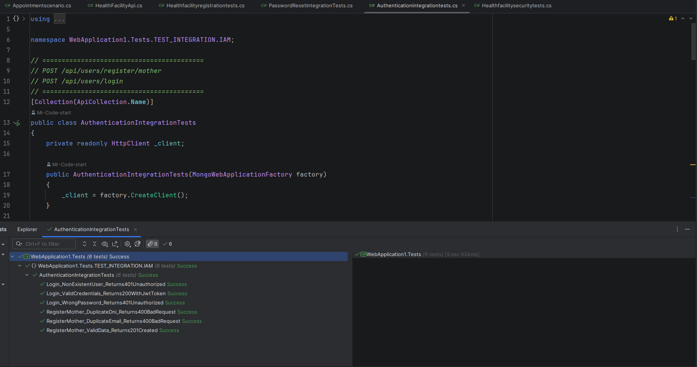
</div>

##### Prueba 2 — Registro de personal (staff)

**Clase:** `StaffRegistrationIntegrationTests`

Valida el alta de personal de salud (enfermera y administrador) y comprueba que los datos enviados queden guardados correctamente en la base de datos, consultándolos después por correo. También verifica el manejo de roles inválidos y de DNI repetidos, y que el personal registrado pueda iniciar sesión.

| Caso | Endpoint | Resultado esperado |
| --- | --- | --- |
| Registro con rol válido (`Nurse` y `Admin`) | `POST /api/users/register/staff` | `201 Created` + mensaje de confirmación |
| Datos guardados correctamente (`Nurse` y `Admin`) | `POST /api/users/register/staff` y `GET /api/users/email/{email}` | `200 OK` con nombre, apellido, DNI, correo, teléfono y rol iguales a los enviados |
| Rol inexistente | `POST /api/users/register/staff` | `400 Bad Request` |
| DNI duplicado | `POST /api/users/register/staff` | `400 Bad Request` |
| Inicio de sesión del personal registrado | `POST /api/users/login` | `200 OK` + token JWT |

<div align="center">
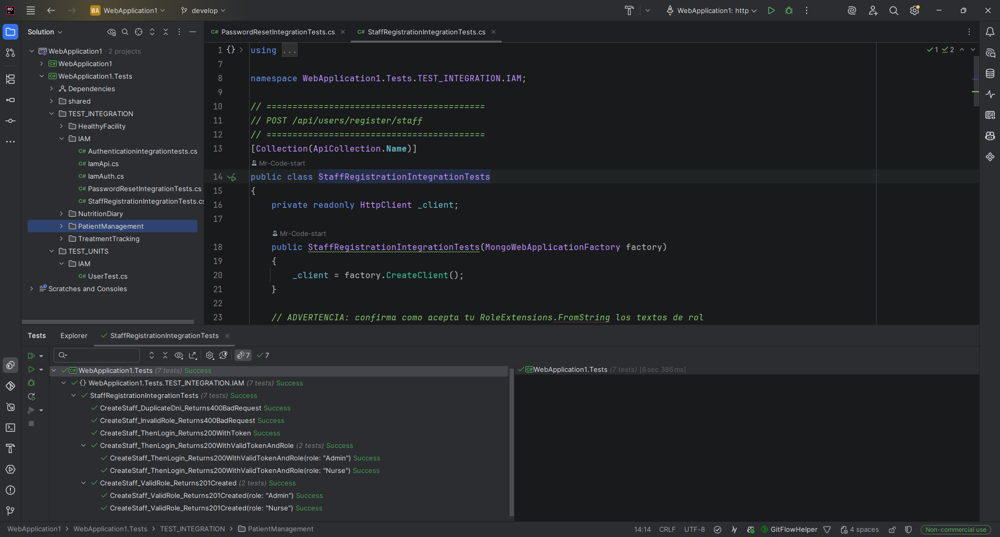
</div>

**Hallazgo detectado por la prueba:** al registrar personal con un DNI duplicado, la API respondía `500 Internal Server Error` porque el controlador solo capturaba `ArgumentException` y no `InvalidOperationException`. Se corrigió para devolver `400 Bad Request`, igual que el registro de madres.

##### Prueba 3 — Recuperación de contraseña

**Clase:** `PasswordResetIntegrationTests`

Valida los casos de error del flujo de recuperación de contraseña en sus tres pasos: solicitar código, verificarlo y restablecer la contraseña. Comprueba que la API rechace correos inexistentes y códigos inválidos, y que ante un intento fallido la contraseña original siga funcionando.

| Caso | Endpoint | Resultado esperado |
| --- | --- | --- |
| Solicitar código con correo inexistente | `POST /api/users/password/request-code` | `400 Bad Request` |
| Verificar código con correo inexistente | `POST /api/users/password/verify-code` | `400 Bad Request` |
| Verificar código sin haberlo solicitado | `POST /api/users/password/verify-code` | `400 Bad Request` |
| Restablecer con correo inexistente | `POST /api/users/password/reset` | `400 Bad Request` |
| Restablecer con código inválido | `POST /api/users/password/reset` y `POST /api/users/login` | `400 Bad Request`; el inicio de sesión con la contraseña original devuelve `200 OK` |

<div align="center">
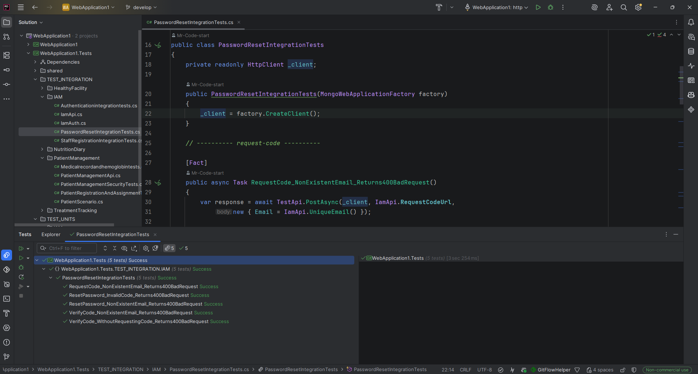
</div>

**Alcance:** el flujo exitoso (solicitar código, verificarlo y restablecer) no está cubierto porque el código se envía por correo electrónico. Para probarlo se requiere reemplazar el servicio de correo por un doble de prueba que capture el código enviado.

---

### Core Integration Tests — Nutrition Diary

Para el módulo Nutrition Diary se implementó la clase de prueba `NutritiondiaryintegrationTests`. Los casos utilizan `HttpClient` y `MongoWebApplicationFactory` para validar la interacción con los endpoints REST, incluyendo la seguridad, las validaciones de datos y las consultas de información nutricional.

| Clase | Endpoints cubiertos | Casos |
| --- | --- | --- |
| `NutritiondiaryintegrationTests` | `food-entry`, `today/{patientId}`, `history/{patientId}`, `foods/search`, `foods/{foodItemId}` | 17 |

##### Prueba 1 — Seguridad y autorización (Nutrition Diary)

**Clase:** `NutritiondiaryintegrationTests`

Valida los mecanismos de autenticación y autorización de los endpoints destinados a las madres. Comprueba que las solicitudes sin token sean rechazadas, que el personal de salud no pueda acceder a los endpoints exclusivos para madres y que el token de una madre contenga el claim `motherId` requerido para identificarla.

| Caso | Endpoint | Resultado esperado |
| --- | --- | --- |
| Registro de consumo sin token | `POST /api/nutritional-diary/food-entry` | `401 Unauthorized` |
| Consulta diaria sin token | `GET /api/nutritional-diary/today/{patientId}` | `401 Unauthorized` |
| Consulta del historial sin token | `GET /api/nutritional-diary/history/{patientId}` | `401 Unauthorized` |
| Registro de consumo con token de personal de salud | `POST /api/nutritional-diary/food-entry` | `403 Forbidden` |
| Consulta diaria con token de personal de salud | `GET /api/nutritional-diary/today/{patientId}` | `403 Forbidden` |
| Consulta del historial con token de personal de salud | `GET /api/nutritional-diary/history/{patientId}` | `403 Forbidden` |
| Token de madre con claim `motherId` | `GET /api/nutritional-diary/history/{patientId}` | No devuelve `401 Unauthorized`, `403 Forbidden` ni el mensaje `Mother ID no encontrado` |

<div align="center">
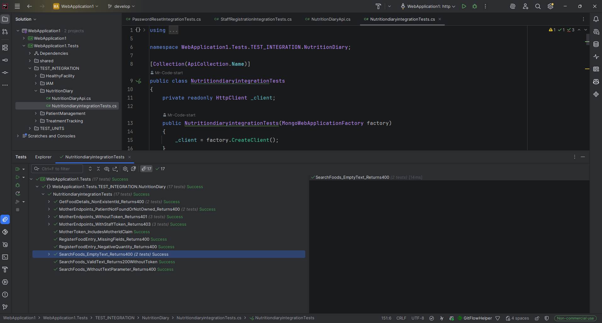
</div>

##### Prueba 2 — Validación del registro de consumo de alimentos

**Clase:** `NutritiondiaryintegrationTests`

Comprueba las validaciones del endpoint de registro de consumo de alimentos, verificando que las solicitudes con campos obligatorios faltantes o cantidades negativas sean rechazadas por la API.

| Caso | Endpoint | Resultado esperado |
| --- | --- | --- |
| Registro con campos obligatorios faltantes | `POST /api/nutritional-diary/food-entry` | `400 Bad Request` + mensaje `Faltan campos requeridos` |
| Registro con cantidad negativa | `POST /api/nutritional-diary/food-entry` | `400 Bad Request` |

##### Prueba 3 — Consulta diaria e historial de pacientes

**Clase:** `NutritiondiaryintegrationTests`

Valida el comportamiento de los endpoints de consulta diaria e historial cuando la madre autenticada solicita información de un paciente inexistente o que no le pertenece.

| Caso | Endpoint | Resultado esperado |
| --- | --- | --- |
| Consulta diaria de paciente inexistente o no asociado | `GET /api/nutritional-diary/today/{patientId}` | `400 Bad Request` |
| Consulta del historial de paciente inexistente o no asociado | `GET /api/nutritional-diary/history/{patientId}` | `400 Bad Request` |

##### Prueba 4 — Búsqueda de alimentos

**Clase:** `NutritiondiaryintegrationTests`

Verifica el comportamiento del endpoint público de búsqueda de alimentos. Comprueba que la API rechace búsquedas con texto vacío, espacios en blanco o sin el parámetro requerido, y que permita realizar una búsqueda válida sin autenticación.

| Caso | Endpoint | Resultado esperado |
| --- | --- | --- |
| Búsqueda con texto vacío | `GET /api/nutritional-diary/foods/search?text=` | `400 Bad Request` |
| Búsqueda con texto compuesto por espacios | `GET /api/nutritional-diary/foods/search?text=...` | `400 Bad Request` |
| Búsqueda sin el parámetro `text` | `GET /api/nutritional-diary/foods/search` | `400 Bad Request` |
| Búsqueda válida de alimentos (`arroz`) | `GET /api/nutritional-diary/foods/search?text=arroz` | `200 OK`, sin token de autenticación |

##### Prueba 5 — Consulta de detalles de alimentos

**Clase:** `NutritiondiaryintegrationTests`

Comprueba la respuesta de la API cuando se solicitan los detalles de un alimento mediante un identificador inexistente, utilizando tanto un identificador con formato ObjectId como una cadena de texto que no corresponde a un alimento registrado.

| Caso | Endpoint | Resultado esperado |
| --- | --- | --- |
| Consulta con identificador inexistente en formato ObjectId | `GET /api/nutritional-diary/foods/{foodItemId}` | `400 Bad Request` |
| Consulta con identificador inexistente en formato de texto | `GET /api/nutritional-diary/foods/{foodItemId}` | `400 Bad Request` |

<div align="center">

</div>

**Alcance:** las pruebas de esta clase se concentran en seguridad, validaciones y consultas. No se incluyen escenarios de registro exitoso de consumo de alimentos ni consultas exitosas de información diaria e historial. Asimismo, el endpoint de alimentos por categoría (`foods/category/{category}`) está definido en `NutritionDiaryApi.cs`, pero no cuenta con casos de prueba en esta clase.

---

### Core Integration Tests — Patient Management

Cada escenario de prueba prepara sus propios datos mediante la API, creando madres, pacientes y enfermeras según los requisitos de cada caso. Para el módulo Patient Management se implementaron tres clases de prueba de integración, utilizando `xUnit`, `HttpClient` y `MongoWebApplicationFactory`. Las pruebas validan el registro y la asignación de pacientes, la gestión de historias clínicas, el seguimiento de hemoglobina y los mecanismos de autenticación y autorización por roles.

| Clase | Endpoints cubiertos | Casos |
|---|---|---:|
| `MedicalRecordAndHemoglobinTests` | `medical-record`, `{patientId}/medical-record`, `hemoglobin-control`, `medical-record/{id}/controls`, `{patientId}/hemoglobin-evolution`, `discharge` | 15 |
| `PatientManagementSecurityTests` | `register`, `assign-nurse`, `medical-record`, `hemoglobin-control`, `discharge`, `my-patients`, `nurse`, `mother/{motherId}`, `mother/search/{term}`, `{id}` y endpoints relacionados | 28 |
| `PatientRegistrationAndAssignmentTests` | `register`, `my-patients`, `assign-nurse`, `mother/{motherId}`, `nurse`, `{id}`, `mother/search/{term}` | 14 |

##### Prueba 1 — Historia clínica y control de hemoglobina

**Clase:** `MedicalRecordAndHemoglobinTests`

Valida la creación y consulta de historias clínicas, el registro y consulta de controles de hemoglobina, la consulta de la evolución de hemoglobina por parte de la madre y las validaciones del alta del paciente. También comprueba que una enfermera no pueda acceder ni modificar la información de pacientes asignados a otra profesional de salud.

| Caso | Endpoint | Resultado esperado |
|---|---|---|
| Crear historia clínica de paciente asignado | `POST /api/patients/medical-record` | `201 Created` + mensaje de confirmación |
| Crear historia clínica de paciente asignado a otra enfermera | `POST /api/patients/medical-record` | `400 Bad Request` |
| Crear historia clínica con campos obligatorios faltantes | `POST /api/patients/medical-record` | `400 Bad Request` |
| Consultar historia clínica después de crearla | `GET /api/patients/{patientId}/medical-record` | `200 OK` + datos guardados |
| Consultar historia clínica antes de crearla | `GET /api/patients/{patientId}/medical-record` | `404 Not Found` o `400 Bad Request` |
| Consultar historia clínica de paciente asignado a otra enfermera | `GET /api/patients/{patientId}/medical-record` | `400 Bad Request` |
| Registrar un nivel válido de hemoglobina | `POST /api/patients/hemoglobin-control` | `201 Created` + mensaje de confirmación |
| Registrar hemoglobina sin especificar el nivel | `POST /api/patients/hemoglobin-control` | `400 Bad Request` |
| Registrar hemoglobina de paciente asignado a otra enfermera | `POST /api/patients/hemoglobin-control` | `400 Bad Request` |
| Consultar controles después de registrar hemoglobina | `GET /api/patients/medical-record/{id}/controls` | `200 OK` + control registrado |
| Consultar controles sin acceso autorizado | `GET /api/patients/medical-record/{id}/controls` | `400 Bad Request` |
| Consultar evolución de hemoglobina del propio paciente | `GET /api/patients/{patientId}/hemoglobin-evolution` | `200 OK` + evolución registrada |
| Consultar evolución de paciente de otra madre | `GET /api/patients/{patientId}/hemoglobin-evolution` | `400 Bad Request` |
| Dar de alta sin identificador de paciente | `PUT /api/patients/discharge` | `400 Bad Request` |
| Dar de alta a un paciente asignado a otra enfermera | `PUT /api/patients/discharge` | `400 Bad Request` |

<div align="center">
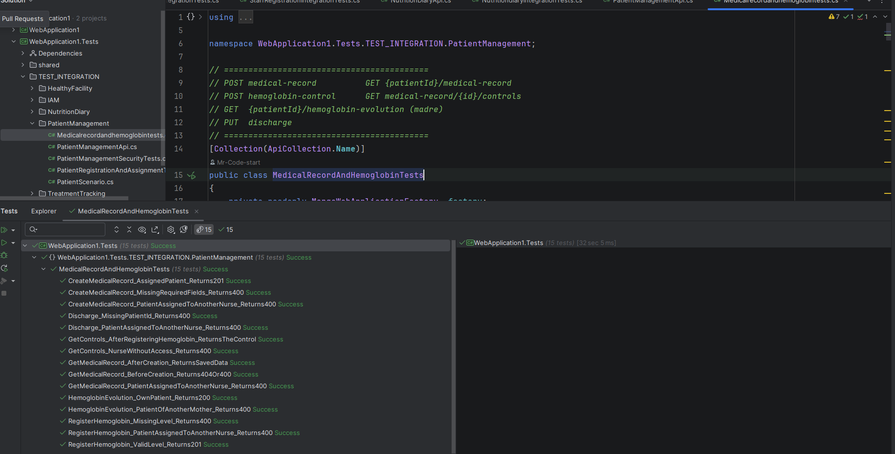
</div>

**Alcance:** las pruebas de alta del paciente cubren únicamente escenarios de error relacionados con la ausencia del identificador y la asignación a otra enfermera. El flujo exitoso de alta no está cubierto porque depende de las reglas de negocio establecidas para el alta del paciente.

##### Prueba 2 — Seguridad y autorización de Patient Management

**Clase:** `PatientManagementSecurityTests`

Valida que los endpoints del módulo requieran autenticación y que el acceso esté restringido según el rol del usuario. Comprueba que las operaciones exclusivas de las madres no puedan ejecutarse con un token de enfermera y que las operaciones destinadas al personal de salud rechacen los tokens de madre. Asimismo, verifica que los tokens incluyan los claims `motherId` y `nurseId` requeridos por los controladores.

| Caso | Endpoint | Resultado esperado |
|---|---|---|
| Acceso a endpoints protegidos sin token (13 escenarios) | Endpoints de registro, asignación, historia clínica, hemoglobina, alta y consultas de pacientes | `401 Unauthorized` |
| Acceso a endpoints de enfermera con token de madre (10 escenarios) | Endpoints de asignación, historia clínica, hemoglobina, alta y consultas de personal de salud | `403 Forbidden` |
| Acceso a endpoints de madre con token de enfermera (3 escenarios) | `POST /api/patients/register`, `GET /api/patients/my-patients` y `GET /api/patients/{id}/hemoglobin-evolution` | `403 Forbidden` |
| Verificación del claim `motherId` | `GET /api/patients/my-patients` | `200 OK`, sin el mensaje `Mother ID no encontrado` |
| Verificación del claim `nurseId` | `GET /api/patients/nurse` | `200 OK`, sin el mensaje `Nurse ID no encontrado` |

<div align="center">
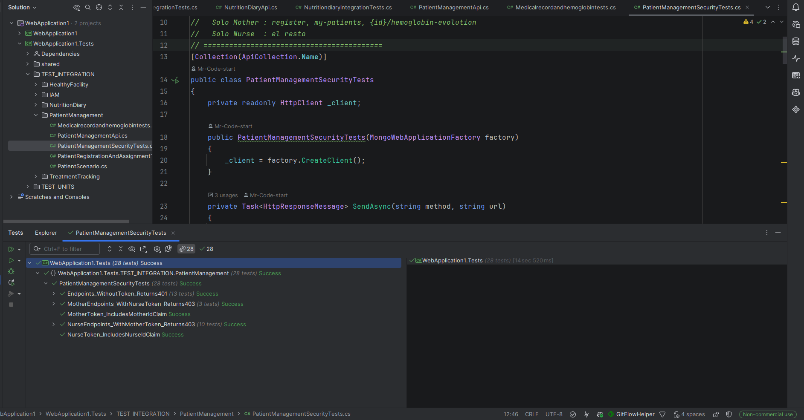
</div>

**Alcance:** se verifican 28 ejecuciones relacionadas con la autenticación, la autorización por roles y la presencia de los claims necesarios para identificar a madres y enfermeras.

##### Prueba 3 — Registro y asignación de pacientes

**Clase:** `PatientRegistrationAndAssignmentTests`

Valida el registro de pacientes por parte de las madres, la asociación del paciente con la madre autenticada, la asignación de pacientes a enfermeras y las consultas de pacientes asignados y no asignados. También comprueba las respuestas de la API cuando no existen pacientes, se envían datos inválidos o se consultan identificadores inexistentes.

| Caso | Endpoint | Resultado esperado |
|---|---|---|
| Registrar paciente con datos válidos | `POST /api/patients/register` | `201 Created` + mensaje de confirmación |
| Verificar que el paciente se asocia a la madre del token | `POST /api/patients/register` y `GET /api/patients/my-patients` | `200 OK` al consultar los pacientes; aparece el paciente registrado |
| Registrar paciente con peso negativo | `POST /api/patients/register` | `400 Bad Request` |
| Consultar pacientes de una madre sin pacientes | `GET /api/patients/my-patients` | `200 OK` + lista vacía |
| Listar pacientes de una madre antes de la asignación | `GET /api/patients/mother/{motherId}` | `200 OK` + estado `UNASSIGNED` |
| Listar pacientes de una madre después de la asignación | `GET /api/patients/mother/{motherId}` | `200 OK` + estado `ASSIGNED` |
| Asignar un paciente válido a una enfermera | `POST /api/patients/assign-nurse` | `201 Created` + mensaje de confirmación |
| Asignar paciente sin identificador | `POST /api/patients/assign-nurse` | `400 Bad Request` |
| Asignar paciente inexistente | `POST /api/patients/assign-nurse` | `400 Bad Request` |
| Consultar pacientes de una enfermera sin asignaciones | `GET /api/patients/nurse` | `200 OK` + estado `EMPTY` y total `0` |
| Consultar pacientes después de la asignación | `GET /api/patients/nurse` | `200 OK` + estado `SUCCESS` y total `1` |
| Consultar información básica de un paciente existente | `GET /api/patients/{id}` | `200 OK` + información del paciente |
| Consultar información básica de un paciente inexistente | `GET /api/patients/{id}` | `404 Not Found` o `400 Bad Request` |
| Buscar una madre por DNI existente | `GET /api/patients/mother/search/{term}` | `200 OK` + información de la madre |

<div align="center">
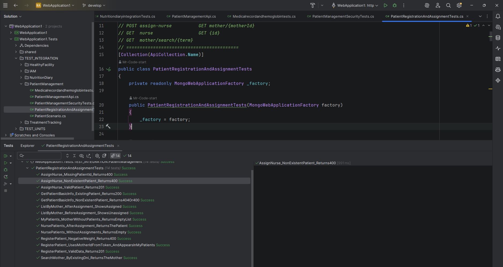
</div>

**Alcance:** los casos cubren los flujos principales de registro, asignación y consulta, además de las validaciones de error y las respuestas para listas vacías. La prueba de registro con peso negativo espera `400 Bad Request`, por lo que el resultado depende de que la validación correspondiente esté implementada en el dominio.

---

### Core Integration Tests — Treatment Tracking

Cada escenario de prueba prepara los datos necesarios para verificar el seguimiento del tratamiento, utilizando pacientes registrados, enfermeras asignadas, historias clínicas y controles de hemoglobina. Para el módulo Treatment Tracking se implementaron cuatro clases de prueba de integración mediante `xUnit`, `HttpClient` y `MongoWebApplicationFactory`.

Las pruebas validan el inicio y la gestión del tratamiento, el seguimiento de las dosis diarias, el historial de cumplimiento, la clasificación de pacientes según su nivel de riesgo y los mecanismos de autenticación y autorización por roles.

| Clase | Endpoints cubiertos | Casos |
|---|---|---:|
| `DoseTests` | `patients/{id}/today-dose`, `doses/confirm`, `patients/{id}/dose-history` | 9 |
| `RiskTests` | `risk-overview`, `risk/{riskLevel}/patients` | 4 |
| `TreatmentLifecycleTests` | `treatments`, `treatments/complete`, `treatments/abandon`, `nurses/treatments` | 18 |
| `TreatmentSecurityTests` | Endpoints de tratamientos, dosis, consultas de riesgo y tratamientos de enfermeras | 18 |

##### Prueba 1 — Registro y seguimiento de dosis

**Clase:** `DoseTests`

Valida la consulta de la dosis correspondiente al día, la confirmación de la toma por parte de la madre y la consulta del historial de dosis. Comprueba que la madre pueda consultar y confirmar las dosis de su propio paciente, y que la API rechace operaciones relacionadas con pacientes ajenos, pacientes sin tratamiento o identificadores inexistentes.

| Caso | Endpoint | Resultado esperado |
|---|---|---|
| Consultar dosis diaria del propio paciente con tratamiento | `GET /api/treatment-tracking/patients/{id}/today-dose` | `200 OK` |
| Consultar dosis diaria de un paciente de otra madre | `GET /api/treatment-tracking/patients/{id}/today-dose` | `400 Bad Request` |
| Confirmar dosis del propio paciente | `POST /api/treatment-tracking/doses/confirm` | `200 OK` |
| Confirmar dosis de un paciente de otra madre | `POST /api/treatment-tracking/doses/confirm` | `400 Bad Request` |
| Confirmar dosis de un paciente sin tratamiento | `POST /api/treatment-tracking/doses/confirm` | `400 Bad Request` |
| Confirmar dosis de un paciente inexistente | `POST /api/treatment-tracking/doses/confirm` | `400 Bad Request` |
| Consultar historial del propio paciente con tratamiento | `GET /api/treatment-tracking/patients/{id}/dose-history` | `200 OK` |
| Consultar historial después de confirmar una dosis | `GET /api/treatment-tracking/patients/{id}/dose-history` | `200 OK` + estado de dosis `CONFIRM` |
| Consultar historial de un paciente de otra madre | `GET /api/treatment-tracking/patients/{id}/dose-history` | `400 Bad Request` |

<div align="center">
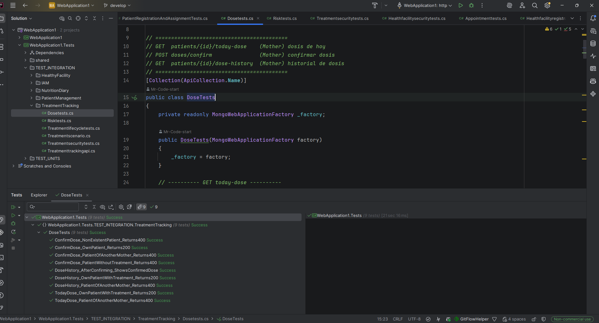
</div>

**Alcance:** se validan nueve escenarios relacionados con la consulta y confirmación de dosis. El caso de confirmación depende de las reglas temporales que aplique la API para permitir registrar una toma. La prueba de historial de otro paciente verifica también que no se exponga información perteneciente a otra madre.

##### Prueba 2 — Clasificación y consulta de pacientes por riesgo

**Clase:** `RiskTests`

Valida los endpoints destinados a las enfermeras para consultar el resumen de pacientes según su nivel de riesgo y obtener la lista de pacientes pertenecientes a un nivel determinado. Se comprueba el comportamiento cuando la enfermera no tiene pacientes, cuando existen tratamientos y cuando se proporciona un nivel de riesgo inválido.

| Caso | Endpoint | Resultado esperado |
|---|---|---|
| Consultar resumen de riesgo sin pacientes | `GET /api/treatment-tracking/risk-overview` | `200 OK` |
| Consultar resumen de riesgo con pacientes en tratamiento | `GET /api/treatment-tracking/risk-overview` | `200 OK` + contenido no vacío |
| Consultar pacientes con nivel de riesgo válido | `GET /api/treatment-tracking/risk/{riskLevel}/patients` | `200 OK` |
| Consultar pacientes con nivel de riesgo inválido | `GET /api/treatment-tracking/risk/{riskLevel}/patients` | `400 Bad Request` |

<div align="center">
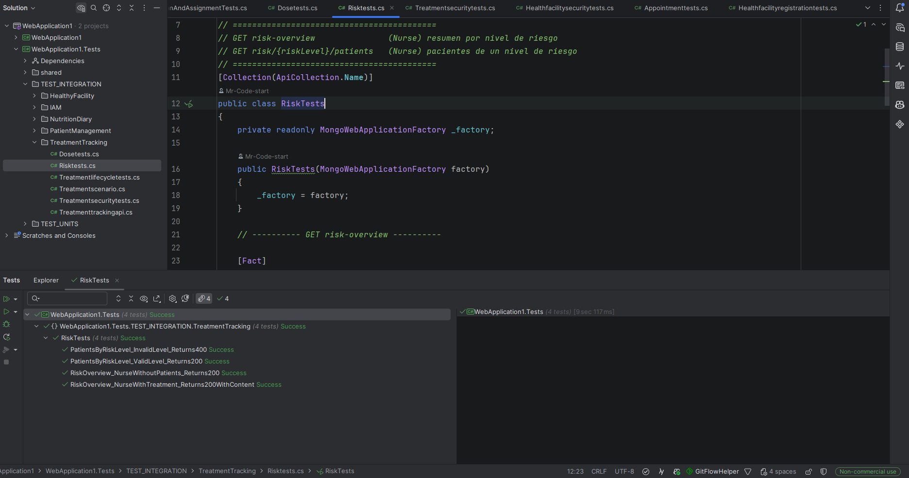
</div>

**Alcance:** las cuatro pruebas verifican las consultas de riesgo y la validación del nivel proporcionado. El nivel válido utilizado en las pruebas es `HIGH`, definido en `TreatmentTrackingApi.cs`.

##### Prueba 3 — Ciclo de vida del tratamiento

**Clase:** `TreatmentLifecycleTests`

Valida el inicio de tratamientos para pacientes asignados a una enfermera, la consulta de los tratamientos registrados y el filtrado por estado. También verifica las operaciones de completar y abandonar un tratamiento, incluyendo el rechazo de identificadores inexistentes y de operaciones sobre tratamientos asignados a otra enfermera.

| Caso | Endpoint | Resultado esperado |
|---|---|---|
| Iniciar tratamiento para un paciente asignado | `POST /api/treatment-tracking/treatments` | `201 Created` |
| Verificar que el tratamiento aparece en la lista de la enfermera | `POST /api/treatment-tracking/treatments` y `GET /api/treatment-tracking/nurses/treatments` | El tratamiento aparece con el paciente correspondiente |
| Iniciar tratamiento sin identificador de paciente | `POST /api/treatment-tracking/treatments` | `400 Bad Request` + mensaje `PatientId es requerido` |
| Iniciar tratamiento para paciente asignado a otra enfermera | `POST /api/treatment-tracking/treatments` | `400 Bad Request` |
| Iniciar tratamiento para paciente inexistente | `POST /api/treatment-tracking/treatments` | `400 Bad Request` |
| Iniciar tratamiento con duración de cero días | `POST /api/treatment-tracking/treatments` | `400 Bad Request` |
| Iniciar tratamiento con duración negativa | `POST /api/treatment-tracking/treatments` | `400 Bad Request` |
| Iniciar tratamiento sin nombre del suplemento | `POST /api/treatment-tracking/treatments` | `400 Bad Request` |
| Consultar tratamientos sin tratamientos asignados a la enfermera | `GET /api/treatment-tracking/nurses/treatments` | `200 OK` + lista vacía |
| Filtrar tratamientos por estado activo | `GET /api/treatment-tracking/nurses/treatments?status=ACTIVE` | `200 OK` + tratamiento activo incluido |
| Filtrar por estado completado | `GET /api/treatment-tracking/nurses/treatments?status=COMPLETED` | `200 OK` + tratamiento activo excluido |
| Consultar tratamientos con estado inválido | `GET /api/treatment-tracking/nurses/treatments?status=ESTADO-INEXISTENTE` | `400 Bad Request` |
| Completar tratamiento propio | `PUT /api/treatment-tracking/treatments/complete` | `200 OK` + tratamiento excluido de la lista activa |
| Completar tratamiento inexistente | `PUT /api/treatment-tracking/treatments/complete` | `400 Bad Request` |
| Completar tratamiento asignado a otra enfermera | `PUT /api/treatment-tracking/treatments/complete` | `400 Bad Request` |
| Abandonar tratamiento propio | `PUT /api/treatment-tracking/treatments/abandon` | `200 OK` + tratamiento excluido de la lista activa |
| Abandonar tratamiento inexistente | `PUT /api/treatment-tracking/treatments/abandon` | `400 Bad Request` |
| Abandonar tratamiento asignado a otra enfermera | `PUT /api/treatment-tracking/treatments/abandon` | `400 Bad Request` |

<div align="center">
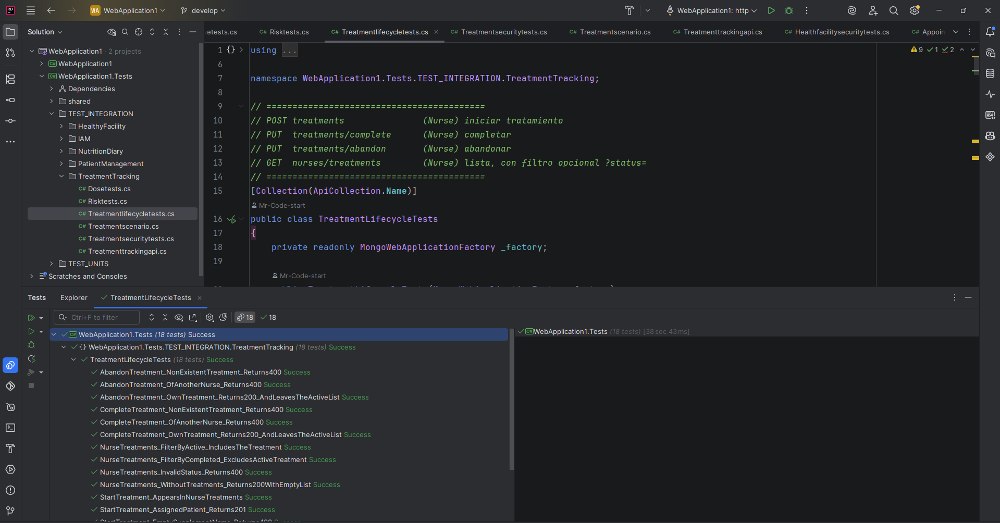
</div>

**Alcance:** las pruebas cubren el inicio, la consulta, el filtrado, la finalización y el abandono de tratamientos. Se incluyen escenarios de éxito y error para validar la asignación del paciente, los datos obligatorios, la duración y los permisos de acceso. La lista de tratamientos se comprueba después de completar o abandonar un tratamiento para verificar que deje de aparecer entre los activos.

##### Prueba 4 — Seguridad y autorización de Treatment Tracking

**Clase:** `TreatmentSecurityTests`

Valida que los endpoints protegidos requieran un token de autenticación y que las operaciones se restrinjan según el rol del usuario. Comprueba que las madres no puedan gestionar tratamientos ni consultar información exclusiva de enfermería, y que las enfermeras no puedan confirmar dosis ni consultar la información de dosis reservada a las madres.

| Caso | Endpoint | Resultado esperado |
|---|---|---|
| Acceso a endpoints protegidos sin token (9 escenarios) | Inicio, confirmación, finalización y abandono de tratamientos; dosis diaria, historial, resumen de riesgo, lista de tratamientos y pacientes por riesgo | `401 Unauthorized` |
| Acceso con rol incorrecto (9 escenarios) | Operaciones exclusivas de enfermería con token de madre y consultas o confirmación de dosis con token de enfermera | `403 Forbidden` |

<div align="center">
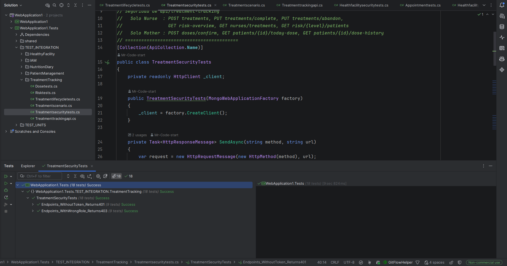
</div>

**Alcance:** se ejecutaron 18 casos relacionados con la autenticación y autorización del módulo, distribuidos en nueve escenarios sin token y nueve escenarios con un rol incorrecto. Estas pruebas verifican la separación de permisos entre madres y enfermeras para los endpoints de seguimiento del tratamiento.

---

### Core Integration Tests — Healthy Facility

Las pruebas de integración del módulo Healthy Facility verifican la interacción entre los endpoints REST encargados de gestionar las postas de salud, asignar enfermeras y administrar las citas médicas. Se utiliza `xUnit` junto con `MongoWebApplicationFactory` para ejecutar las pruebas contra la API en memoria y comprobar las respuestas HTTP y los datos generados durante cada escenario.

Para este módulo se implementaron tres clases de prueba: `HealthFacilityRegistrationTests`, `HealthFacilitySecurityTests` y `AppointmentTests`.

| Clase | Endpoints cubiertos | Casos |
|---|---|---:|
| `HealthFacilityRegistrationTests` | Registro de postas, asignación de enfermeras, consulta de postas y búsqueda de postas cercanas | 17 |
| `HealthFacilitySecurityTests` | Registro y asignación de postas, citas, búsqueda de postas cercanas y consultas de agenda | 17 |
| `AppointmentTests` | Reserva y cancelación de citas, historial de citas del paciente, agenda de enfermería y próxima cita | 23 |

##### Prueba 1 — Registro de postas y asignación de enfermeras

**Clase:** `HealthFacilityRegistrationTests`

Valida el registro de postas de salud por parte del administrador, la asignación de enfermeras y la consulta de información de las postas. También comprueba las validaciones de campos obligatorios, la existencia de los identificadores enviados y las reglas que impiden asignar más de una enfermera a una posta o a una enfermera a varias postas.

| Caso | Endpoint | Resultado esperado |
|---|---|---|
| Registrar posta con datos válidos | `POST /api/health-facilities` | `201 Created` + la posta aparece en el listado |
| Registrar posta sin nombre | `POST /api/health-facilities` | `400 Bad Request` |
| Registrar posta sin dirección | `POST /api/health-facilities` | `400 Bad Request` |
| Registrar posta sin identificador de distrito | `POST /api/health-facilities` | `400 Bad Request` |
| Registrar posta sin servicios | `POST /api/health-facilities` | `400 Bad Request` |
| Registrar posta sin días disponibles | `POST /api/health-facilities` | `400 Bad Request` |
| Registrar posta sin horarios disponibles | `POST /api/health-facilities` | `400 Bad Request` |
| Asignar enfermera a una posta disponible | `POST /api/health-facilities/assign-nurse` | `200 OK` + mensaje de confirmación |
| Asignar enfermera a una posta que ya tiene enfermera | `POST /api/health-facilities/assign-nurse` | `400 Bad Request` |
| Asignar enfermera a una posta inexistente | `POST /api/health-facilities/assign-nurse` | `400 Bad Request` |
| Asignar una enfermera inexistente | `POST /api/health-facilities/assign-nurse` | `400 Bad Request` |
| Asignar una enfermera que ya pertenece a otra posta | `POST /api/health-facilities/assign-nurse` | `400 Bad Request` |
| Consultar una posta existente sin token | `GET /api/health-facilities/{id}` | `200 OK` + información de la posta |
| Consultar una posta inexistente | `GET /api/health-facilities/{id}` | `404 Not Found` o `400 Bad Request` |
| Buscar postas cercanas sin pacientes registrados | `GET /api/health-facilities/nearby?lat={lat}&lng={lng}` | `400 Bad Request` |
| Buscar postas cercanas a una ubicación con una posta registrada | `GET /api/health-facilities/nearby?lat={lat}&lng={lng}` | `200 OK` + la posta cercana en los resultados |

<div align="center">
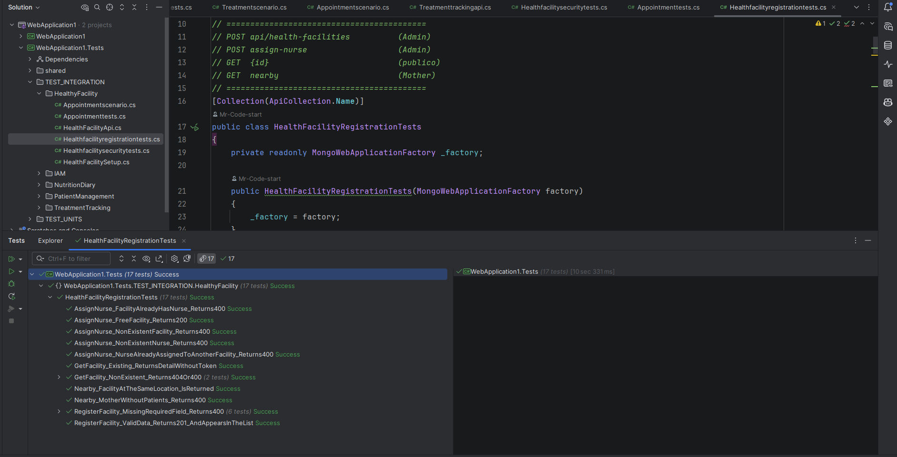
</div>

**Alcance:** se verifican 17 casos de prueba, incluyendo seis escenarios de campos obligatorios, la asignación de enfermeras y las consultas públicas y geográficas. Las pruebas también comprueban que cada posta admita una sola enfermera y que una enfermera no pueda asignarse a otra posta si ya pertenece a una.

##### Prueba 2 — Seguridad y autorización de Healthy Facility

**Clase:** `HealthFacilitySecurityTests`

Valida la protección de los endpoints según el rol del usuario. Comprueba que las operaciones administrativas requieran autenticación y autorización de administrador, que las madres puedan gestionar sus citas y buscar postas cercanas, y que las enfermeras puedan consultar únicamente la agenda correspondiente a su rol. También verifica la presencia del identificador de enfermera en el token JWT.

| Caso | Endpoint | Resultado esperado |
|---|---|---|
| Acceso a endpoints protegidos sin token (7 escenarios) | Registro de postas, asignación de enfermeras, reserva y cancelación de citas, búsqueda de postas cercanas y consultas de agenda | `401 Unauthorized` |
| Acceso a endpoints con rol incorrecto (9 escenarios) | Registro y asignación de postas, reserva y cancelación de citas, búsqueda de postas cercanas y consultas de agenda | `403 Forbidden` |
| Verificar el claim `nurseId` en el token de enfermera | Token JWT generado para el rol `Nurse` | El claim `nurseId` está presente y no está vacío |

<div align="center">
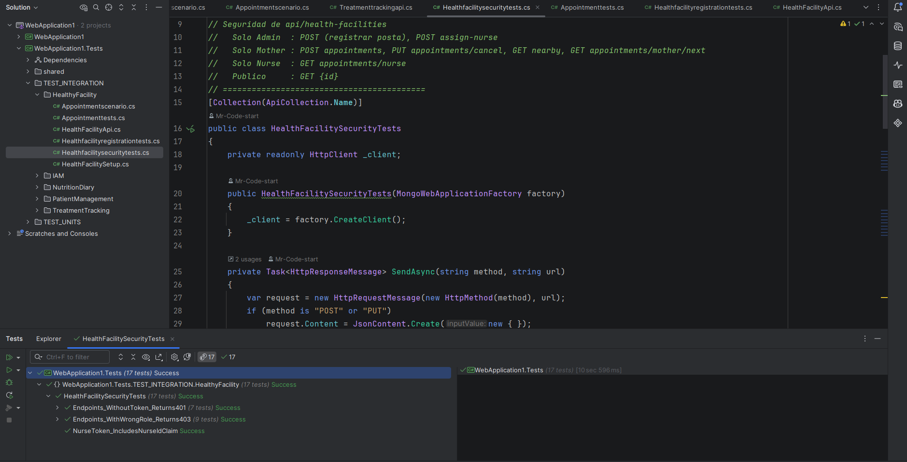
</div>

**Alcance:** se ejecutaron 17 casos relacionados con la seguridad, distribuidos en siete escenarios sin token, nueve escenarios con rol incorrecto y una validación del claim de enfermera. Los resultados permiten verificar la separación de permisos entre los roles `Admin`, `Nurse` y `Mother`.

##### Prueba 3 — Reserva, cancelación y consulta de citas

**Clase:** `AppointmentTests`

Valida el ciclo de vida de las citas médicas desde la reserva por parte de una madre hasta la cancelación y consulta de la agenda de enfermería. Comprueba que las citas se registren correctamente, que la información aparezca en el historial del paciente y que se rechacen las reservas con datos inválidos, fechas pasadas, postas inexistentes o pacientes que pertenecen a otra madre.

| Caso | Endpoint | Resultado esperado |
|---|---|---|
| Reservar cita con datos válidos | `POST /api/health-facilities/appointments` | `201 Created` + mensaje de confirmación |
| Verificar que la cita aparece en el historial del paciente | `POST /api/health-facilities/appointments` y `GET /api/health-facilities/patient/{patientId}/appointments` | `200 OK` + datos de la cita |
| Reservar cita para un paciente de otra madre | `POST /api/health-facilities/appointments` | `400 Bad Request` |
| Reservar cita en una posta inexistente | `POST /api/health-facilities/appointments` | `400 Bad Request` |
| Reservar cita con fecha inválida (3 variantes) | `POST /api/health-facilities/appointments` | `400 Bad Request` |
| Reservar cita con hora inválida (3 variantes) | `POST /api/health-facilities/appointments` | `400 Bad Request` |
| Reservar cita con fecha pasada | `POST /api/health-facilities/appointments` | `400 Bad Request` |
| Reservar cita en una posta sin enfermera asignada | `POST /api/health-facilities/appointments` | `400 Bad Request` |
| Reservar un horario que ya está ocupado | `POST /api/health-facilities/appointments` | `400 Bad Request` |
| Volver a reservar el horario de una cita cancelada | `POST /api/health-facilities/appointments` | `201 Created` |
| Cancelar una cita propia | `PUT /api/health-facilities/appointments/cancel` | `200 OK` + estado de cita cancelada |
| Cancelar una cita perteneciente a otra madre | `PUT /api/health-facilities/appointments/cancel` | `400 Bad Request` |
| Cancelar una cita inexistente | `PUT /api/health-facilities/appointments/cancel` | `400 Bad Request` |
| Consultar agenda de enfermería sin citas | `GET /api/health-facilities/appointments/nurse` | `200 OK` + lista vacía |
| Consultar agenda después de reservar una cita | `GET /api/health-facilities/appointments/nurse` | `200 OK` + cita registrada |
| Consultar agenda desde otra enfermera | `GET /api/health-facilities/appointments/nurse` | `200 OK` + lista vacía |
| Consultar próxima cita sin citas registradas | `GET /api/health-facilities/appointments/mother/next` | `404 Not Found` |
| Consultar próxima cita después de reservar | `GET /api/health-facilities/appointments/mother/next` | `200 OK` + información de la cita |
| Consultar próxima cita después de cancelar | `GET /api/health-facilities/appointments/mother/next` | `404 Not Found` |

<div align="center">
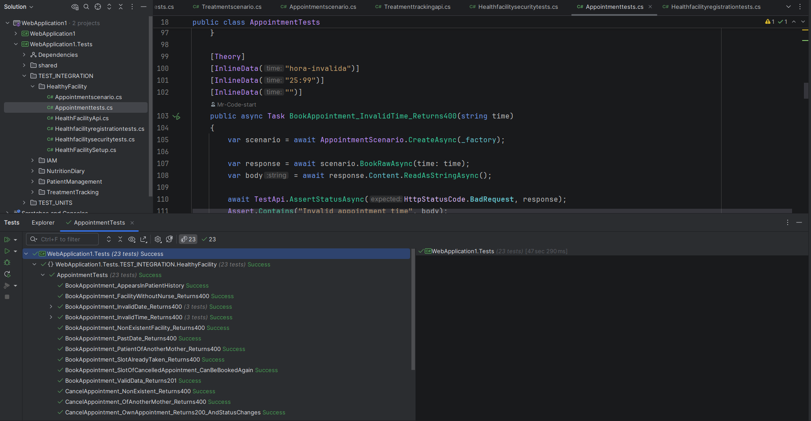
</div>

**Alcance:** la clase contempla 23 casos de prueba, incluidos los escenarios parametrizados para fechas y horas inválidas. Se comprueba la validación de reservas, la prevención de duplicidad de horarios, la autorización por paciente, la actualización del estado de las citas y la separación de las agendas entre enfermeras.

**Observación:** la prueba de reutilización del horario cancelado comprueba que la API permita reservar nuevamente ese horario. Esto es importante porque un horario liberado después de una cancelación no debería permanecer bloqueado para futuras reservas.


### 6.1.3. Core Behavior-Driven Development

En esta sección se aplican técnicas de Behavior-Driven Development (BDD) para definir y validar el comportamiento esperado del sistema Ferova desde la perspectiva del usuario.
BDD permite crear una especificación ejecutable que sirve como documentación viva del sistema y como base para las pruebas automatizadas.

Se utiliza Gherkin como lenguaje de especificación, estructurando los escenarios con el formato Given-When-Then, lo que facilita la comunicación entre el equipo técnico y los stakeholders del negocio.

### Feature Files - Funcionalidades Core

#### Feature 1: Gestión de Pacientes

```gherkin

Feature: Gestión de la información del paciente

Como madre, quiero gestionar la información de mi hijo,
para mantener sus datos registrados
y facilitar el seguimiento de su tratamiento.

Scenario: Registrar nuevo paciente

Background:
    Given el usuario ha iniciado sesión como Madre
    And se encuentra con la sección pacientes

Scenario: Registrar nuevo paciente
  Given no existe pacientes registrados
  When la madre completa el formulario:
      | Campo       | Valor                |
      | Nombre      | Franchesco           |
      | Apellido    | Basilio              |
      | Peso        | 50                   |
      | Precio      | 150                  |
  Then el sistema registra a dicho paciente

Scenario: Información inválida del paciente
  Given que se proporciona información incompleta
  When  la madre intenta registrar al paciente
  Then el sistema muestra "Ingresar datos para el registro del paciente"

```

#### Feature 2: Gestion del Diario Nutricional

```gherkin

Feature: Gestion del Diario Nutricional de un paciente

Como madre, quiero llevar un registro de los alimentos que consume mi hijo durante el día
para conocer su alimentación
y el aporte de hierro asociado a los alimentos registrados.

Background:
    Given el usuario ha iniciado sesión como Madre
    And tiene pacientes registrados
    And se encuentra en la sección diario nutricional

Scenario: Registro de alimentos exitoso
   Given no existe un diario nutricional para un paciente
   When la madre selecciona o busca un alimento
   Then introduce los gramos de dicho alimento que va consumir:
       | Campo       | Valor                |
       | Gramos      | 20                   |
   Then el sistema registra muestra "Alimento registrado"

Scenario Resumen Nutricional 
  Given la madre ha registrado alimentos durante el día
  When consulta el resumen nutricional del día
  Then puede visualizar:
      | Información              |
      | Hierro Absorvido         |
      | Alimentos de Hoy         |
  
```

#### Feature 3: Gestion de Postas Medicas

```gherkin

Feature: Gestion de Postas Medicas

Como administrador, quiero registrar una nueva posta de salud con su información de ubicación
y servicios disponibles, para incorporarla al registro de postas
y permitir la gestión de sus atenciones.

Background:
    Given el usuario ha iniciado sesión como Admin
    And no tiene postas registradas

Scenario: Registro exitoso de una posta
    Given que el administrador desea registrar una nueva posta
    When el administrador complete dicho formulario:
        | Campo                   | Valor                                                                        |
        | Nombre de la posta      | Posta Santa Anita                                                            |
        | Dirección               | Av. Jiron de la Union                                                        |
        | Distrito                | San Juan de Miraflores                                                       | 
        | Ubicación               | Ubicacion respectiva al mapa (sacando la latitude, longitude)                |
        | Numero de teléfono      | +51 936266001                                                                |
        | Servicios               | Pediatría, Vacunación                                                        |
        | Horarios disponibles    | Lun, Mar, Mie, Ju, Vi, Sab, Dom                                              |
        | Horas disponibles       | 7:00, 8:00, 9:00, 11: 00, 12:00, 2:00                                        |
   Then el sistema dicha posta

Scenario: Asignación de Enfermero a posta
    Given que el administrador desea asignar a un enfermero(a) en una posta
    When selecciona una posta sin un enfermero
    Then podrá seleccionar desde una lista al enfermero para dicha posta
         | Información              |
         | Nombre del enfermero     |

Scenario: Consulta de postas cercanas
    Given que la madre tiene pacientes registrados y permite el acceso a su ubicación,
    When consulta la sección de  "postas cercanas",
    Then deben mostrarse las postas activas ordenadas según su ubicación actual.

```

#### Feature 4: Gestion de Citas

```gherkin

Feature: Gestion de Citas

Como madre, quiero reservar, consultar y cancelar citas para mis pacientes,
para organizar sus controles médicos en las postas de salud disponibles.

Scenario: Reserva de cita exitosa
    Given que la madre tiene un paciente registrado
    And selecciona una posta, fecha y hora disponible,
        | Campo                   | Valor                                                                        |
        | Posta                   | Posta Santa Anita                                                            |
        | Fecha                   | 20/11/2026                                                                   |
        | Hora                    | 9:00                                                                         | 
    When confirma la reserva,
    Then la cita debe registrarse correctamente y debe mostrarse un mensaje de confirmación.

Scenario: Cancelación de cita
    
    Given que la madre tiene una cita registrada,
    When selecciona la opción de cancelar y confirma la acción,
    Then la cita debe quedar registrada con estado cancelado
    And debe mostrarse un mensaje de confirmación.

Scenario: Horario ocupado

    Given que la madre selecciona un horario que ya fue reservado,
    When intenta confirmar la cita,
    Then debe mostrarse un mensaje indicando que el horario no está disponible
    And no debe registrarse la cita.
```

#### Feature 5: Gestion de Historial Medico

```gherkin

Feature: Gestión del Historial Médico
  Como enfermero, quiero consultar y gestionar el historial médico inicial de un paciente asignado a mi cartera,
  para contar con información clínica que facilite el seguimiento médico del paciente.

  Background:
    Given el usuario ha iniciado sesión como Nurse
    And tiene pacientes asignados a su cartera

  Scenario: Registro del historial médico inicial
    Given que el paciente se encuentra asignado a la cartera de la enfermera
    And el paciente no cuenta con un historial médico previo
    When la enfermera ingresa la siguiente información clínica inicial:
      | Campo                | Valor              |
      | Peso                 | 12.5 kg            |
      | Altura               | 85 cm              |
      | Motivo de Consulta   | Baja Hemoglobina   |
      | Antecedentes         | ALERGIA: Penicilina|
      | Síntomas             | Fatiga, Palidez    |
    And el sistema valida que todos los campos obligatorios están completos
    Then se registra el historial médico con estado "ACTIVO"
    And el historial queda disponible para su consulta y seguimiento
    And el paciente cambia de "Pendiente de historial" a "Historial registrado"

  Scenario: Consulta del historial médico existente
    Given que el paciente ya cuenta con un historial médico registrado
    When la enfermera accede al módulo de historial del paciente
    Then el sistema muestra los datos clínicos completos:
      | Sección      | Información mostrada                        |
      | Cabecera     | Nombre, edad, sexo, peso, altura            |
      | Clínico      | Motivo de consulta y observaciones          |
      | Antecedentes | Lista de antecedentes registrados           |
      | Síntomas     | Lista de síntomas reportados                |
      | Controles    | Historial de controles de hemoglobina       |

  Scenario: Información clínica incompleta
    Given que la enfermera está en el formulario de registro de historial médico
    When la enfermera intenta guardar el historial dejando campos obligatorios vacíos:
      | Campo faltante       | Estado   |
      | Peso                 | Vacío    |
      | Motivo de Consulta   | Vacío    |
    Then el sistema no registra el historial médico
    And muestra un mensaje indicando que el peso y el motivo de consulta son obligatorios
    And el botón "Guardar Historial" permanece deshabilitado

  Scenario: Actualización del historial médico
    Given que el paciente cuenta con un historial médico registrado
    When la enfermera actualiza la siguiente información clínica:
      | Campo          | Valor Nuevo         |
      | Peso           | 13.0 kg             |
      | Observaciones  | Mejora en el apetito|
      | Síntomas       | Ninguno             |
    And el sistema valida los nuevos datos
    Then el historial médico se actualiza con la nueva información
    And se registra la fecha de última actualización ("updatedAt")
    And el historial queda disponible con los datos actualizados para su seguimiento

```

#### Feature 6: Registro del control de hemoglobina

```gherkin

Feature: Registro del control de hemoglobina
  Como enfermero, quiero gestionar el registro de los controles de hemoglobina de los pacientes,
  para mantener actualizada la información de su evolución
  y determinar automáticamente su estado de anemia.

  Background:
    Given el usuario ha iniciado sesión como Nurse
    And tiene pacientes asignados a su cartera


  Scenario: Registro del control exitoso
    Given que se recibe un paciente asignado a la enfermera con historia clínica existente
    And el enfermero ingresa el siguiente nivel de hemoglobina:
      | Campo | Valor |
      | Nivel | 10.5  |
    When el sistema valida que el nivel de hemoglobina se encuentra dentro del rango permitido (0 - 30 g/dL)
    Then se registra el nivel de hemoglobina en la historia clínica del paciente
    And se crea un nuevo control con la fecha actual y el estado de anemia correspondiente


  Scenario: Nivel de hemoglobina fuera de rango
    Given que el enfermero ingresa un nivel de hemoglobina menor que 0 o mayor que 30 g/dL
    When el sistema valida el valor proporcionado
    Then responde con un error indicando "El nivel de hemoglobina debe encontrarse entre 0 y 30 g/dL"
    And no registra el control en la historia clínica


  Scenario: Paciente sin historia clínica
    Given que el enfermero intenta registrar un control para un paciente que no cuenta con historia clínica
    When el sistema verifica la información clínica requerida
    Then responde con un error indicando que la historia clínica no existe
    And no registra el control

  Scenario Outline: Determinación automática del estado de anemia
    Given que el enfermero ingresa un nivel de hemoglobina válido de "<nivel>"
    When el sistema registra el control y evalúa el valor proporcionado
    Then determina automáticamente el estado de anemia como "<estado>"

    Examples:
      | nivel | estado     |
      | 6.5   | SEVERE     |
      | 8.0   | MODERATE   |
      | 10.0  | MILD       |
      | 12.0  | CONTROLLED |

```

#### Feature 7: Gestión de Tratamientos

```gherkin

Feature: Inicio del tratamiento

Como enfermero, quiero gestionar el inicio del tratamiento de un paciente,
para establecer sus condiciones de tratamiento y generar las dosis correspondientes.

Background:
    Given el usuario ha iniciado sesión como Nurse
    And Tiene Pacientes asignado a su cartera
    
Scenario: Inicio de tratamiento exitoso

Given que el enfermero ingrese suplemento, cantidad, horario y duración del tratamiento,
        | Campo                                  | Valor                                |
        | suplemento                             | Sulfato ferroso                      |
        | cantidad                               | 20 gramos                            |
        | horario                                | 9:00 AM                              |
        | duración                               | 5 dias                               |

When el sistema valida que el paciente existe y no tiene un tratamiento activo,
Then el sistema registra dicho tratamiento,
And crea el tratamiento con estado ACTIVE y genera las dosis correspondientes.

Scenario: Tratamiento completado exitosamente
    Given que el enfermero accede al detalle de un tratamiento con estado "ACTIVE"
    And el paciente ha mostrado un gran avance en la adherencia (tasa >= 85%)
    When el enfermero selecciona la opción "Marcar como completado"
    And ingresa la justificación clínica: "El paciente ha completado el ciclo de 90 días..."
    And el sistema valida el ID del tratamiento y la observación
    Then el sistema actualiza el tratamiento con estado "COMPLETED"
    And registra la observación en el campo "completionObservation"
    And actualiza automáticamente la ficha epidemiológica y el padrón HIS-MINSA
    And los botones de acción desaparecen y se muestra la nota clínica registrada

Scenario: Registrar abandono de tratamiento
    Given que el enfermero accede al detalle de un tratamiento con estado "ACTIVE"
    And el paciente no ha respondido a las dosis o al contacto con la madre
    When el enfermero selecciona la opción "Registrar abandono"
    And ingresa la justificación: "No hay respuesta de dicho paciente, no se ha tomado la dosis..."
    And el sistema valida el ID del tratamiento y la observación
    Then el sistema actualiza el tratamiento con estado "ABANDONED"
    And registra la observación en el campo "abandonmentObservation"
    And notifica al promotor de salud para visita domiciliaria en las próximas 48 horas
    And los botones de acción desaparecen y se muestra la nota clínica registrada

```

#### Feature 8: Registro del cumplimiento de dosis

```gherkin

Feature: Registro del cumplimiento de dosis

Como madre, quiero registrar el cumplimiento de las dosis de mi paciente,
para llevar un seguimiento de su tratamiento.

Background:
    Given el usuario ha iniciado sesión como Mother
    And Tiene Pacientes registrados

Scenario: Registro exitoso del cumplimiento

Given que la madre tiene un tratamiento activo para su paciente,
When confirma que ha administrado la dosis correspondiente del día,
Then el sistema debe registrar la dosis como cumplida y actualizar el seguimiento del tratamiento.

Scenario: Dosis ya registrada

Given que la dosis correspondiente al día ya fue registrada,
When la madre intenta confirmar nuevamente la misma dosis,
Then el sistema debe informar que la dosis ya fue registrada y evitar duplicar el registro.

Scenario: Tratamiento no activo

Given que el paciente no tiene un tratamiento activo,
When la madre intenta registrar una dosis,
Then el sistema debe informar que no existe un tratamiento activo para registrar la dosis.

```

#### Feature 9: Registro del cumplimiento de dosis

```gherkin

Feature: Dar de Alta a un Paciente
  Como desarrollador, quiero gestionar el alta de un paciente mediante una API,
  para finalizar su seguimiento clínico cuando corresponda.

  Background:
    Given el sistema tiene un paciente registrado con estado "ACTIVE"
    And el paciente está asignado a la enfermera autenticada

  Scenario: Alta exitosa de un paciente
    Given que se recibe una solicitud "PUT /discharge" con el ID de un paciente existente
    When la API verifica que la enfermera autenticada está asignada al paciente
    Then la API responde con un estado "200 OK"
    And el estado del paciente cambia de "ACTIVE" a "DISCHARGED"
    And el paciente ya no aparece en la lista de pacientes activos de la enfermera


  Scenario: Intento de alta de un paciente inexistente
    Given que se recibe una solicitud "PUT /discharge" con un identificador de paciente inexistente
    When la API verifica la existencia del paciente
    Then la API responde con un estado "400 Bad Request"
    And retorna un mensaje de error indicando que el paciente no fue encontrado
    And el estado del paciente no sufre modificaciones

```

#### Feature 10: Autenticación y Seguridad

```gherkin

Feature: Gestión de autenticación y seguridad

  Como usuario Quiero registrarme con mi rol respectivo
  Para acceder a las funcionalidades de la aplicación.

Scenario: Registro exitoso
    Given el usuario tiene credenciales validas
    When ingresa su dni "76919351"
    And ingresa su contraseña
    And hace click en "Iniciar Seccion"
    And se registra la fecha y hora del acceso
    And se muestra mensaje "Bienvenido de nuevo, [Nombre]"

 Scenario: Credenciales incorrectas:
    Given el usuario ingresa dni válido
    When ingresa contraseña incorrecta
    And hace clic en "Iniciar Sesión"
    Then el sistema muestra "Credenciales Incorrectas"
    And no permite el acceso

  Scenario: Solicitud de recuperación de contraseña mediante el correo
    Given el usuario olvidó su contraseña
    When selecciona "¿Olvidaste tu contraseña?"
    And ingresa su email registrado
    And hace clic en "Enviar codigo de validacion"
    Then recibe email con el codigo de 4 digitos
    And ingresa dicho codigo de validacion
    And puede crear una nueva contraseña.

  Scenario: Cerrar sesión de forma segura
    Given el usuario ha terminado su trabajo
    When selecciona "Cerrar Sesión"
    Then el sistema invalida el token de sesión
    And redirige a la página de inicio de sesión
    And limpia datos sensibles del navegador
```

#### Feature 11: Gestion de Roles

```gherkin

Feature: Control de acceso basado en roles

  Como developer del sistema
  Quiero que cada funcionalidad esté disponible solo para los roles autorizados
  Para proteger los datos de salud de las madres y de sus pacientes

Background:

    Given el sistema define tres roles fijos: "Admin", "Nurse" y "Mother"
    And cada usuario inicia sesión con su DNI y contraseña y recibe un token JWT
    And el token de una madre incluye "motherId" y el de una enfermera incluye "nurseId"

 Scenario: Registrar personal asigna el rol indicado
    When se registra personal con el rol
    Then el sistema responde 201 Created
    And al iniciar sesión recibe un token que incluye el rol
    Examples:
      | rol   |
      | Nurse |
      | Admin |

  Scenario: Una madre solo accede a las funciones de madre
    Given el usuario ha iniciado sesión con el rol "Mother"
    Then el usuario solo tiene acceso a:
      | Módulo permitido          | Funcionalidad                                                  |
      | Gestión de pacientes      | Registrar paciente, ver mis pacientes, evolución de hemoglobina |
      | Diario nutricional        | Registrar alimento, ver diario de hoy, ver historial           |
      | Seguimiento de tratamiento | Confirmar dosis, ver dosis de hoy, ver historial de dosis      |
      | Citas                     | Reservar y cancelar citas, ver postas cercanas, próxima cita   |
    And no puede acceder a:
      | Módulo restringido        | Funcionalidad                                                  |
      | Historia clínica          | Crear y consultar historias clínicas                           |
      | Control de hemoglobina    | Registrar controles                                            |
      | Gestión de pacientes      | Asignarse pacientes, dar de alta, buscar madres                |
      | Seguimiento de tratamiento | Iniciar, completar o abandonar tratamientos, ver riesgo        |
      | Citas                     | Ver la agenda de la enfermera                                  |
      | Postas de salud           | Registrar postas y asignar enfermeras                          |

  Scenario: Una enfermera solo accede a las funciones de enfermera
    Given el usuario ha iniciado sesión con el rol "Nurse"
    Then el usuario solo tiene acceso a:
      | Módulo permitido          | Funcionalidad                                                         |
      | Gestión de pacientes      | Asignarse pacientes, buscar madres, ver pacientes asignados, dar de alta |
      | Historia clínica          | Crear y consultar historias clínicas de sus pacientes                 |
      | Control de hemoglobina    | Registrar controles y consultar el historial                          |
      | Seguimiento de tratamiento | Iniciar, completar y abandonar tratamientos, ver riesgo               |
      | Citas                     | Ver la agenda de citas de su posta                                    |
    And no puede acceder a:
      | Módulo restringido        | Funcionalidad                                                  |
      | Gestión de pacientes      | Registrar pacientes, ver "mis pacientes" de una madre          |
      | Diario nutricional        | Registrar alimento, ver diario e historial                     |
      | Seguimiento de tratamiento | Confirmar dosis, ver dosis de hoy e historial de dosis         |
      | Citas                     | Reservar o cancelar citas, ver postas cercanas, próxima cita   |
      | Postas de salud           | Registrar postas y asignar enfermeras                          |

  Scenario: Un administrador gestiona las postas de salud
    Given el usuario ha iniciado sesión con el rol "Admin"
    Then el usuario tiene acceso a:
      | Módulo permitido | Funcionalidad                                                  |
      | Postas de salud  | Registrar postas, consultar distritos, asignar enfermeras a postas |
    And ni una madre ni una enfermera pueden usar esas funciones

```

<!-- COMPLETAR -->

### 6.1.4. Core System Tests

> Pruebas de sistema / aceptación end-to-end sobre el producto desplegado.

<!-- COMPLETAR -->

## 6.2. Static testing & Verification

### 6.2.1. Static Code Analysis

#### 6.2.1.1. Coding standard & Code conventions

> Reglas y linters configurados por repositorio, y evidencia de su ejecución.

<!-- COMPLETAR -->

#### 6.2.1.2. Code Quality & Code Security

> Resultados del análisis estático (por ejemplo, SonarQube / SonarCloud, CodeQL): bugs, code smells, vulnerabilidades, cobertura y duplicación.


| Métrica | Valor | Umbral definido |
|---------|-------|-----------------|
| Bugs | | |
| Vulnerabilities | | |
| Security Hotspots | | |
| Code Smells | | |
| Coverage | | |
| Duplications | | |

<!-- COMPLETAR -->

### 6.2.2. Reviews

> Evidencia de revisiones de código (Pull Requests con comentarios, checklist de revisión y acuerdos del equipo).

<!-- COMPLETAR -->

## 6.3. Validation Interviews

### 6.3.1. Diseño de Entrevistas

> Elementos a validar y preguntas por segmento objetivo sobre el producto ya implementado.

**Segmento 1: [Nombre del segmento]**

*Elementos a validar*

<!-- COMPLETAR -->

*Preguntas*

<!-- COMPLETAR -->

**Segmento 2: [Nombre del segmento]**

<!-- COMPLETAR -->

### 6.3.2. Registro de Entrevistas

| Campo | Dato |
|-------|------|
| Nombres y apellidos | [Nombre] |
| Edad | [Edad] |
| Distrito | [Distrito] |
| Fecha | [DD/MM/AAAA] |
| Timing | [inicio] — duración [mm:ss] |
| Enlace del video | [URL] |


*Resumen:* <!-- COMPLETAR -->

<!-- COMPLETAR: repetir por cada entrevista -->

### 6.3.3. Evaluaciones según heurísticas

> Evaluación heurística UX (Nielsen) por aplicación, con cabecera del formato indicado en el statement, tabla de severidad y lista de hallazgos.

**UX Heuristics & Principles Evaluation**

| Campo | Dato |
|-------|------|
| Carrera | Ingeniería de Software |
| Curso | Diseño de Experimentos de Ingeniería de Software |
| Sección | [Sección] |
| Profesor | [Docente] |
| Auditor | [Nombre] |
| Fecha | [DD/MM/AAAA] |
| Nombre de App | Ferova |
| Tareas evaluadas | [lista] |

**Escala de severidad**

| Nivel | Descripción |
|-------|-------------|
| 1 | Problema superficial |
| 2 | Problema menor |
| 3 | Problema mayor |
| 4 | Problema catastrófico |

**Hallazgos**

| # | Problema | Escala de severidad | Heurística / Principio violado | Recomendación |
|---|----------|---------------------|--------------------------------|---------------|
| 1 | [Problema] | [1-4] | [Heurística] | [Recomendación] |

<!-- COMPLETAR -->

## 6.4. Auditoría de Experiencias de Usuario

### 6.4.1. Auditoría realizada

#### 6.4.1.1. Información del grupo auditado

| Campo | Dato |
|-------|------|
| Startup auditada | [Nombre] |
| Producto | [Nombre] |
| Integrantes | [Nombres] |
| Repositorio / despliegue | [URL] |

#### 6.4.1.2. Cronograma de auditoría realizada

| Fecha | Actividad | Participantes | Duración |
|-------|-----------|---------------|----------|
| [DD/MM/AAAA] | [Actividad] | [Nombres] | [hh:mm] |

#### 6.4.1.3. Contenido de auditoría realizada

| # | Problema | Escala de severidad | Heurística / Principio violado | Recomendación |
|---|----------|---------------------|--------------------------------|---------------|
| 1 | [Problema] | [1-4] | [Heurística] | [Recomendación] |

<!-- COMPLETAR -->

### 6.4.2. Auditoría recibida

#### 6.4.2.1. Información del grupo auditor

| Campo | Dato |
|-------|------|
| Startup auditora | [Nombre] |
| Integrantes | [Nombres] |

#### 6.4.2.2. Cronograma de auditoría recibida

| Fecha | Actividad | Participantes | Duración |
|-------|-----------|---------------|----------|
| [DD/MM/AAAA] | [Actividad] | [Nombres] | [hh:mm] |

#### 6.4.2.3. Contenido de auditoría recibida

| # | Problema | Escala de severidad | Heurística / Principio violado | Recomendación |
|---|----------|---------------------|--------------------------------|---------------|
| 1 | [Problema] | [1-4] | [Heurística] | [Recomendación] |

#### 6.4.2.4. Resumen de modificaciones para subsanar hallazgos

| # Hallazgo | Modificación realizada | Evidencia (commit / captura) | Responsable |
|------------|------------------------|------------------------------|-------------|
| 1 | [Modificación] | [enlace] | [Nombre] |

<!-- COMPLETAR -->
