# Capítulo VIII: Experiment-Driven Development

## 8.1. Experiment Planning

Para cerrar la brecha entre la entrega funcional de **Ferova** y la validación empírica con usuarios reales, el equipo de **SANUVI** adopta el ciclo **Experiment-Driven Product Development (XDPD)** (*premise → question → hypothesis → experiment → analysis → decision*), guiado por los principios *Simplest, Useful Thing*, *Strong opinions, loosely held* y *Be data informed*.

### 8.1.1. As-Is Summary

#### Estado técnico y funcional de la plataforma Ferova

Al cierre del Capítulo V y la configuración operativa del Capítulo VII, **Ferova** cuenta con una arquitectura distribuida de cuatro componentes en funcionamiento para combatir la anemia infantil en el Perú, tomando como referencia el umbral clínico de la **NTS N.° 213-MINSA/DGIESP-2024** (≥ 75 % de adherencia adecuada) y atendiendo a dos segmentos de usuarios: **Madres/cuidadores** (*User Persona: María López*) y **Personal de salud** (*User Persona: Carlos Rojas*):

| Componente | Tecnología y despliegue | Capacidades principales implementadas |
|---|---|---|
| **Landing Page** | Web estática desplegada en **GitHub Pages** | Presentación de la propuesta de valor de Ferova, contexto de anemia infantil y accesos de entrada para los segmentos objetivo. |
| **FerovaFamily** (App móvil) | **Kotlin + Jetpack Compose**, distribuida en **Firebase App Distribution** | Registro y confirmación de dosis (`/today-dose`), progreso y logros (`/achievement`), evolución de hemoglobina (`/hemoglobin-evolution`), mapa de postas cercanas y chat con personal de enfermería. |
| **FerovaClinic** (Portal web) | **Angular + TypeScript**, desplegada en **Azure Static Web Apps** | Panel clínico para personal de salud con mapa de calor de adherencia (`/heatmap`), resumen de riesgo (`/risk-overview`) y control de hemoglobina (`/hemoglobin-control`). |
| **Backend API & Persistencia** | **C# / .NET 9 + MongoDB** en **Docker**, desplegado en **Railway** | Exposición de endpoints REST para sincronización móvil/web, respaldado por pipelines CI/CD en GitHub Actions (`backend-ci.yml`, `frontend-ci.yml`) y monitoreo continuo (Capítulo VII). |

#### Áreas de incertidumbre que motivan la experimentación

Si bien la plataforma es funcionalmente operativa, el análisis del estado actual y de los resultados de verificación del Capítulo VI evidencia tres fuentes principales de incertidumbre que deben transformarse en preguntas investigables antes de diseñar nuevas funcionalidades:

1. **Suposiciones de Lean UX aún no validadas longitudinalmente (Capítulos I y III):** Las definiciones de *Business Outcomes*, *User Outcomes* y *Feature Assumptions* que dieron origen a las épicas `EP-01` a `EP-10` (recordatorios, gamificación por rachas, seguimiento del tratamiento y alertas clínicas) asumen cambios conductuales que todavía no han sido comprobados con datos de uso sostenido ni pruebas A/B sobre adherencia semanal, retención o conversión.
2. **Fricciones de usabilidad detectadas en inspección técnica y evaluaciones UX (Capítulo VI):** Aunque las pruebas funcionales y de API (BDD Gherkin, Selenium IDE y Postman) verifican flujos críticos y SonarQube aprueba el *Quality Gate* (con 0 % de cobertura automatizada reportada), las evaluaciones de interfaz identificaron hallazgos relevantes sin validación empírica de impacto:
   - **Evaluación Heurística (`6.3.3`):** **6 hallazgos** en *FerovaFamily* (severidad máxima **3**) y **10 hallazgos** en *FerovaClinic* (severidad máxima **4**).
   - **Auditoría UX — Aether System (`6.4.2`):** **20 hallazgos** distribuidos entre la Landing Page (`LP-01` a `LP-06`), *FerovaClinic* (`WEB-01` a `WEB-08`) y *FerovaFamily* (`MOB-01` a `MOB-06`), vinculados con jerarquía visual, claridad de métricas, prevención de errores en controles clínicos y diferenciación de accesos por rol.
3. **Asimetría en validación por segmento y ausencia de analítica de producto (Capítulos VI y VII):** En la sección `6.3.2`, el Segmento 1 cuenta con la entrevista de validación de **Alessandro Daniel Bravo Castillo** (13/11/2026), quien destacó la utilidad de la trazabilidad de dosis, el mapa de postas cercanas y el chat con enfermería, aunque manifestó indecisión personal al elegir médico y horario al agendar citas. En contraste, las entrevistas de validación del **Segmento 2 (Personal de salud)** siguen pendientes de ejecución, y actualmente no existe telemetría comportamental instrumentada para comparar tasas reales de confirmación, error clínico o conversión.

### 8.1.2. Raw Material: Assumptions, Knowledge Gaps, Ideas, Claims

Para estructurar la planificación experimental sin partir de soluciones preconcebidas, el equipo consolidó el material bruto proveniente de los Capítulos I–VII en cuatro categorías (*Ideas*, *Claims*, *Assumptions* y *Knowledge Gaps*).

**Ideas** — propuestas para resolver un problema o alcanzar un objetivo. El equipo prueba las premisas subyacentes a la idea, no la idea en sí.

| ID | Idea | Premisa subyacente | Origen |
|----|------|--------------------|--------|
| ID-01 | Mostrar en la vista principal de *FerovaFamily* (`/today-dose` y `/achievement`) la racha activa, el avance porcentual hacia la meta de ≥ 75 % (NTS N.° 213-MINSA/DGIESP-2024) y el último valor de hemoglobina (`/hemoglobin-evolution`). | Visibilizar la meta clínica y la racha en el flujo diario reduce la fricción cognitiva y motiva al cuidador a confirmar la toma diaria de sulfato ferroso. | Cap. I (Lean UX), Cap. III (`EP-01`–`EP-10`), Cap. VI (`6.3.3`, `MOB-01`–`MOB-06`) |
| ID-02 | Incorporar porcentajes explícitos, etiqueta `"Sin datos"` en `/heatmap` y alertas preventivas ante valores atípicos de edad o hemoglobina en *FerovaClinic* (`/hemoglobin-control`, `/risk-overview`). | Sin lectura numérica directa ni validaciones de entrada en tiempo real, el personal de salud demora más en detectar pacientes de alto riesgo o comete errores de registro clínico. | Cap. V (*FerovaClinic*), Cap. VI (`6.3.3` sev. máx. 4; `6.4.2` `WEB-01`–`WEB-08`) |
| ID-03 | Añadir una leyenda de disponibilidad en el calendario de citas de *FerovaFamily* y una guía contextual de asignación de enfermera/horario. | La indecisión reportada al reservar citas responde a falta de claridad sobre horarios y asignación de personal, más que a desinterés en el control médico. | Cap. VI (`6.3.2` entrevista a Alessandro Daniel Bravo Castillo; `6.4.2` `MOB-01`–`MOB-06`) |
| ID-04 | Incluir cifras citadas del INS/MINSA y botones *CTA* diferenciados por rol (*FerovaFamily* y *FerovaClinic*) en la Landing Page. | Respaldar la propuesta con fuentes sanitarias oficiales y separar los accesos por segmento incrementa la confianza y evita redirecciones erróneas. | Cap. I (Segmentos 1 y 2), Cap. V (Landing Page), Cap. VI (`6.4.2` `LP-01`–`LP-06`) |

**Claims (Afirmaciones)** — declaraciones hechas sobre el producto por stakeholders o usuarios.

| ID | Afirmación | Quién la formuló | Origen |
|----|------------|------------------|--------|
| CL-01 | La trazabilidad de confirmación de dosis, el mapa de postas cercanas y el chat con enfermería resultan útiles para organizar el seguimiento diario. | Alessandro Daniel Bravo Castillo (cuidador — Segmento 1) | Entrevista de validación, Cap. VI (`6.3.2`, 13/11/2026) |
| CL-02 | Al momento de reservar una cita médica desde la aplicación móvil surge indecisión personal para escoger doctor y horario disponible. | Alessandro Daniel Bravo Castillo (cuidador — Segmento 1) | Entrevista de validación, Cap. VI (`6.3.2`, 13/11/2026) |
| CL-03 | Las soluciones existentes orientadas solo a alarmas de medicamentos (*Medisafe*, *MyTherapy*) o información estática (*App ALMA MINSA*) no integran seguimiento de la adherencia y monitoreo clínico continuo. | Equipo SANUVI (análisis competitivo) | Cap. I (Lean UX) y Cap. II (Matriz CAME) |
| CL-04 | El seguimiento manual en establecimientos de salud dificulta detectar oportunamente abandonos de tratamiento y controles de hemoglobina atrasados. | Gladys Echegaray (68 años) y Dr. Hugo Rojas (72 años) — Segmento 2 | Entrevistas iniciales, Cap. II |

**Assumptions (Suposiciones)** — creencias preexistentes sobre la audiencia o el producto que deben ser probadas mediante experimentación.

| ID | Suposición | Base de la creencia | Riesgo si es falsa |
|----|------------|---------------------|--------------------|
| AS-01 | Mostrar la racha activa, el progreso hacia ≥ 75 % y la última hemoglobina en el inicio de *FerovaFamily* aumenta la tasa diaria de confirmación de dosis frente a la vista simple actual. | *Feature Assumptions* (Cap. I) y entrevistas iniciales a Milagros, Paola y Alessandro (Cap. II). | Sobrecarga visual en móvil sin impacto real en la adherencia semanal ni cumplimiento de la NTS N.° 213-MINSA/DGIESP-2024. |
| AS-02 | La codificación cromática del mapa de calor (`/heatmap`) y los campos actuales de hemoglobina en *FerovaClinic* permiten al personal de salud identificar riesgo y registrar controles sin ambigüedades. | Diseño base de *FerovaClinic* en los Capítulos IV y V. | Errores de interpretación entre `"Sin datos"` y baja adherencia, retrasos en triaje y errores de digitación clínica (Cap. VI `6.3.3` sev. 4). |
| AS-03 | Los puntos y medallas del módulo de logros (`/achievement`) sostienen por sí solos la retención semanal de los cuidadores después de las dos primeras semanas de uso. | *Business y User Outcomes* de Lean UX (Cap. I) e historias de gamificación (Cap. III). | Abandono abrupto tras la fase inicial de novedad si no se percibe valor clínico directo ni acompañamiento del personal de salud. |
| AS-04 | Mostrar una leyenda visual de disponibilidad y guía de enfermera en el calendario reduce la duda al reservar citas en *FerovaFamily* y mejora la finalización de reservas. | Evidencia cualitativa de Alessandro Daniel Bravo Castillo en `6.3.2` y hallazgos `MOB-01`–`MOB-06`. | Deserción en el flujo de citas y sobrecarga operativa del chat de enfermería para coordinar horarios manualmente. |

**Knowledge Gaps (Brechas de conocimiento)** — áreas donde el equipo reconoce que carece de información.

| ID | Brecha de conocimiento | Por qué importa |
|----|------------------------|-----------------|
| KG-01 | En qué puntos exactos del flujo clínico de *FerovaClinic* (registro del paciente, control de hemoglobina o actualización del esquema) enfrenta mayores cuellos de botella el personal de salud, al estar pendientes las entrevistas de validación del Segmento 2 (`6.3.2`). | Sin evidencia directa del Segmento 2 (*Carlos Rojas*), el equipo no conoce las causas operativas reales detrás de los 10 hallazgos heurísticos ni cómo priorizar mejoras clínicas. |
| KG-02 | En qué franjas del día y por qué motivos reales (olvido, malestar gástrico del suplemento, desabastecimiento o carga laboral/doméstica) se omiten dosis diarias de sulfato ferroso. | Permite diseñar intervenciones basadas en evidencia real de adherencia y no asumir que todo incumplimiento se resuelve con más notificaciones. |

### 8.1.3. Experiment-Ready Questions

Para transformar el material bruto de `8.1.2` en preguntas investigables, el equipo aplicó la técnica **5W+H** (*What, Who, When, Where, Why, How*): en preguntas **Belief-led** permitió explicitar premisas ocultas detrás de cada suposición antes de formular hipótesis, mientras que en preguntas **Exploratorias** acotó quién, cuándo, dónde y cómo observar fenómenos sin supuestos previos.

| ID | Pregunta | Tipo (Belief-led / Exploratoria) | Material bruto de origen | Premisa oculta descubierta (5W1H) |
|----|----------|----------------------------------|--------------------------|-----------------------------------|
| Q-01 | ¿Mostrar en el inicio de *FerovaFamily* la racha diaria, el avance porcentual hacia ≥ 75 % y la última hemoglobina incrementa la tasa diaria de confirmación de dosis y la adherencia semanal frente a la pantalla actual? | Belief-led | ID-01, CL-01, AS-01 | *Who / What / Why / How:* Se asume que las madres/cuidadores comprenden de inmediato el umbral clínico ≥ 75 % y que ver su progreso continuo modifica el hábito diario sin generar sobrecarga visual (`MOB-01`–`MOB-06`). |
| Q-02 | ¿Incorporar porcentajes explícitos, etiqueta `"Sin datos"` en `/heatmap` y alertas por valores atípicos de edad/hemoglobina en *FerovaClinic* reduce el tiempo de identificación de pacientes de alto riesgo y la tasa de error en el control clínico frente a la vista actual? | Belief-led | ID-02, CL-04, AS-02 | *Who / What / Where / How:* Se asume que el personal de salud confunde casillas vacías con baja adherencia cuando falta texto explícito y que las alertas de rango previenen errores de digitación sin frenar la consulta (`6.3.3` sev. 4; `WEB-01`–`WEB-08`). |
| Q-03 | ¿Presentar cifras citadas de INS/MINSA y botones *CTA* diferenciados por rol (*FerovaFamily* vs. *FerovaClinic*) en la Landing Page incrementa la tasa de clics (*CTR*) y la redirección correcta según el segmento? | Belief-led | ID-04, CL-03 | *Who / Why / Where / How:* Se asume que cuidadores y profesionales desconfían de datos sin fuente oficial y se confunden sobre qué enlace seguir cuando los llamados a la acción no separan ambos roles (`LP-01`–`LP-06`). |
| Q-05 | ¿Incluir una leyenda visual de disponibilidad en el calendario y una guía breve de asignación de enfermera/horario en *FerovaFamily* disminuye la indecisión percibida y aumenta la tasa de finalización al reservar citas? | Belief-led | ID-03, CL-02, AS-04 | *When / Where / Why / How:* Se asume que la indecisión reportada por Alessandro Daniel Bravo Castillo (`6.3.2`) al elegir doctor y horario se debe a falta de contexto visual en el calendario y no a restricciones externas de horario del centro de salud. |
| Q-06 | ¿En qué franjas del día y por qué motivos reales del entorno familiar omiten los cuidadores las dosis diarias de sulfato ferroso durante el tratamiento? | Exploratoria | KG-02, AS-01 | *When / Why / Who:* Enmarque exploratorio para descubrir si la omisión obedece a olvido por horario, intolerancia digestiva del menor, falta de suplemento o dinámicas laborales antes de intervenir con más recordatorios. |
| Q-07 | ¿Dónde se concentran los principales cuellos de botella operativos que enfrenta el personal de salud al ejecutar de extremo a extremo el registro de paciente, control de hemoglobina y seguimiento en *FerovaClinic*? | Exploratoria | CL-04, AS-02, KG-02 | *Who / Where / How:* Enmarque exploratorio necesario tras estar pendientes las entrevistas de validación del Segmento 2 (`6.3.2`), para identificar qué vistas o pasos concretos concentran la fricción clínica. |
| Q-08 | ¿Los puntos y medallas de gamificación en `/achievement` logran por sí solos sostener la retención semanal de las madres/cuidadores más allá de las dos primeras semanas de uso? | Belief-led | ID-01, AS-03 | *When / Why / Who:* Se asume que los incentivos lúdicos mantienen el compromiso familiar tras la semana 2 de tratamiento, incluso sin intervención directa o refuerzo clínico de enfermería. |

### 8.1.4. Question Backlog

**Estructura del backlog:** [x] Broad · [ ] Deep — **Justificación:** Ferova se encuentra en una etapa inicial de validación empírica con incertidumbre distribuida en sus cuatro componentes y en ambos segmentos de usuarios (adherencia diaria y seguimiento del tratamiento en *FerovaFamily*, interpretación clínica y validaciones en *FerovaClinic*, y confianza/enrutamiento en la *Landing Page*). Una estructura **Broad** permite reducir simultáneamente los riesgos más altos en todo el ecosistema antes de profundizar (*Deep*) en un único flujo en ciclos posteriores.

**Criterio de puntuación:** cada dimensión se califica de **1 a 5**. En **Confianza**, un puntaje bajo representa mayor desconocimiento y suma más prioridad mediante `(6 − Confianza)`. La fórmula aplicada es `Puntaje total = (6 − Confianza) + Riesgo + Impacto + Interés`. Las **3 primeras preguntas** (`Q-01`, `Q-02` y `Q-03`) pasan directamente a formalización mediante *Experiment Cards* en la sección `8.1.5`.

| Prioridad | ID | Pregunta | Why (motivación) | Confianza (1-5) | Riesgo (1-5) | Impacto (1-5) | Interés (1-5) | Puntaje total |
|-----------|----|----------|------------------|-----------------|--------------|---------------|---------------|---------------|
| 1 | Q-01 | ¿Mostrar en el inicio de *FerovaFamily* la racha diaria, el avance porcentual hacia ≥ 75 % y la última hemoglobina incrementa la tasa diaria de confirmación de dosis y la adherencia semanal frente a la pantalla actual? | Valida la propuesta de valor central de Ferova sobre cumplimiento de la NTS N.° 213-MINSA/DGIESP-2024 (≥ 75 %) en madres/cuidadores antes de ampliar funciones móviles. | 2 | 5 | 5 | 5 | 19 |
| 2 | Q-02 | ¿Incorporar porcentajes explícitos, etiqueta `"Sin datos"` en `/heatmap` y alertas por valores atípicos de edad/hemoglobina en *FerovaClinic* reduce el tiempo de identificación de pacientes de alto riesgo y la tasa de error en el control clínico frente a la vista actual? | Mitiga el riesgo clínico y los hallazgos de severidad 4 en *FerovaClinic* (`6.3.3`, `WEB-01`–`WEB-08`), evitando errores de triaje y de registro asistencial. | 2 | 5 | 5 | 4 | 18 |
| 3 | Q-03 | ¿Presentar cifras citadas de INS/MINSA y botones *CTA* diferenciados por rol (*FerovaFamily* vs. *FerovaClinic*) en la Landing Page incrementa la tasa de clics (*CTR*) y la redirección correcta según el segmento? | Ataca los hallazgos `LP-01`–`LP-06` de la puerta de entrada del producto para validar credibilidad sanitaria y evitar abandono o ingreso al portal incorrecto. | 2 | 4 | 4 | 4 | 16 |
| 4 | Q-05 | ¿Incluir una leyenda visual de disponibilidad en el calendario y una guía breve de asignación de enfermera/horario en *FerovaFamily* disminuye la indecisión percibida y aumenta la tasa de finalización al reservar citas? | Responde directamente al hallazgo de validación de Alessandro Daniel Bravo Castillo (`6.3.2`) para destrabar el flujo de reserva de citas médicas. | 3 | 4 | 4 | 4 | 15 |
| 5 | Q-07 | ¿Dónde se concentran los principales cuellos de botella operativos que enfrenta el personal de salud al ejecutar de extremo a extremo el registro de paciente, control de hemoglobina y seguimiento en *FerovaClinic*? | Compensa la ausencia de entrevistas de validación ejecutadas en el Segmento 2 (`6.3.2`, `KG-01`) identificando fricciones reales del flujo clínico. | 2 | 3 | 4 | 3 | 14 |
| 6 | Q-06 | ¿En qué franjas del día y por qué motivos reales del entorno familiar omiten los cuidadores las dosis diarias de sulfato ferroso durante el tratamiento? | Aporta evidencia contextual sobre la causa raíz de olvidos u omisiones (`KG-02`) antes de proponer nuevas reglas de notificación. | 1 | 2 | 3 | 3 | 13 |
| 7 | Q-08 | ¿Los puntos y medallas de gamificación en `/achievement` logran por sí solos sostener la retención semanal de las madres/cuidadores más allá de las dos primeras semanas de uso? | Verifica si la gamificación genera retención sostenible tras la novedad inicial (`AS-03`) o requiere refuerzo clínico de enfermería. | 3 | 3 | 3 | 3 | 12 |

### 8.1.5. Experiment Cards

A continuación se documentan las **3 Experiment Cards (`EC-01` a `EC-03`)** correspondientes a las preguntas priorizadas del backlog (`8.1.4`), alineadas con el principio *Simplest, Useful Thing* y con los identificadores de métricas `M-01` a `M-08` que se formalizan en la sección **8.2.2 Domain Business Metrics**.

#### Experiment Card EC-01

*Lado frontal*

| Campo | Contenido |
|-------|-----------|
| Question | `Q-01`: ¿Mostrar en el inicio de *FerovaFamily* la racha diaria, el avance porcentual hacia ≥ 75 % y la última hemoglobina incrementa la tasa diaria de confirmación de dosis y la adherencia semanal frente a la pantalla actual? |
| Why | Validar la propuesta de valor central de adherencia terapéutica alineada con la NTS N.° 213-MINSA/DGIESP-2024 (≥ 75 %) en cuidadores reales antes de ampliar funciones móviles (`ID-01`, `AS-01`). |
| Hypothesis (si aplica) | Las madres/cuidadores que visualizan en el inicio de *FerovaFamily* su racha activa, el avance porcentual hacia ≥ 75 % y el último registro de hemoglobina alcanzarán una mayor tasa diaria de confirmación de dosis (`M-01`) y una mayor tasa de adherencia adecuada semanal (`M-02`) frente a la vista actual sin dichos indicadores. |
| What — Simplest Useful Thing | Tarjeta resumen liviana en el inicio de *FerovaFamily* consumiendo los endpoints existentes (`/today-dose`, `/achievement`, `/hemoglobin-evolution`) para mostrar únicamente días de racha activa, porcentaje hacia la meta del 75 % y última hemoglobina registrada. |

*Lado posterior*

| Campo | Contenido |
|-------|-----------|
| Measures | `M-01` (*Daily Dose Confirmation Rate*, métrica primaria) y `M-02` (*Weekly Adequate Adherence Rate ≥ 75 %*, métrica secundaria) — definidas en `8.2.2`. |
| Conditions | Experimental: *FerovaFamily* con tarjeta resumen visible en el inicio (racha activa, avance hacia 75 % y última hemoglobina) · Control: versión actual de *FerovaFamily* con registro estándar de dosis diaria sin tarjeta de progreso ni hemoglobina en el inicio. |
| Scale | 20 madres/cuidadores del Segmento 1 (*María López*), asignados equitativamente (10 Experimental / 10 Control), durante 14 días continuos. |

#### Experiment Card EC-02

*Lado frontal*

| Campo | Contenido |
|-------|-----------|
| Question | `Q-02`: ¿Incorporar porcentajes explícitos, etiqueta `"Sin datos"` en `/heatmap` y alertas por valores atípicos de edad/hemoglobina en *FerovaClinic* reduce el tiempo de identificación de pacientes de alto riesgo y la tasa de error en el control clínico frente a la vista actual? |
| Why | Mitigar el riesgo clínico y los hallazgos heurísticos de severidad máxima 4 y de auditoría UX (`6.3.3`, `WEB-01`–`WEB-08`) en *FerovaClinic*, evitando demoras en triaje y errores de registro asistencial (`ID-02`, `AS-02`). |
| Hypothesis (si aplica) | El personal/evaluadores clínicos que trabajen sobre *FerovaClinic* con porcentajes explícitos, etiqueta `"Sin datos"` en `/heatmap` y alertas no bloqueantes ante valores atípicos de edad o hemoglobina reducirán el tiempo para identificar pacientes de alto riesgo (`M-03`) y la tasa de error al ingresar controles clínicos (`M-04`) frente a la vista actual. |
| What — Simplest Useful Thing | Versión experimental acotada sobre `/heatmap`, `/risk-overview` y `/hemoglobin-control` en *FerovaClinic* añadiendo etiquetas numéricas `%` / `"Sin datos"` en las celdas del mapa de calor y advertencias visuales inmediatas ante rangos clínicos atípicos de edad o hemoglobina. |

*Lado posterior*

| Campo | Contenido |
|-------|-----------|
| Measures | `M-03` (*High-Risk Patient Identification Time*, métrica co-primaria) y `M-04` (*Clinical Control Entry Error Rate*, métrica co-primaria) — definidas en `8.2.2`. |
| Conditions | Experimental: *FerovaClinic* con porcentajes explícitos, etiqueta `"Sin datos"` en `/heatmap` y alertas preventivas por valores atípicos en `/hemoglobin-control` · Control: versión actual de *FerovaClinic* con codificación únicamente por color y formulario sin alertas de rango atípico. |
| Scale | 12 evaluadores de salud/clínicos del Segmento 2 (*Carlos Rojas*), divididos en 6 Experimental / 6 Control, realizando 5 tareas clínicas estandarizadas cada uno en un periodo de 7 días. |

#### Experiment Card EC-03

*Lado frontal*

| Campo | Contenido |
|-------|-----------|
| Question | `Q-03`: ¿Presentar cifras citadas de INS/MINSA y botones *CTA* diferenciados por rol (*FerovaFamily* vs. *FerovaClinic*) en la Landing Page incrementa la tasa de clics (*CTR*) y la redirección correcta según el segmento? |
| Why | Atender los hallazgos `LP-01`–`LP-06` (Cap. VI `6.4.2`) en la puerta de entrada pública de Ferova para validar credibilidad institucional y evitar que madres y personal de salud ingresen al portal incorrecto (`ID-04`, `CL-03`). |
| Hypothesis (si aplica) | Los visitantes que acceden a la Landing Page con cifras epidemiológicas citadas del INS/MINSA y botones *CTA* diferenciados por rol obtendrán un mayor *CTR* en los llamados a la acción (`M-07`) y una mayor tasa de redirección correcta según su segmento (`M-08`) en comparación con la Landing Page actual. |
| What — Simplest Useful Thing | Variante B ligera de la sección principal de la Landing Page desplegada en GitHub Pages, incorporando únicamente las fuentes oficiales citadas (INS/MINSA) y dos *CTAs* explícitos por segmento (*FerovaFamily* vs. *FerovaClinic*) con medición de clics. |

*Lado posterior*

| Campo | Contenido |
|-------|-----------|
| Measures | `M-07` (*Landing Page CTA Click-Through Rate — CTR*, métrica primaria) y `M-08` (*Role-Specific Access Redirection Rate*, métrica secundaria) — definidas en `8.2.2`. |
| Conditions | Experimental (Variante B): Landing Page con cifras citadas de INS/MINSA y *CTAs* diferenciados por rol · Control (Variante A): Landing Page actual sin respaldo estadístico citado ni diferenciación explícita de rol en el llamado a la acción. |
| Scale | Mínimo 100 sesiones únicas distribuidas al 50/50 entre Variante A (Control) y Variante B (Experimental), durante 10 días. |

## 8.2. Experiment Design

### 8.2.1. Hypotheses

En esta fase se transforman las premisas identificadas durante la planificación experimental en declaraciones específicas, comprobables y medibles. Siguiendo el método científico aplicado al desarrollo de software, cada experimento presenta una **Hipótesis de Trabajo (H1)**, que plantea el resultado esperado al implementar una mejora, y una **Hipótesis Nula (H0)**, que establece que dicha intervención no generará cambios significativos en los resultados observados.

**Experimento 01: Impacto de los Indicadores de Progreso en la Adherencia Terapéutica**

- **Hipótesis de Trabajo (H1):** Creemos que mostrar una tarjeta resumen en la pantalla principal de FerovaFamily, que incluya la racha activa, el avance porcentual hacia la meta de adherencia del 75 % y el último valor de hemoglobina registrado, permitirá incrementar la participación de las madres y cuidadores en el seguimiento del tratamiento. Esta mejora se evidenciará mediante un aumento en la tasa diaria de confirmación de dosis (M-01) y en la tasa de adherencia semanal adecuada igual o superior al 75 % (M-02), en comparación con la versión actual de la aplicación, bajo condiciones de uso durante 14 días por parte de 20 madres/cuidadores distribuidos en dos grupos: experimental y control.

- **Hipótesis Nula (H0):** La incorporación de la tarjeta resumen con indicadores de progreso en FerovaFamily no producirá diferencias significativas en la tasa diaria de confirmación de dosis (M-01) ni en la tasa de adherencia semanal adecuada (M-02). Los resultados observados se mantendrán similares a los obtenidos con la versión actual de la aplicación, sin que la intervención genere una mejora medible en el seguimiento del tratamiento.

**Experimento 02: Efectividad de las Mejoras Visuales y Alertas Preventivas en FerovaClinic**

- **Hipótesis de Trabajo (H1):** Creemos que incorporar porcentajes explícitos y la etiqueta "Sin datos" en el mapa de calor, junto con alertas preventivas ante valores atípicos de edad o hemoglobina, permitirá al personal de salud identificar con mayor rapidez a los pacientes de alto riesgo y reducir los errores durante el registro de controles clínicos. Esta mejora se evidenciará mediante una reducción del tiempo de identificación de pacientes de alto riesgo (M-03) y de la tasa de errores en el registro de controles clínicos (M-04), en comparación con la versión actual de FerovaClinic, bajo condiciones de evaluación con 12 participantes del segmento de personal de salud, quienes realizarán cinco tareas clínicas estandarizadas durante un periodo de siete días.

- **Hipótesis Nula (H0):** La incorporación de porcentajes explícitos, etiquetas de datos faltantes y alertas preventivas en FerovaClinic no producirá diferencias significativas en el tiempo de identificación de pacientes de alto riesgo (M-03) ni en la tasa de errores de registro clínico (M-04). El desempeño de los participantes se mantendrá similar al obtenido con la versión actual del portal, sin mejoras medibles atribuibles a los cambios implementados.

**Experimento 03: Influencia de la Información Sanitaria y los Accesos Diferenciados en la Landing Page**

- **Hipótesis de Trabajo (H1):** Creemos que incorporar cifras epidemiológicas respaldadas por fuentes oficiales del INS/MINSA y botones de acceso diferenciados para madres/cuidadores y personal de salud en la Landing Page incrementará la interacción de los visitantes y facilitará su ingreso al componente correspondiente según su segmento. Esta mejora se evidenciará mediante un aumento en la tasa de clics de los botones de acceso (M-07) y en la tasa de redirección correcta según el perfil del usuario (M-08), en comparación con la versión actual de la Landing Page, bajo condiciones de evaluación con un mínimo de 100 sesiones únicas distribuidas equitativamente entre la variante experimental y la variante de control durante 10 días.

- **Hipótesis Nula (H0):** La incorporación de cifras epidemiológicas oficiales y botones de acceso diferenciados por segmento en la Landing Page no producirá diferencias significativas en la tasa de clics de los botones de acceso (M-07) ni en la tasa de redirección correcta según el perfil del usuario (M-08). El comportamiento de los visitantes se mantendrá similar al registrado con la versión actual de la Landing Page, sin mejoras medibles atribuibles a la intervención.

### 8.2.2. Domain Business Metrics

El objetivo de esta sección es establecer métricas de negocio concretas, estandarizadas y medibles que permitan evaluar los resultados de los experimentos de Ferova. Cada métrica se encuentra vinculada directamente con las hipótesis planteadas en la sección 8.2.1 y con las medidas definidas en las *Experiment Cards* de la sección 8.1.5.

Estas métricas permitirán comparar los resultados obtenidos entre los grupos experimentales y de control, identificando si las mejoras propuestas generan cambios en la adherencia terapéutica, la eficiencia del seguimiento clínico y la interacción de los usuarios con la plataforma. De esta manera, se evita utilizar indicadores aislados que no contribuyan a la toma de decisiones del equipo SANUVI.

**1. Tasa de Confirmación Diaria de Dosis (Daily Dose Confirmation Rate - DDCR)**

- **Descripción:** Mide el porcentaje de dosis programadas que son confirmadas diariamente por las madres o cuidadores en FerovaFamily. Permite evaluar si la visualización de la racha activa, el progreso porcentual y el último registro de hemoglobina favorece el cumplimiento del tratamiento.
- **Fórmula de cálculo:**

  \[
  M\text{-}01 = \frac{\text{Dosis confirmadas}}{\text{Total de dosis programadas}} \times 100
  \]

- **Técnica de recolección:** Registro de las confirmaciones de dosis realizadas en FerovaFamily, mediante los datos almacenados por el backend y asociados a cada usuario durante el periodo experimental.
- **Meta deseada:** Obtener una tasa de confirmación diaria superior en el grupo experimental respecto al grupo de control durante los 14 días de evaluación.

**2. Tasa de Adherencia Semanal Adecuada (Weekly Adequate Adherence Rate - WAAR)**

- **Descripción:** Mide el porcentaje de madres o cuidadores que alcanzan una adherencia igual o superior al 75 % durante el periodo semanal de tratamiento, tomando como referencia la NTS N.° 213-MINSA/DGIESP-2024.
- **Fórmula de cálculo:**

  \[
  M\text{-}02 = \frac{\text{Cuidadores con adherencia semanal } \geq 75\%}{\text{Total de cuidadores evaluados}} \times 100
  \]

- **Técnica de recolección:** Análisis de los registros de dosis programadas y confirmadas en FerovaFamily, calculando el porcentaje de adherencia semanal de cada participante.
- **Meta deseada:** Incrementar la proporción de cuidadores que alcanzan una adherencia semanal igual o superior al 75 % en el grupo experimental respecto al grupo de control.

**3. Tiempo de Identificación de Pacientes de Alto Riesgo (High-Risk Patient Identification Time - HRPIT)**

- **Descripción:** Mide el tiempo que necesita el personal de salud para identificar correctamente a un paciente de alto riesgo utilizando FerovaClinic. Permite evaluar si los porcentajes explícitos y la etiqueta "Sin datos" en el mapa de calor facilitan la interpretación de la información clínica.
- **Fórmula de cálculo:**

  \[
  M\text{-}03 = \frac{\text{Suma de tiempos de identificación}}{\text{Total de tareas evaluadas}}
  \]

- **Técnica de recolección:** Pruebas de usabilidad con tareas clínicas estandarizadas, registrando el tiempo transcurrido desde el inicio de cada tarea hasta la identificación correcta del paciente de alto riesgo.
- **Meta deseada:** Reducir el tiempo promedio de identificación de pacientes de alto riesgo en el grupo experimental respecto al grupo de control.

**4. Tasa de Errores en el Registro de Controles Clínicos (Clinical Control Entry Error Rate - CCEER)**

- **Descripción:** Determina el porcentaje de errores cometidos durante el ingreso de controles clínicos en FerovaClinic, especialmente al registrar información relacionada con la edad y los valores de hemoglobina. Permite evaluar la utilidad de las alertas preventivas ante valores atípicos.
- **Fórmula de cálculo:**

  \[
  M\text{-}04 = \frac{\text{Registros con errores}}{\text{Total de registros realizados}} \times 100
  \]

- **Técnica de recolección:** Observación de las cinco tareas clínicas estandarizadas realizadas por cada participante, registrando los errores detectados durante el ingreso de controles de hemoglobina y otros datos clínicos evaluados.
- **Meta deseada:** Reducir la tasa de errores de registro clínico en el grupo experimental respecto al grupo de control.

**5. Tasa de Clics en los Botones de Acceso de la Landing Page (Landing Page CTA Click-Through Rate - CTR)**

- **Descripción:** Mide el porcentaje de sesiones únicas en las que los visitantes interactúan con alguno de los botones de acceso (*Call to Action* o CTA) de la Landing Page. Permite evaluar si la incorporación de cifras epidemiológicas respaldadas por fuentes oficiales del INS/MINSA y la diferenciación de accesos por segmento incrementan la interacción de los visitantes.
- **Fórmula de cálculo:**

  \[
  M\text{-}07 = \frac{\text{Sesiones únicas con al menos un clic en CTA}}{\text{Total de sesiones únicas}} \times 100
  \]

- **Técnica de recolección:** Registro de eventos de clic en los botones CTA de la Landing Page, diferenciando los accesos dirigidos a FerovaFamily y FerovaClinic durante la comparación entre la variante experimental y la variante de control.
- **Meta deseada:** Obtener una tasa de clics superior en la variante experimental respecto a la variante de control durante los 10 días de evaluación.

**6. Tasa de Redirección Correcta según el Segmento de Usuario (Role-Specific Access Redirection Rate - RSARR)**

- **Descripción:** Mide el porcentaje de visitantes que, después de seleccionar un botón de acceso en la Landing Page, son dirigidos correctamente al componente correspondiente a su segmento: FerovaFamily para madres/cuidadores y FerovaClinic para personal de salud.
- **Fórmula de cálculo:**

  \[
  M\text{-}08 = \frac{\text{Redirecciones correctas según el segmento}}{\text{Total de redirecciones realizadas}} \times 100
  \]

- **Técnica de recolección:** Registro de los clics en los botones CTA y verificación de las URL de destino, identificando si cada visitante accede al componente correspondiente al perfil seleccionado.
- **Meta deseada:** Incrementar la tasa de redirección correcta en la variante experimental respecto a la variante de control durante el periodo de evaluación.
  
### 8.2.3. Measures

En esta sección se definen los criterios específicos que permitirán recopilar la evidencia necesaria para responder las preguntas de investigación (*Experiment-Ready Questions*) establecidas en la sección 8.1.3 y comprobar las hipótesis planteadas en la sección 8.2.1. Para ello, se distingue entre la **evidencia principal (Primary Measure)**, que permite evaluar directamente el resultado esperado de cada experimento, y la **evidencia secundaria (Secondary Measure)**, que proporciona información complementaria sobre el comportamiento y las dificultades de los participantes durante la interacción con la plataforma.

Adicionalmente, la recopilación de evidencia se regirá por el principio de **economía de rastreo (*economy of tracking*)**. Esto significa que el equipo SANUVI recopilará únicamente los datos necesarios durante el periodo establecido para cada experimento, evitando el seguimiento de eventos que no contribuyan a responder las preguntas de investigación. De esta manera, se busca reducir el procesamiento innecesario de información y limitar la recopilación de datos personales de los participantes.

A continuación, se detallan las medidas estructuradas para cada uno de los experimentos planificados:

**Experimento 01: Impacto de los Indicadores de Progreso en la Adherencia Terapéutica**

- **Evidencia Principal (Primary Measure):**
  - Tasa diaria de confirmación de dosis (M-01): porcentaje de dosis programadas que son confirmadas por las madres o cuidadores en FerovaFamily.
  - Tasa de adherencia semanal adecuada (M-02): porcentaje de participantes que alcanzan una adherencia igual o superior al 75 % durante el periodo semanal de tratamiento.

- **Evidencia Secundaria (Secondary Measure):**
  - Frecuencia de consulta de la tarjeta resumen que muestra la racha activa, el progreso porcentual y el último valor de hemoglobina.
  - Observación de dificultades o dudas expresadas por los participantes al interpretar los indicadores de progreso durante el uso de la aplicación.

- **Principio de Economía:** La recopilación de datos se limitará a los registros de dosis programadas y confirmadas, así como a los valores necesarios para calcular la adherencia semanal. El seguimiento se realizará exclusivamente durante los 14 días establecidos para el experimento, considerando a los 20 participantes distribuidos entre el grupo experimental y el grupo de control. No se recopilarán datos de navegación ajenos a la evaluación de los indicadores de progreso.

**Experimento 02: Efectividad de las Mejoras Visuales y Alertas Preventivas en FerovaClinic**

- **Evidencia Principal (Primary Measure):**
  - Tiempo de identificación de pacientes de alto riesgo (M-03): tiempo transcurrido desde el inicio de una tarea clínica hasta que el participante identifica correctamente al paciente correspondiente.
  - Tasa de errores en el registro de controles clínicos (M-04): porcentaje de registros que presentan errores durante el ingreso de información clínica evaluada.

- **Evidencia Secundaria (Secondary Measure):**
  - Cantidad de interpretaciones incorrectas de las etiquetas porcentuales y de la categoría "Sin datos" en el mapa de calor.
  - Observación de dificultades al interpretar las alertas preventivas relacionadas con valores atípicos de edad o hemoglobina.
  - Comentarios y dudas expresados por los participantes durante la ejecución de las tareas clínicas estandarizadas.

- **Principio de Economía:** La recopilación de evidencia se realizará mediante la observación de las cinco tareas clínicas estandarizadas ejecutadas por cada uno de los 12 participantes, distribuidos entre el grupo experimental y el grupo de control. El registro se limitará al tiempo de identificación, los errores cometidos y las dificultades observadas durante el periodo de evaluación de siete días. No se realizará seguimiento de actividades ajenas a las tareas establecidas para el experimento.

**Experimento 03: Influencia de la Información Sanitaria y los Accesos Diferenciados en la Landing Page**

- **Evidencia Principal (Primary Measure):**
  - Tasa de clics de los botones de acceso (M-07): porcentaje de sesiones únicas en las que los visitantes interactúan con alguno de los botones CTA de la Landing Page.
  - Tasa de redirección correcta según el segmento de usuario (M-08): porcentaje de redirecciones que conducen correctamente al componente correspondiente, ya sea FerovaFamily o FerovaClinic.

- **Evidencia Secundaria (Secondary Measure):**
  - Distribución de clics entre los botones de acceso dirigidos a madres/cuidadores y personal de salud.
  - Cantidad de redirecciones incorrectas o intentos de acceso al componente que no corresponde al segmento seleccionado.
  - Observación de dificultades de los visitantes para identificar el acceso correspondiente a su perfil.

- **Principio de Economía:** El seguimiento de eventos se limitará a las interacciones con los botones CTA y a la verificación de sus respectivas URL de destino. La recopilación se realizará durante los 10 días de evaluación, considerando un mínimo de 100 sesiones únicas distribuidas equitativamente entre la variante experimental y la variante de control. No se rastrearán otras interacciones de navegación que no estén relacionadas con la evaluación de los accesos diferenciados.

### 8.2.4. Conditions

Para evaluar las hipótesis planteadas, se establecen condiciones de control y condiciones experimentales para cada *Experiment Card*. La condición de control representa la versión actual de cada componente de Ferova, mientras que la condición experimental incorpora las mejoras propuestas para comprobar su impacto en el comportamiento de los usuarios y en los resultados de las métricas definidas.

Asimismo, se establecen criterios de inclusión y exclusión para seleccionar participantes que correspondan a los segmentos de usuarios definidos en el proyecto. La asignación se realizará de acuerdo con las características y el tamaño de muestra establecidos para cada experimento.

| Experiment Card | Condición de control | Condición experimental | Criterios de inclusión / exclusión | Asignación |
|---|---|---|---|---|
| **EC-01: FerovaFamily** | Versión actual de FerovaFamily, con el registro estándar de dosis diarias, sin una tarjeta resumen que muestre la racha activa, el progreso porcentual hacia el 75 % ni la última hemoglobina en la pantalla principal. | Versión de FerovaFamily con una tarjeta resumen que presenta la racha activa, el avance porcentual hacia la meta de adherencia del 75 % y el último valor de hemoglobina registrado. | **Inclusión:** 20 madres o cuidadores pertenecientes al Segmento 1, responsables del seguimiento del tratamiento de un menor y participantes en la evaluación de FerovaFamily. **Exclusión:** Personas que no pertenezcan al segmento objetivo o que no completen el periodo de evaluación establecido. | Asignación equitativa: 10 participantes en el grupo de control y 10 en el grupo experimental, durante 14 días. |
| **EC-02: FerovaClinic** | Versión actual de FerovaClinic, con el mapa de calor representado únicamente mediante codificación por colores y el formulario de control clínico sin alertas preventivas ante valores atípicos. | Versión experimental de FerovaClinic con porcentajes explícitos, etiqueta "Sin datos" en el mapa de calor y alertas preventivas ante valores atípicos de edad o hemoglobina. | **Inclusión:** 12 evaluadores pertenecientes al Segmento 2 (personal de salud), que participen en la ejecución de las tareas clínicas estandarizadas. **Exclusión:** Participantes que no pertenezcan al segmento objetivo o que no completen las tareas establecidas. | Asignación equitativa: 6 participantes en el grupo de control y 6 en el grupo experimental. Cada participante realizará 5 tareas clínicas durante un periodo de 7 días. |
| **EC-03: Landing Page** | Variante A: versión actual de la Landing Page, sin cifras epidemiológicas citadas ni diferenciación explícita de los botones de acceso según el segmento de usuario. | Variante B: versión experimental de la Landing Page, con cifras respaldadas por fuentes oficiales del INS/MINSA y dos botones CTA diferenciados para acceder a FerovaFamily y FerovaClinic. | **Inclusión:** Sesiones únicas de visitantes pertenecientes a los segmentos objetivo: madres/cuidadores y personal de salud. **Exclusión:** Sesiones duplicadas o que no permitan verificar la interacción con los botones CTA y su correspondiente destino. | Distribución equitativa de un mínimo de 100 sesiones únicas: 50 % para la Variante A (control) y 50 % para la Variante B (experimental), durante 10 días.</td></tr></table>

**Consideración sobre la asignación:** En EC-01 y EC-02 se utilizará una distribución equitativa entre los grupos de control y experimental. En EC-03 se realizará una distribución del tráfico entre las dos variantes de la Landing Page. La asignación aleatoria deberá aplicarse si se implementa un mecanismo de aleatorización; de lo contrario, se documentará el procedimiento de distribución utilizado.

### 8.2.5. Scale Calculations and Decisions

La escala de los experimentos de Ferova se establece considerando la certeza estadística y la precisión necesaria para identificar cambios en las métricas de negocio definidas en la sección 8.2.2. Para ello, se consideran el nivel de significación (α), el poder estadístico (1-β) y el efecto mínimo detectable (MDE), con el propósito de determinar si las mejoras propuestas generan resultados relevantes frente a las condiciones actuales de la plataforma.

Debido a que Ferova se encuentra en una etapa inicial de validación y no dispone de datos históricos suficientes para establecer valores de referencia (*baseline*) ni estimar la variabilidad de todas las métricas, los tamaños de muestra se mantienen de acuerdo con las *Experiment Cards* de la sección 8.1.5. En consecuencia, los resultados tendrán un carácter exploratorio y comparativo, sin asumir que las muestras establecidas garantizan por sí solas significación estadística.

| Experiment Card | Baseline | MDE | Nivel de significación (α) | Poder estadístico (1-β) | Tamaño de muestra por condición | Duración estimada |
|---|---|---|---|---|---|---|
| **EC-01: FerovaFamily** | Por determinar mediante la versión actual de la aplicación. | Por determinar a partir de los datos iniciales de confirmación de dosis y adherencia semanal. | 0.05 (referencial) | 0.80 (objetivo de diseño) | 10 participantes en control / 10 en experimental. | 14 días |
| **EC-02: FerovaClinic** | Por determinar mediante las tareas clínicas realizadas con la versión actual. | Por determinar a partir de los tiempos de identificación y errores de registro observados. | 0.05 (referencial) | 0.80 (objetivo de diseño) | 6 participantes en control / 6 en experimental. | 7 días |
| **EC-03: Landing Page** | Por determinar mediante la tasa de clics y redirecciones de la versión actual. | Por determinar a partir de la tasa inicial de interacción y redirección correcta. | 0.05 (referencial) | 0.80 (objetivo de diseño) | 50 sesiones en control / 50 en experimental. | 10 días |

#### Cálculo y justificación

**Experimento 01: EC-01 – Impacto de los Indicadores de Progreso en la Adherencia Terapéutica**

El experimento considera una muestra de 20 madres o cuidadores del Segmento 1, distribuidos equitativamente entre el grupo de control y el grupo experimental. La evaluación tendrá una duración de 14 días continuos.

La comparación se realizará mediante las métricas M-01 (*Daily Dose Confirmation Rate*) y M-02 (*Weekly Adequate Adherence Rate ≥ 75 %*). El grupo de control utilizará la versión actual de FerovaFamily, mientras que el grupo experimental tendrá disponible la tarjeta resumen con indicadores de progreso.

El tamaño de muestra se conserva según lo establecido en la Experiment Card EC-01. Debido a que no se cuenta con una tasa histórica de confirmación de dosis ni con una estimación previa de la variabilidad de la adherencia, el MDE deberá establecerse después de obtener los primeros datos de referencia. Por tanto, los resultados permitirán identificar tendencias y diferencias observadas entre ambos grupos, sin asegurar potencia estadística suficiente.

**Experimento 02: EC-02 – Efectividad de las Mejoras Visuales y Alertas Preventivas en FerovaClinic**

El experimento contempla la participación de 12 evaluadores del Segmento 2 (personal de salud), distribuidos en dos grupos de seis participantes. Cada participante ejecutará cinco tareas clínicas estandarizadas durante un periodo de siete días.

La evaluación se realizará mediante M-03 (*High-Risk Patient Identification Time*) y M-04 (*Clinical Control Entry Error Rate*). Se comparará el desempeño de los participantes que utilizan la versión actual de FerovaClinic con aquellos que utilizan la versión experimental, que incorpora porcentajes explícitos, la etiqueta "Sin datos" y alertas preventivas.

El tamaño de muestra responde a la planificación establecida en la Experiment Card EC-02. Debido al número reducido de evaluadores y a la ausencia de mediciones históricas de tiempo y errores, los resultados se interpretarán principalmente como evidencia exploratoria sobre la eficiencia y facilidad de uso de las mejoras propuestas. El MDE se determinará posteriormente a partir de los resultados iniciales de las tareas.

**Experimento 03: EC-03 – Influencia de la Información Sanitaria y los Accesos Diferenciados en la Landing Page**

El experimento considera un mínimo de 100 sesiones únicas, distribuidas equitativamente entre la variante de control (A) y la variante experimental (B), durante un periodo de diez días.

La evaluación utilizará las métricas M-07 (*Landing Page CTA Click-Through Rate*) y M-08 (*Role-Specific Access Redirection Rate*). La variante A corresponde a la Landing Page actual, mientras que la variante B incorpora cifras epidemiológicas respaldadas por fuentes oficiales del INS/MINSA y botones CTA diferenciados según el segmento de usuario.

La distribución de 50 sesiones por variante permite realizar una comparación inicial de las tasas de interacción y redirección. Sin embargo, al no disponer de una tasa de conversión histórica, no es posible determinar previamente el MDE ni asegurar un poder estadístico del 80 %. Por ello, los resultados se utilizarán para identificar diferencias preliminares y orientar decisiones sobre futuras mejoras de la página de entrada.

#### Decisiones sobre la escala experimental

A partir de las características de los tres experimentos, se establecen las siguientes decisiones:

- **EC-01:** Mantener 20 participantes durante 14 días, priorizando la observación del comportamiento de confirmación de dosis y adherencia semanal.
- **EC-02:** Mantener 12 evaluadores durante 7 días, priorizando la identificación de dificultades y errores en las tareas clínicas.
- **EC-03:** Mantener un mínimo de 100 sesiones únicas durante 10 días, permitiendo comparar la interacción y redirección entre las dos variantes de la Landing Page.

En los tres experimentos, los valores definitivos del *baseline* y del MDE deberán establecerse a partir de mediciones iniciales. Si los resultados muestran diferencias relevantes, pero la muestra no permite confirmar su significación estadística, será necesario ampliar la evaluación antes de tomar decisiones definitivas sobre la efectividad de las intervenciones.

### 8.2.6. Methods Selection

La selección de métodos para los experimentos de Ferova se basa en el principio *Simplest Useful Thing*, priorizando técnicas que permitan obtener evidencia suficiente para evaluar las hipótesis planteadas sin implementar mecanismos de seguimiento o procedimientos innecesariamente complejos.

Para cada experimento se diferencia el objeto de investigación, correspondiente a la pregunta o hipótesis que se busca comprobar, del método seleccionado, que representa la técnica utilizada para recopilar y analizar la evidencia. Asimismo, se consideran los posibles riesgos de solapamiento entre participantes y las medidas éticas necesarias para evitar daños, proteger la información y garantizar una evaluación responsable.

| Experiment Card | Objeto de investigación | Método seleccionado | Justificación (Simplest Useful Thing) | Riesgo de solapamiento | Consideración ética |
|---|---|---|---|---|---|
| **EC-01: FerovaFamily** | Comprobar si la tarjeta resumen con la racha activa, el progreso hacia el 75 % y el último valor de hemoglobina incrementa la confirmación diaria de dosis y la adherencia semanal adecuada (M-01 y M-02). | Prueba A/B con grupo experimental y grupo de control durante 14 días. | Permite comparar directamente la versión actual de FerovaFamily con la versión que incorpora los indicadores de progreso, utilizando los registros de confirmación de dosis y adherencia ya contemplados en la aplicación. | Evitar que un mismo cuidador participe en ambos grupos o utilice ambas versiones durante el experimento, ya que podría alterar los resultados de la comparación. | Solicitar consentimiento informado a los cuidadores, proteger los datos personales y clínicos de los menores y utilizar la información únicamente para fines de evaluación. La participación no debe modificar ni interrumpir el tratamiento médico. |
| **EC-02: FerovaClinic** | Determinar si los porcentajes explícitos, la etiqueta "Sin datos" y las alertas preventivas reducen el tiempo de identificación de pacientes de alto riesgo y los errores de registro clínico (M-03 y M-04). | Prueba de usabilidad controlada con tareas clínicas estandarizadas y comparación entre grupo experimental y grupo de control. | Permite observar directamente el desempeño del personal de salud en cinco tareas clínicas, registrando el tiempo de identificación y los errores sin requerir una implementación compleja de analítica adicional. | Evitar que los participantes de un grupo reciban instrucciones o conozcan anticipadamente las mejoras de la otra versión antes de completar las tareas. | Solicitar consentimiento a los evaluadores y utilizar casos clínicos simulados o datos anonimizados. Las pruebas no deben intervenir en la atención de pacientes reales ni utilizarse para tomar decisiones clínicas. |
| **EC-03: Landing Page** | Evaluar si las cifras oficiales del INS/MINSA y los botones CTA diferenciados incrementan la tasa de clics y las redirecciones correctas según el segmento de usuario (M-07 y M-08). | Prueba A/B de la Landing Page, comparando la Variante A (control) y la Variante B (experimental). | Permite comparar dos versiones de la página de entrada y medir directamente los clics en los botones CTA y las redirecciones realizadas, sin modificar los demás componentes de Ferova. | Evitar que una misma sesión sea contabilizada en ambas variantes y controlar las sesiones duplicadas para no alterar la comparación de resultados. | Utilizar únicamente información de interacción necesaria para el experimento, evitar recopilar datos personales innecesarios y presentar cifras sanitarias respaldadas por fuentes oficiales para no inducir a error a los visitantes. |

#### Calendario de experimentos (evita solapamiento)

Para evitar interferencias entre las evaluaciones, los experimentos se organizarán de manera secuencial, respetando la duración establecida en cada *Experiment Card*. El siguiente calendario representa una planificación relativa, cuyos días de inicio podrán convertirse en fechas concretas cuando se defina el cronograma de ejecución.

| Experimento | Inicio | Fin | Segmento expuesto |
|---|---|---|---|
| **EC-01: FerovaFamily** | Día 1 | Día 14 | Segmento 1: Madres/cuidadores (20 participantes). |
| **EC-02: FerovaClinic** | Día 15 | Día 21 | Segmento 2: Personal de salud (12 evaluadores). |
| **EC-03: Landing Page** | Día 22 | Día 31 | Visitantes de la Landing Page: madres/cuidadores y personal de salud (mínimo 100 sesiones). |

La ejecución secuencial permite organizar los recursos del equipo SANUVI y reducir posibles interferencias entre las pruebas. Cada experimento conservará sus propias condiciones de control y experimentales, así como sus métricas y criterios de evaluación. De esta manera, los resultados obtenidos podrán analizarse de forma independiente antes de tomar decisiones sobre futuras mejoras de Ferova.

### 8.2.7. Data Analytics: Goals, KPIs and Metrics Selection

Previo a la ejecución de los experimentos con usuarios, se realizó una evaluación técnica de los componentes web de Ferova con el propósito de validar su rendimiento, accesibilidad, buenas prácticas y optimización. Para ello, se utilizó **Google Lighthouse**, herramienta que permite analizar la calidad técnica de las interfaces web mediante indicadores estandarizados.

La evaluación comprende dos componentes principales: la **Landing Page de Ferova**, que constituye el punto de entrada para madres, cuidadores y personal de salud, y **FerovaClinic**, la aplicación web destinada al personal de salud para la gestión y el seguimiento clínico de los pacientes.

A través de estas auditorías se busca identificar posibles problemas de rendimiento, accesibilidad y calidad técnica que puedan afectar la experiencia de los usuarios. Los resultados obtenidos servirán como línea base para reconocer oportunidades de mejora y orientar las decisiones de optimización antes de la validación experimental de la plataforma.

**Pantalla: Landing Page de Ferova**

**Resultados generales de Google Lighthouse:**

La auditoría obtuvo los siguientes resultados: 97 en Performance, 92 en Accessibility, 100 en Best Practices y 91 en SEO. Estos valores reflejan un desempeño técnico favorable de la Landing Page, aunque también permiten identificar aspectos específicos que requieren atención.

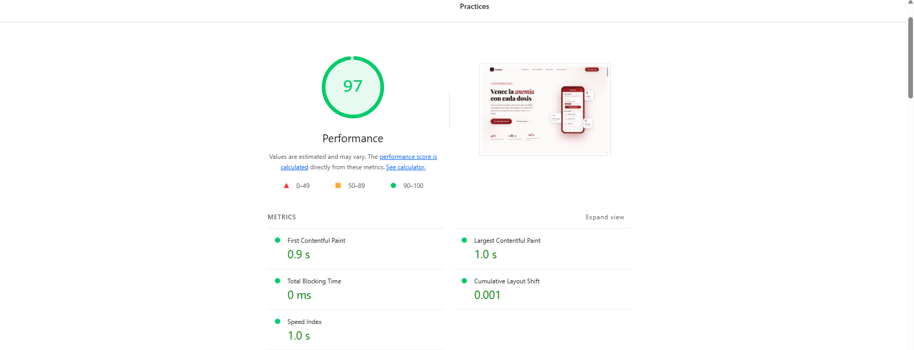

**Performance (97):** La Landing Page obtuvo una puntuación de 97, correspondiente a un rendimiento alto. El First Contentful Paint (FCP) registró 0.9 segundos y el Largest Contentful Paint (LCP) alcanzó 1.0 segundo, lo que evidencia una carga rápida del contenido principal. Asimismo, el Total Blocking Time (TBT) fue de 0 ms, el Cumulative Layout Shift (CLS) de 0.001 y el Speed Index de 1.0 segundo. Estos resultados muestran una experiencia de carga fluida y una adecuada estabilidad visual.

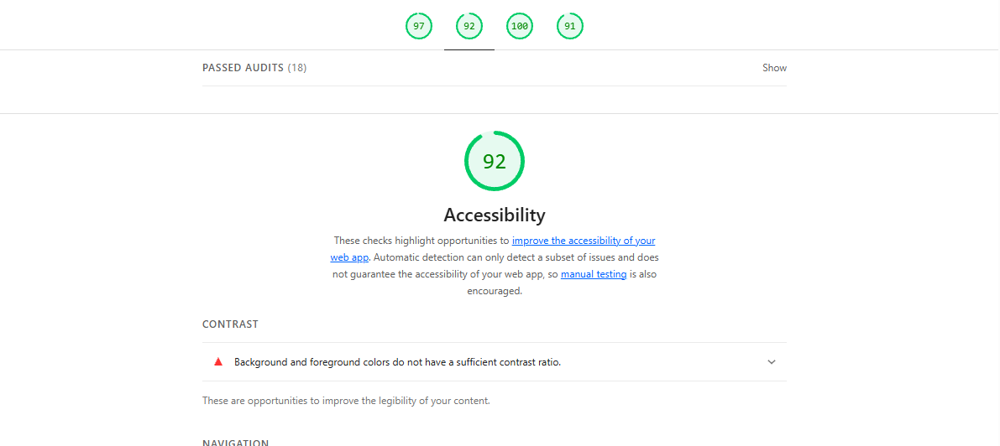

**Accessibility (92):** La puntuación de accesibilidad fue de 92. A pesar del resultado favorable, Lighthouse identificó una deficiencia en la relación de contraste entre los colores del fondo y del primer plano. Este hallazgo representa una oportunidad de mejora en la legibilidad de los contenidos, especialmente para visitantes con dificultades de percepción visual. Por ello, se recomienda revisar las combinaciones de colores utilizadas en los textos y elementos interactivos.

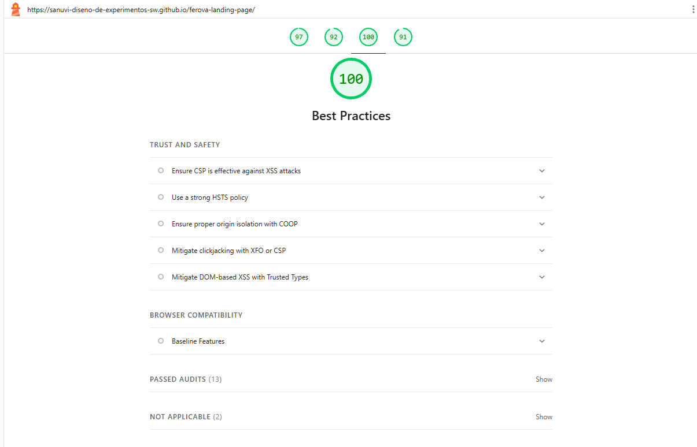

**Best Practices (100):** La Landing Page alcanzó una puntuación de 100, obteniendo el máximo resultado en esta categoría. Las auditorías de buenas prácticas evaluadas por Lighthouse fueron satisfactorias, lo que refleja un cumplimiento favorable de los criterios técnicos considerados por la herramienta.

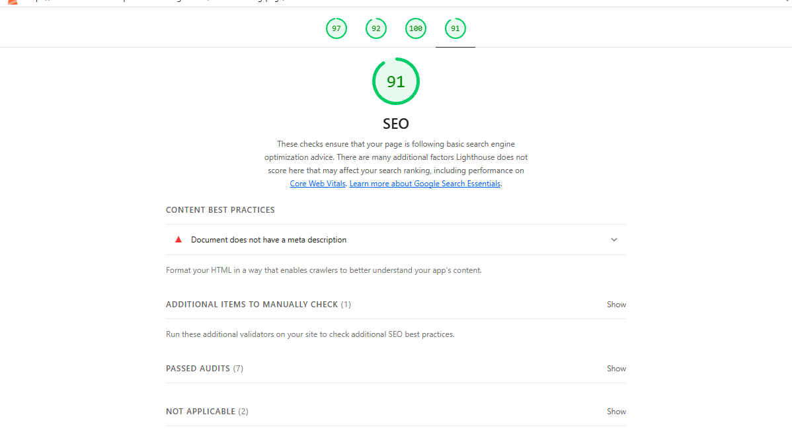

**SEO (91):** La página obtuvo una puntuación de 91. No obstante, Lighthouse identificó la ausencia de una meta descripción en el documento HTML. Esta observación representa una oportunidad de mejora para proporcionar a los motores de búsqueda una descripción clara del contenido y propósito de Ferova.

**Conclusión de la evaluación técnica:** Los resultados obtenidos muestran que la Landing Page presenta un rendimiento elevado, una buena estabilidad visual y un cumplimiento favorable de las buenas prácticas evaluadas. Sin embargo, se identificaron dos aspectos que deben mejorarse: el contraste de colores para fortalecer la accesibilidad y la incorporación de una meta descripción para optimizar el SEO. Estas observaciones servirán como referencia técnica para futuras mejoras de la página antes de ejecutar el experimento EC-03, relacionado con la información sanitaria y los accesos diferenciados por segmento.

**Pantalla: Inicio de sesión de FerovaClinic**

Para evaluar la calidad técnica de la aplicación web FerovaClinic, se ejecutó una auditoría mediante Google Lighthouse sobre la pantalla de inicio de sesión. La evaluación obtuvo una puntuación de **78 en Performance, 96 en Accessibility, 78 en Best Practices y 83 en SEO**.

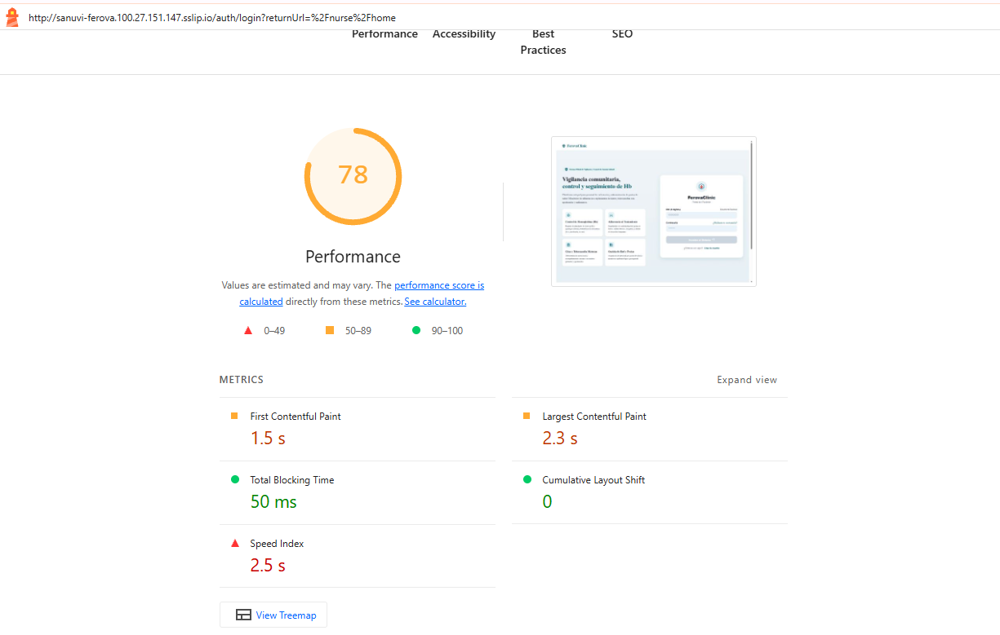

**Performance (78):** La aplicación obtuvo una puntuación de 78. El First Contentful Paint (FCP) registró 1.5 segundos y el Largest Contentful Paint (LCP) alcanzó 2.3 segundos. Asimismo, el Total Blocking Time (TBT) fue de 50 ms, el Cumulative Layout Shift (CLS) fue de 0 y el Speed Index registró 2.5 segundos. Estos resultados muestran una estabilidad visual adecuada, aunque existen oportunidades para optimizar la velocidad de presentación del contenido.

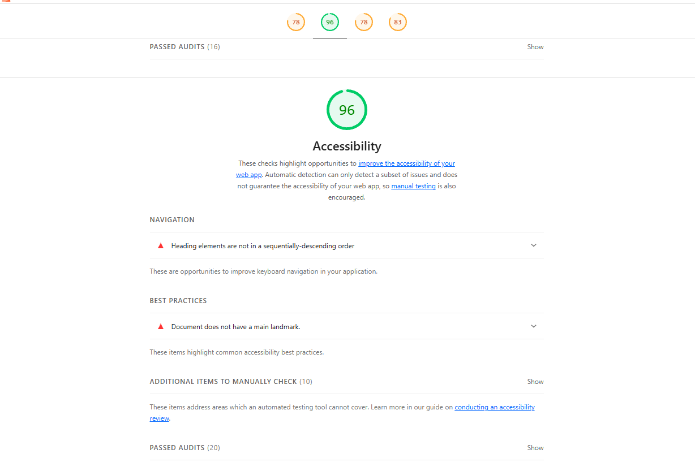

**Accessibility (96):** La puntuación de accesibilidad fue de 96. No obstante, Lighthouse identificó que los elementos de encabezado no siguen un orden jerárquico secuencial y que el documento no cuenta con un *landmark* principal. Se recomienda mejorar la estructura semántica de la interfaz para facilitar la navegación y comprensión del contenido mediante tecnologías de asistencia.

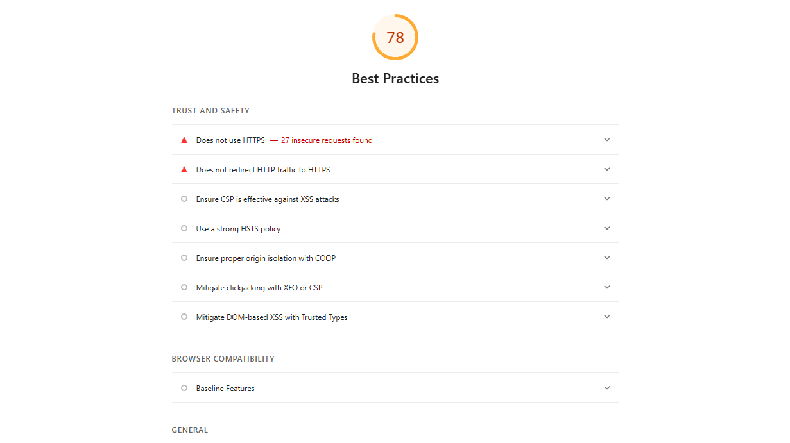

**Best Practices (78):** La aplicación obtuvo 78 puntos. Lighthouse identificó 27 solicitudes de recursos inseguros, debido a que algunos recursos se solicitan mediante HTTP, así como la ausencia de redirección del tráfico HTTP hacia HTTPS. Estos hallazgos representan aspectos prioritarios de mejora, ya que pueden comprometer la seguridad de las comunicaciones y la integridad de los recursos cargados en la aplicación.

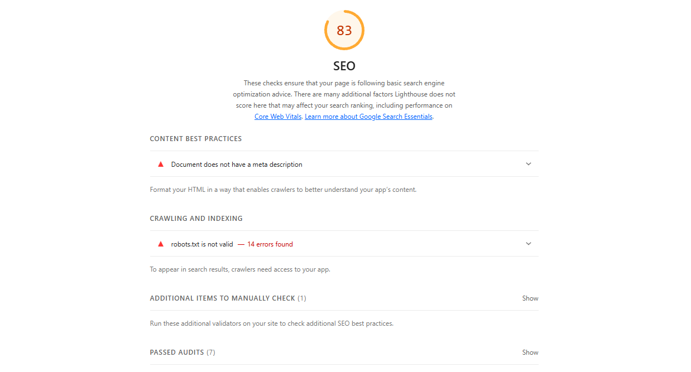

**SEO (83):** La puntuación obtenida fue de 83. Se identificó la ausencia de una meta descripción y un archivo `robots.txt` no válido, que presenta 14 errores. Debido a que la pantalla evaluada corresponde al inicio de sesión de una aplicación privada, la indexación por motores de búsqueda no constituye un objetivo principal. Por ello, se debe priorizar la configuración adecuada del acceso a las rutas públicas y privadas.

**Conclusión de la evaluación técnica:** Los resultados de Lighthouse muestran que FerovaClinic presenta una buena puntuación de accesibilidad y una estabilidad visual adecuada en su pantalla de inicio de sesión. Sin embargo, se identificaron oportunidades de mejora en el rendimiento, la estructura semántica y, principalmente, en la seguridad de las solicitudes de recursos. Estos hallazgos constituyen una línea base técnica para orientar futuras optimizaciones de la aplicación web.

**Pantalla: Dashboard de FerovaClinic**

Se realizó una auditoría técnica del Dashboard de FerovaClinic mediante Google Lighthouse, accediendo a la ruta autenticada `/nurse/home`. A diferencia de la evaluación de la pantalla de inicio de sesión, esta prueba permitió analizar directamente la interfaz principal utilizada por el personal de salud.

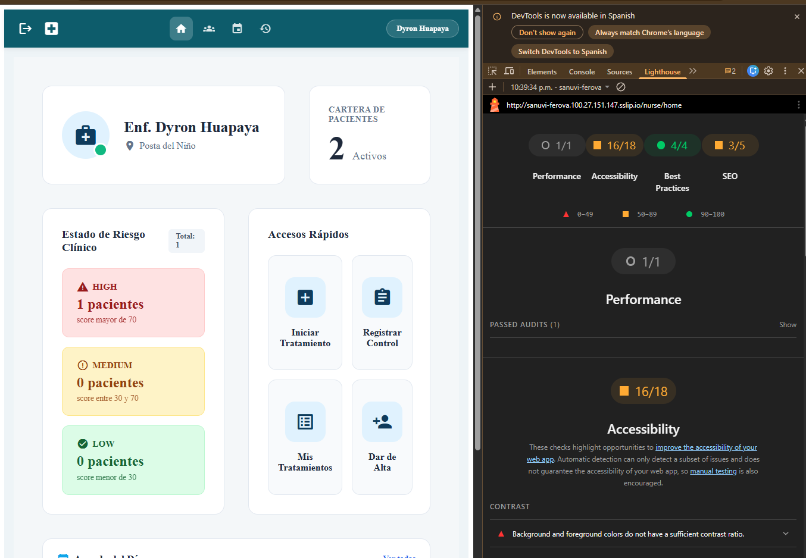

**Performance:** En la captura se observa una auditoría aprobada de un total de una evaluación visible (1/1). Sin embargo, no se dispone del puntaje global ni del detalle de las métricas de rendimiento, por lo que estos valores deberán verificarse en el informe completo.

**Accessibility (16/18):** Lighthouse registró 16 auditorías aprobadas de un total de 18. Entre los hallazgos identificados se encuentra una relación de contraste insuficiente entre los colores del fondo y del primer plano. Esta condición representa una oportunidad de mejora para facilitar la lectura de los indicadores clínicos, tarjetas informativas y demás elementos del Dashboard.

**Best Practices (4/4):** Se aprobaron las cuatro auditorías mostradas por Lighthouse. Asimismo, la herramienta identificó las bibliotecas JavaScript utilizadas en la aplicación, sin mostrar advertencias en esta categoría dentro de los resultados presentados.

**SEO (3/5):** Se aprobaron tres de las cinco auditorías evaluadas. Entre los aspectos pendientes se identificó la ausencia de una meta descripción. Debido a que el Dashboard corresponde a una sección privada de FerovaClinic, la optimización para su indexación pública no constituye una prioridad funcional.

**Conclusión de la evaluación técnica:** Los resultados del Dashboard muestran un cumplimiento favorable de las buenas prácticas evaluadas y oportunidades de mejora en accesibilidad y SEO. La principal observación corresponde al contraste insuficiente entre colores, que debe revisarse para favorecer la legibilidad de la información clínica. Estos hallazgos permiten establecer una referencia técnica de la interfaz principal de FerovaClinic antes de continuar con las evaluaciones experimentales.

**Aplicación móvil: FerovaFamily**

Se integró Firebase Analytics en la aplicación móvil Ferova Family, desarrollada en Kotlin con Jetpack Compose, con el propósito de registrar y analizar las interacciones de los usuarios dentro de la aplicación.

**Registro de la aplicación en Firebase**

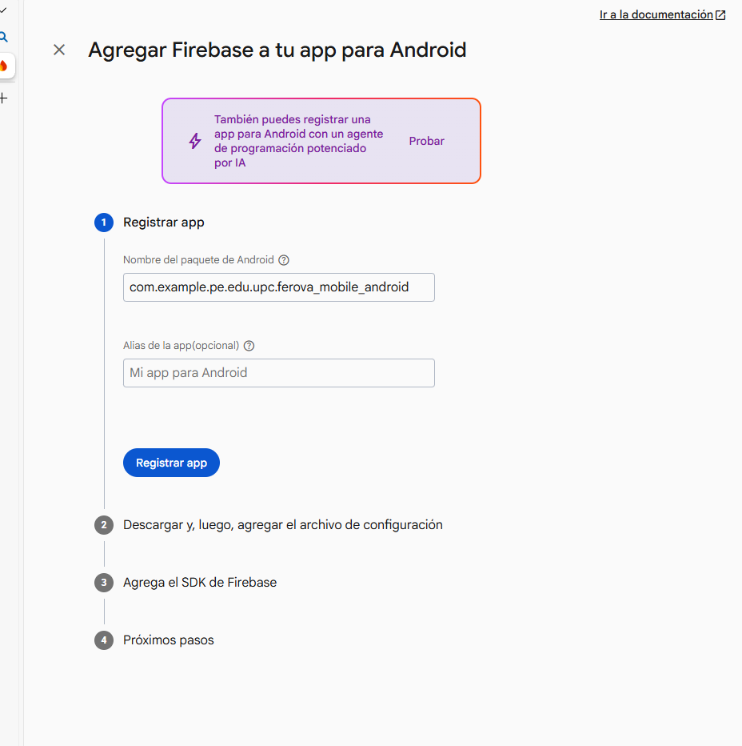

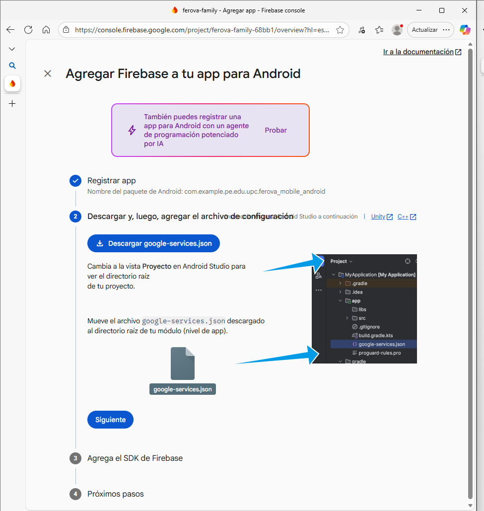

Se registró la aplicación Android en el proyecto Firebase `ferova-family-68bb1`, utilizando el identificador de paquete `com.example.pe.edu.upc.ferova_mobile_android`. Posteriormente, se descargó el archivo `google-services.json` y se incorporó al módulo `app` del proyecto Android.

**Configuración de las dependencias**

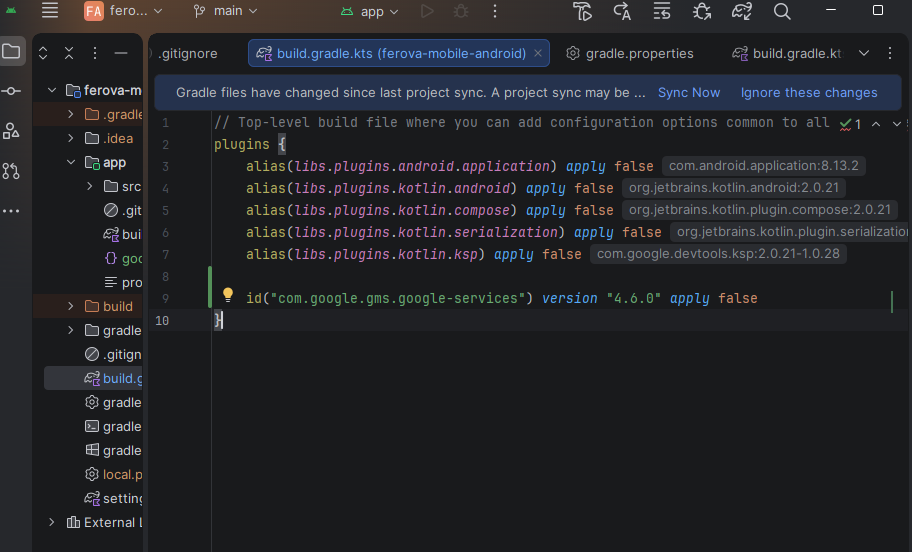

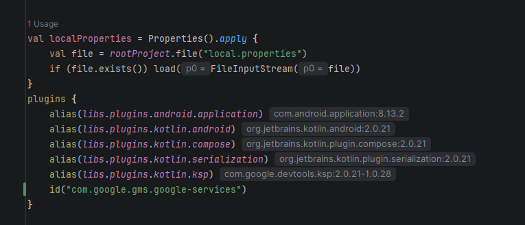

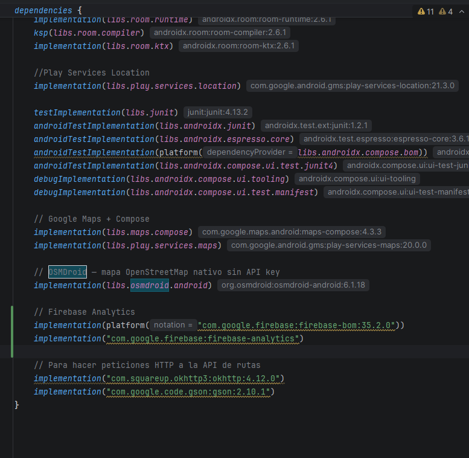

Se agregó el plugin de Google Services en el archivo `build.gradle.kts` del proyecto y se habilitó en el módulo de la aplicación. Asimismo, se incorporaron las dependencias correspondientes a Firebase Analytics mediante Firebase BoM, permitiendo utilizar sus funcionalidades para el registro de eventos.

**Implementación del registro de eventos**

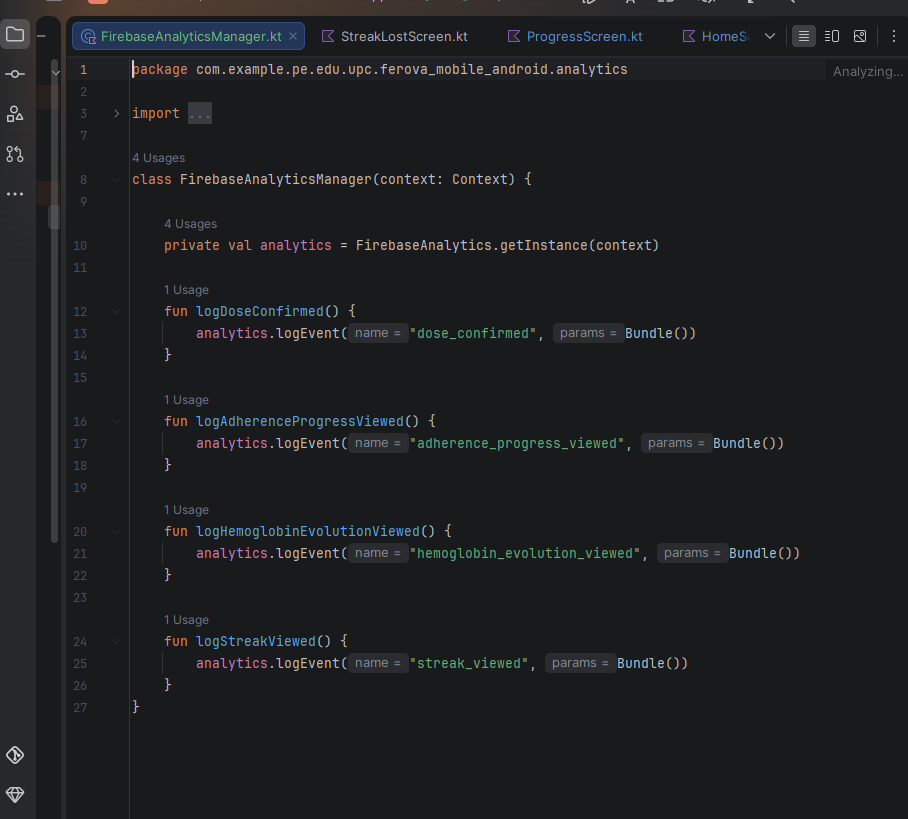

Se creó la clase `FirebaseAnalyticsManager.kt`, encargada de centralizar el registro de eventos personalizados mediante Firebase Analytics. Se implementaron los siguientes eventos:

- `dose_confirmed`: registra la confirmación de una dosis del tratamiento.
- `adherence_progress_viewed`: registra la consulta del progreso de adherencia.
- `hemoglobin_evolution_viewed`: registra la visualización de la evolución de hemoglobina.
- `streak_viewed`: registra la visualización de la racha de cumplimiento.

Los eventos se vincularon con las acciones correspondientes dentro de la aplicación móvil.

**Validación mediante Firebase DebugView**

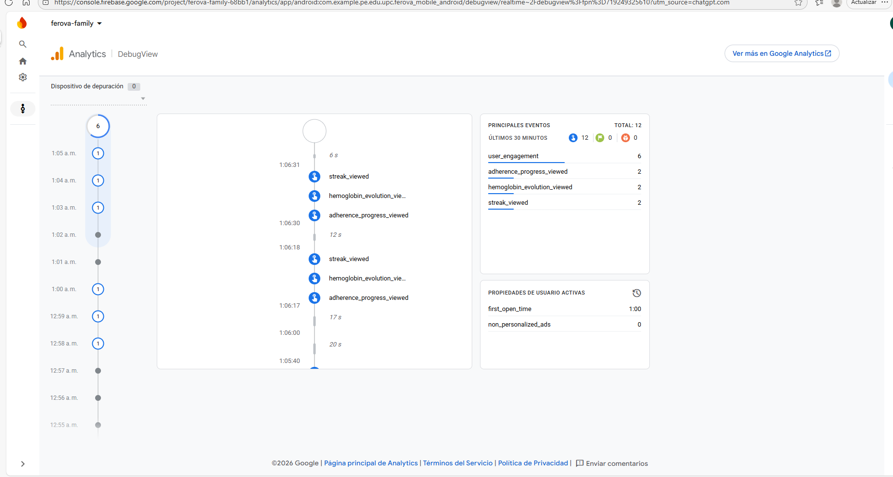

Para comprobar el funcionamiento de la integración, se habilitó el modo de depuración de Firebase Analytics en el dispositivo Android conectado. Luego, se ejecutó la aplicación y se accedió a la sección de progreso y medallas.

Mediante Firebase Console, en la sección Analytics – DebugView, se verificó la recepción de los eventos personalizados. En los resultados observados se registraron dos apariciones de cada uno de los siguientes eventos: `adherence_progress_viewed`, `hemoglobin_evolution_viewed` y `streak_viewed`.

Además, se observaron eventos automáticos como `user_engagement` y `first_open_time`, generados por Firebase Analytics.

**Resultado:** La validación permitió comprobar que Firebase Analytics recibe correctamente los eventos personalizados asociados a la consulta del progreso de adherencia, la evolución de hemoglobina y las rachas de cumplimiento. Esto permite recopilar información sobre el uso de las funcionalidades de seguimiento de la aplicación Ferova Family.

### 8.2.8. Web and Mobile Tracking Plan

El plan de instrumentación establece los eventos que serán recopilados en los componentes web y móvil de Ferova, especificando las condiciones que generan su registro, las propiedades asociadas, las métricas que alimentan y los responsables de su seguimiento. Su finalidad es organizar la recolección de datos para evaluar la interacción de los usuarios con las funcionalidades comprendidas en el alcance del experimento.

#### Plan de instrumentación de eventos

| Evento | Plataforma (Web / Mobile) | Trigger | Propiedades | Métrica que alimenta | Responsable |
|---|---|---|---|---|---|
| `dose_confirmed` | Mobile (FerovaFamily) | Cuando el usuario confirma una dosis del tratamiento. | Evento, fecha de registro. | Número de dosis confirmadas. | Equipo de desarrollo móvil. |
| `adherence_progress_viewed` | Mobile (FerovaFamily) | Cuando el usuario accede a la sección de progreso de adherencia. | Evento, fecha de visualización. | Número de visualizaciones del progreso de adherencia. | Equipo de desarrollo móvil. |
| `hemoglobin_evolution_viewed` | Mobile (FerovaFamily) | Cuando el usuario accede a la sección de evolución de hemoglobina. | Evento, fecha de visualización. | Número de visualizaciones de la evolución de hemoglobina. | Equipo de desarrollo móvil. |
| `streak_viewed` | Mobile (FerovaFamily) | Cuando el usuario visualiza la información de su racha de cumplimiento. | Evento, fecha de visualización. | Número de visualizaciones de las rachas de cumplimiento. | Equipo de desarrollo móvil. |
| Navegación entre secciones | Web (FerovaClinic) | Cuando el personal de salud accede a las secciones principales de la plataforma. | Sección consultada, fecha de acceso. | Número de accesos por sección. | Equipo de desarrollo web. |
| Acceso al Dashboard | Web (FerovaClinic) | Cuando el personal de salud ingresa al Dashboard principal. | Fecha de acceso, tipo de plataforma. | Número de accesos al Dashboard. | Equipo de desarrollo web. |

**Nota:** Los cuatro primeros eventos corresponden a eventos personalizados implementados y verificados mediante Firebase Analytics DebugView. Los eventos de navegación y acceso al Dashboard se proponen como parte del plan de seguimiento web; no deben considerarse implementados hasta contar con su instrumentación y validación.

#### Consideraciones de privacidad y consentimiento

La recolección de datos debe realizarse respetando la privacidad de madres, cuidadores y personal de salud. Por ello, los eventos deben limitarse a información necesaria para analizar el uso de las funcionalidades de Ferova, evitando incluir datos personales identificables o información clínica sensible en los parámetros enviados a las herramientas de analítica.

Asimismo, se debe considerar lo siguiente:

- No enviar nombres, números de DNI, datos de contacto ni identificadores clínicos de los pacientes como propiedades de los eventos.
- Registrar únicamente información relacionada con las interacciones y el uso de las funcionalidades de la aplicación.
- Restringir el acceso a las herramientas de analítica al personal autorizado del proyecto.
- Informar a los usuarios sobre la recopilación y finalidad del uso de datos, de acuerdo con las políticas de privacidad y los requisitos de consentimiento aplicables.
- Utilizar la información recopilada con fines de evaluación y mejora de la experiencia de uso de Ferova.

De esta manera, el plan de seguimiento establece una estructura para recopilar y analizar información de los componentes web y móvil, permitiendo relacionar las interacciones de los usuarios con las métricas definidas para evaluar los resultados del experimento.

## 8.3. Experimentation

### 8.3.1. To-Be User Stories

Las siguientes historias de usuario amplían el catálogo establecido en el capítulo III (historias `US-01` a `US-32` e historias técnicas `TS`). Cada historia representa la funcionalidad mínima que debe implementarse como *Simplest Useful Thing* para ejecutar una de las *Experiment Cards* definidas en 8.1.5 y diseñadas en 8.2. Para no confundirlas con el catálogo original, los identificadores utilizan el prefijo `US-TB` (*To-Be*), y cada historia se vincula con las epics del capítulo III, con su *Experiment Card* y con las métricas de 8.2.2 que permite medir.

| Experiment Card | Pregunta | Componente | Historias To-Be | Métricas |
|---|---|---|---|---|
| **EC-01** | `Q-01` | FerovaFamily (móvil) | `US-TB01` | `M-01`, `M-02` |
| **EC-02** | `Q-02` | FerovaClinic (web) | `US-TB02`, `US-TB03` | `M-03`, `M-04` |
| **EC-03** | `Q-03` | Landing Page | `US-TB04`, `US-TB05` | `M-07`, `M-08` |

Las preguntas `Q-05` a `Q-08` del *Question Backlog* no cuentan con historias To-Be en este ciclo, pues el alcance de la experimentación se limita a las tres tarjetas priorizadas en 8.1.4.

<table border="1" cellpadding="8" cellspacing="0" width="100%" style="margin-bottom:18px;">
  <thead>
    <tr>
      <th>Story ID</th>
      <th>User</th>
      <th>Priority</th>
      <th>Epic</th>
    </tr>
    <tr>
      <td>US-TB01</td>
      <td>Madre o cuidador (Segmento 1)</td>
      <td>High</td>
      <td>EP-05 / EP-07</td>
    </tr>
  </thead>
  <tbody>
    <tr>
      <td><strong>Title</strong></td>
      <td colspan="3">Tarjeta resumen de progreso del tratamiento en el inicio de FerovaFamily</td>
    </tr>
    <tr>
      <td><strong>Experiment Card</strong></td>
      <td colspan="3">EC-01 (Q-01) — mide M-01, M-02</td>
    </tr>
    <tr>
      <td colspan="4" align="left"><strong>Description</strong> 
      Como madre o cuidador, quiero ver en la pantalla de inicio de FerovaFamily mi racha activa, el avance porcentual hacia la meta de adherencia del 75 % y el último valor de hemoglobina de mi hijo, para conocer de inmediato cómo va el tratamiento y mantener la confirmación diaria de dosis.</td>
    </tr>
    <tr>
      <td colspan="4" align="left"><strong>Acceptance Criteria</strong>
        <ul>
          <li><strong>Escenario 1: Visualización de la tarjeta en el grupo experimental.</strong> 
          Dado que la madre pertenece al grupo experimental y el paciente tiene un tratamiento activo, 
          cuando accede a la pantalla de inicio, 
          entonces el sistema muestra una tarjeta con los días de racha activa, el porcentaje de avance hacia la meta del 75 % y el último valor de hemoglobina registrado.</li>
          <li><strong>Escenario 2: Reutilización de los datos existentes.</strong> 
          Dado que la tarjeta resumen está visible, 
          cuando la aplicación carga su contenido, 
          entonces obtiene la información desde los endpoints existentes de dosis del día, logros y evolución de hemoglobina, sin pedir a la madre ningún registro adicional.</li>
          <li><strong>Escenario 3: Paciente sin control de hemoglobina.</strong> 
          Dado que el paciente aún no tiene un control de hemoglobina registrado, 
          cuando se muestra la tarjeta, 
          entonces el campo de hemoglobina indica que no existe registro y los demás indicadores se visualizan con normalidad.</li>
          <li><strong>Escenario 4: Continuidad del registro de dosis.</strong> 
          Dado que la tarjeta resumen está visible, 
          cuando la madre confirma la dosis del día, 
          entonces la confirmación se registra con el flujo habitual y la racha y el avance reflejan el nuevo estado.</li>
          <li><strong>Escenario 5: Versión sin tarjeta para el grupo de control.</strong> 
          Dado que la madre pertenece al grupo de control, 
          cuando accede a la pantalla de inicio, 
          entonces visualiza la versión actual con el registro estándar de dosis diaria y sin la tarjeta resumen.</li>
          <li><strong>Escenario 6: Registro de eventos de medición sin datos personales.</strong> 
          Dado que la madre consulta el progreso de adherencia, la racha o la evolución de hemoglobina, 
          cuando se muestra la información, 
          entonces se registran los eventos <code>adherence_progress_viewed</code>, <code>streak_viewed</code> y <code>hemoglobin_evolution_viewed</code> (y <code>dose_confirmed</code> al confirmar una dosis), sin incluir nombres, DNI ni datos clínicos identificables.</li>
        </ul>
      </td>
    </tr>
  </tbody>
</table>

<table border="1" cellpadding="8" cellspacing="0" width="100%" style="margin-bottom:18px;">
  <thead>
    <tr>
      <th>Story ID</th>
      <th>User</th>
      <th>Priority</th>
      <th>Epic</th>
    </tr>
    <tr>
      <td>US-TB02</td>
      <td>Personal de salud (Segmento 2)</td>
      <td>High</td>
      <td>EP-09</td>
    </tr>
  </thead>
  <tbody>
    <tr>
      <td><strong>Title</strong></td>
      <td colspan="3">Porcentajes explícitos y etiqueta "Sin datos" en el mapa de calor de FerovaClinic</td>
    </tr>
    <tr>
      <td><strong>Experiment Card</strong></td>
      <td colspan="3">EC-02 (Q-02) — mide M-03</td>
    </tr>
    <tr>
      <td colspan="4" align="left"><strong>Description</strong> 
      Como profesional de salud, quiero ver el porcentaje de adherencia de cada elemento del mapa de calor y una etiqueta explícita "Sin datos" cuando no existe información, para identificar con rapidez los casos de alto riesgo sin confundir la ausencia de datos con una baja adherencia.</td>
    </tr>
    <tr>
      <td colspan="4" align="left"><strong>Acceptance Criteria</strong>
        <ul>
          <li><strong>Escenario 1: Porcentaje explícito en el mapa de calor.</strong> 
          Dado que el personal de salud accede al mapa de calor de adherencia, 
          cuando se carga la vista, 
          entonces cada elemento con información muestra su porcentaje de adherencia además de su codificación por color.</li>
          <li><strong>Escenario 2: Etiqueta "Sin datos".</strong> 
          Dado que un elemento del mapa no cuenta con registros de adherencia, 
          cuando se carga la vista, 
          entonces se muestra la etiqueta "Sin datos" y no un porcentaje ni un color que pueda interpretarse como baja adherencia.</li>
          <li><strong>Escenario 3: Identificación de pacientes de alto riesgo.</strong> 
          Dado que el evaluador realiza una tarea clínica de identificación, 
          cuando consulta el mapa de calor y el resumen de riesgo, 
          entonces puede identificar los casos de alto riesgo a partir de los porcentajes y las etiquetas, sin depender únicamente del color.</li>
          <li><strong>Escenario 4: Legibilidad de las etiquetas.</strong> 
          Dado que el mapa de calor muestra porcentajes y etiquetas, 
          cuando el usuario los observa sobre el fondo del mapa, 
          entonces el texto mantiene un contraste suficiente para leerse con claridad.</li>
          <li><strong>Escenario 5: La funcionalidad existente no se ve afectada.</strong> 
          Dado que las mejoras visuales están activas, 
          cuando el usuario filtra por nivel de riesgo o navega a otras secciones, 
          entonces estas acciones operan con normalidad.</li>
          <li><strong>Escenario 6: Versión de control (solo color).</strong> 
          Dado que el participante pertenece al grupo de control, 
          cuando accede al mapa de calor, 
          entonces visualiza la versión actual con codificación por color, sin porcentajes explícitos ni etiqueta "Sin datos".</li>
        </ul>
      </td>
    </tr>
  </tbody>
</table>

<table border="1" cellpadding="8" cellspacing="0" width="100%" style="margin-bottom:18px;">
  <thead>
    <tr>
      <th>Story ID</th>
      <th>User</th>
      <th>Priority</th>
      <th>Epic</th>
    </tr>
    <tr>
      <td>US-TB03</td>
      <td>Personal de salud (Segmento 2)</td>
      <td>High</td>
      <td>EP-04</td>
    </tr>
  </thead>
  <tbody>
    <tr>
      <td><strong>Title</strong></td>
      <td colspan="3">Alertas preventivas ante valores atípicos de edad o hemoglobina en el control clínico</td>
    </tr>
    <tr>
      <td><strong>Experiment Card</strong></td>
      <td colspan="3">EC-02 (Q-02) — mide M-04</td>
    </tr>
    <tr>
      <td colspan="4" align="left"><strong>Description</strong> 
      Como profesional de salud, quiero recibir una advertencia inmediata cuando la edad o el valor de hemoglobina que ingreso en un control clínico sea atípico, para corregir errores de digitación antes de guardar el registro sin interrumpir mi atención.</td>
    </tr>
    <tr>
      <td colspan="4" align="left"><strong>Acceptance Criteria</strong>
        <ul>
          <li><strong>Escenario 1: Advertencia por hemoglobina atípica.</strong> 
          Dado que el profesional registra un control de hemoglobina, 
          cuando el valor ingresado se aleja de los rangos esperados aunque aún se encuentre dentro del rango que acepta el sistema (0 a 30 g/dL), 
          entonces el formulario muestra una advertencia visual indicando que el valor es atípico y sugiere revisarlo.</li>
          <li><strong>Escenario 2: Advertencia por edad atípica.</strong> 
          Dado que el profesional ingresa la edad del paciente en el control clínico, 
          cuando el valor se aleja de los rangos esperados, 
          entonces el formulario muestra una advertencia visual indicando que la edad es atípica.</li>
          <li><strong>Escenario 3: Alerta no bloqueante.</strong> 
          Dado que el formulario muestra una advertencia, 
          cuando el profesional confirma que el valor ingresado es correcto, 
          entonces el sistema permite guardar el control sin bloquear el flujo de atención.</li>
          <li><strong>Escenario 4: Sin alerta para valores esperados.</strong> 
          Dado que el valor ingresado se encuentra dentro de los rangos esperados, 
          cuando el profesional completa el campo, 
          entonces no se muestra ninguna advertencia.</li>
          <li><strong>Escenario 5: Las validaciones existentes se mantienen.</strong> 
          Dado que la API valida que la hemoglobina esté entre 0 y 30 g/dL, 
          cuando el profesional intenta guardar un valor fuera de ese rango, 
          entonces el registro sigue siendo rechazado, con independencia de las advertencias preventivas.</li>
          <li><strong>Escenario 6: Versión de control sin alertas.</strong> 
          Dado que el participante pertenece al grupo de control, 
          cuando registra un control de hemoglobina, 
          entonces el formulario se comporta como en la versión actual, sin advertencias por valores atípicos.</li>
        </ul>
      </td>
    </tr>
  </tbody>
</table>

<table border="1" cellpadding="8" cellspacing="0" width="100%" style="margin-bottom:18px;">
  <thead>
    <tr>
      <th>Story ID</th>
      <th>User</th>
      <th>Priority</th>
      <th>Epic</th>
    </tr>
    <tr>
      <td>US-TB04</td>
      <td>Visitante de la Landing Page</td>
      <td>Medium</td>
      <td>EP-01</td>
    </tr>
  </thead>
  <tbody>
    <tr>
      <td><strong>Title</strong></td>
      <td colspan="3">Cifras epidemiológicas con fuente oficial INS/MINSA en la Landing Page</td>
    </tr>
    <tr>
      <td><strong>Experiment Card</strong></td>
      <td colspan="3">EC-03 (Q-03) — mide M-07</td>
    </tr>
    <tr>
      <td colspan="4" align="left"><strong>Description</strong> 
      Como visitante de la Landing Page, quiero ver cifras sobre la anemia infantil respaldadas por fuentes oficiales del INS/MINSA, para confiar en la información y comprender la magnitud del problema que Ferova busca atender.</td>
    </tr>
    <tr>
      <td colspan="4" align="left"><strong>Acceptance Criteria</strong>
        <ul>
          <li><strong>Escenario 1: Visualización de cifras con fuente citada (Variante B).</strong> 
          Dado que el visitante accede a la Variante B de la Landing Page, 
          cuando recorre la sección de problemática, 
          entonces visualiza cifras epidemiológicas sobre anemia infantil acompañadas de su fuente oficial.</li>
          <li><strong>Escenario 2: Trazabilidad de la fuente.</strong> 
          Dado que una cifra se muestra en la página, 
          cuando el visitante la consulta, 
          entonces puede identificar la institución y la publicación de la que proviene, y no se muestra ninguna cifra sin fuente.</li>
          <li><strong>Escenario 3: Variante A sin cifras citadas.</strong> 
          Dado que el visitante accede a la Variante A (control), 
          cuando recorre la página, 
          entonces visualiza la versión actual, sin cifras epidemiológicas citadas.</li>
          <li><strong>Escenario 4: Las secciones existentes se mantienen.</strong> 
          Dado que la Variante B incorpora las cifras, 
          cuando se visualiza en distintos tamaños de pantalla, 
          entonces las secciones de funcionalidades, segmentos, flujo de uso y testimonios conservan su contenido y su diseño responsive.</li>
        </ul>
      </td>
    </tr>
  </tbody>
</table>

<table border="1" cellpadding="8" cellspacing="0" width="100%" style="margin-bottom:18px;">
  <thead>
    <tr>
      <th>Story ID</th>
      <th>User</th>
      <th>Priority</th>
      <th>Epic</th>
    </tr>
    <tr>
      <td>US-TB05</td>
      <td>Visitante de la Landing Page</td>
      <td>High</td>
      <td>EP-01</td>
    </tr>
  </thead>
  <tbody>
    <tr>
      <td><strong>Title</strong></td>
      <td colspan="3">Botones de acceso (CTA) diferenciados por rol en la Landing Page</td>
    </tr>
    <tr>
      <td><strong>Experiment Card</strong></td>
      <td colspan="3">EC-03 (Q-03) — mide M-07, M-08</td>
    </tr>
    <tr>
      <td colspan="4" align="left"><strong>Description</strong> 
      Como visitante de la Landing Page, quiero encontrar botones de acceso claramente diferenciados para madres/cuidadores y para personal de salud, para ingresar directamente a FerovaFamily o a FerovaClinic según mi rol sin confundirme.</td>
    </tr>
    <tr>
      <td colspan="4" align="left"><strong>Acceptance Criteria</strong>
        <ul>
          <li><strong>Escenario 1: Visualización de CTA diferenciados (Variante B).</strong> 
          Dado que el visitante accede a la Variante B, 
          cuando observa los llamados a la acción, 
          entonces encuentra un botón dirigido a madres/cuidadores (FerovaFamily) y otro dirigido a personal de salud (FerovaClinic), con textos distintos y fácilmente reconocibles.</li>
          <li><strong>Escenario 2: Redirección correcta según el rol.</strong> 
          Dado que el visitante selecciona el botón correspondiente a su rol, 
          cuando hace clic, 
          entonces es dirigido al acceso de FerovaFamily (madres/cuidadores) o de FerovaClinic (personal de salud) según el botón elegido.</li>
          <li><strong>Escenario 3: Variante A sin diferenciación explícita.</strong> 
          Dado que el visitante accede a la Variante A (control), 
          cuando observa los llamados a la acción, 
          entonces visualiza la versión actual, sin diferenciación explícita de los accesos por rol.</li>
          <li><strong>Escenario 4: Distribución equitativa de las sesiones.</strong> 
          Dado que una sesión única ingresa a la Landing Page durante los 10 días del experimento, 
          cuando el sistema asigna la variante, 
          entonces la sesión queda asociada a una sola variante y la distribución entre A y B se mantiene equitativa (50 % / 50 %).</li>
          <li><strong>Escenario 5: Registro mínimo de la interacción.</strong> 
          Dado que el visitante hace clic en un botón de acceso, 
          cuando se registra la interacción, 
          entonces se guardan únicamente la variante, el botón y la URL de destino, sin datos personales.</li>
        </ul>
      </td>
    </tr>
  </tbody>
</table>

### 8.3.2. To-Be Product Backlog

El siguiente backlog prioriza las cinco historias To-Be derivadas de los experimentos planificados. El orden se determina por el puntaje total del *Question Backlog* de la sección 8.1.4: `Q-01` (19 pts) > `Q-02` (18 pts) > `Q-03` (16 pts). Dentro de una misma pregunta, se prioriza la historia que habilita la métrica principal de su *Experiment Card*. Las estimaciones de esfuerzo en *Story Points* siguen la escala de Fibonacci (1/2/3/5/8) utilizada en el *Product Backlog* del capítulo III. El backlog totaliza **18 Story Points**.

| # Orden | User Story ID | Título | Descripción | Experiment Card vinculada | Story Points |
|---------|---------------|--------|-------------|---------------------------|--------------|
| 1 | US-TB01 | Tarjeta resumen de progreso del tratamiento en el inicio de FerovaFamily | Como madre o cuidador, quiero ver en el inicio de FerovaFamily mi racha activa, el avance hacia la meta del 75 % y la última hemoglobina, para conocer cómo va el tratamiento y mantener la confirmación diaria de dosis. | EC-01 — `Q-01` (puntaje 19) | 5 |
| 2 | US-TB02 | Porcentajes explícitos y etiqueta "Sin datos" en el mapa de calor de FerovaClinic | Como profesional de salud, quiero ver porcentajes explícitos y la etiqueta "Sin datos" en el mapa de calor, para identificar con rapidez los casos de alto riesgo sin confundir datos ausentes con baja adherencia. | EC-02 — `Q-02` (puntaje 18) | 3 |
| 3 | US-TB03 | Alertas preventivas ante valores atípicos de edad o hemoglobina en el control clínico | Como profesional de salud, quiero recibir una advertencia cuando la edad o la hemoglobina ingresadas sean atípicas, para corregir errores de digitación antes de guardar el control clínico sin interrumpir la atención. | EC-02 — `Q-02` (puntaje 18) | 5 |
| 4 | US-TB04 | Cifras epidemiológicas con fuente oficial INS/MINSA en la Landing Page | Como visitante de la Landing Page, quiero ver cifras de anemia infantil respaldadas por fuentes oficiales del INS/MINSA, para confiar en la información y comprender la magnitud del problema. | EC-03 — `Q-03` (puntaje 16) | 2 |
| 5 | US-TB05 | Botones de acceso (CTA) diferenciados por rol en la Landing Page | Como visitante, quiero encontrar botones de acceso diferenciados para madres/cuidadores y personal de salud, para ingresar directamente a FerovaFamily o FerovaClinic según mi rol. | EC-03 — `Q-03` (puntaje 16) | 3 |

### 8.3.3. Pipeline-supported, Experiment-Driven To-Be Software Platform Lifecycle

La ejecución de los experimentos se apoya en el pipeline implementado en el capítulo VII y en los componentes de recolección de datos definidos en 8.2.8. Cada historia To-Be se desarrolla en una rama `feature/*` siguiendo GitFlow, se integra mediante *pull request* a `develop` y se publica a través de la plataforma de despliegue de su componente, de modo que cada variante experimental llega a los participantes por el mismo camino que una versión regular de Ferova.

| Experiment Card | Componente | Integración y entrega (capítulo VII) | Medición | Ventana (8.2.6) |
|---|---|---|---|---|
| **EC-01** | FerovaFamily (Kotlin + Jetpack Compose) | Distribución del APK a los testers mediante Firebase App Distribution | Firebase Analytics (eventos de 8.2.8) y registros de dosis almacenados por el backend (`M-01`, `M-02`) | Día 1 a 14 |
| **EC-02** | FerovaClinic (Angular + TypeScript) | CI con `frontend-ci.yml` y despliegue en Azure Static Web Apps | Observación de las 5 tareas clínicas por evaluador: tiempos y errores (`M-03`, `M-04`) | Día 15 a 21 |
| **EC-03** | Landing Page | Publicación en GitHub Pages | Registro de clics en los CTA y verificación de la URL de destino (`M-07`, `M-08`) | Día 22 a 31 |
| Transversal | Backend (.NET 9 + MongoDB) | CI con `backend-ci.yml` y despliegue con Dockerfile en Railway | Fuente de datos de dosis, logros, hemoglobina y riesgo | Todo el periodo |

Se mantienen las reglas de 8.2.6 y 8.2.8: los experimentos se ejecutan de forma secuencial para evitar solapamientos, la recolección se limita a los eventos estrictamente necesarios durante la ventana de cada experimento (economía de rastreo) y no se envían nombres, DNI ni datos clínicos identificables a las herramientas de analítica.

#### 8.3.3.1. To-Be Sprint Backlogs

##### Sprint Backlog 2

El presente *Sprint Backlog* corresponde al sprint de experimentación To-Be de Ferova. Su objetivo es implementar lo mínimo necesario para ejecutar las tres *Experiment Cards*: la tarjeta resumen de progreso en FerovaFamily, los porcentajes, la etiqueta "Sin datos" y las alertas preventivas en FerovaClinic, y la variante B de la Landing Page, junto con la medición definida en 8.2.8.

**Board Screenshot:**

**Board URL:** [completar enlace del tablero]

| Campo | Valor |
|-------|-------|
| Sprint # | Sprint 2 |
| Date | [YYYY-MM-DD] |
| Sprint 2 Goal | Implementar el *Simplest Useful Thing* de `EC-01`, `EC-02` y `EC-03` y su medición mínima, de modo que los tres experimentos puedan ejecutarse en el calendario de 8.2.6. |
| Sprint 2 Velocity | 18 Story Points (todas las historias completadas) |
| Sum of Story Points | 18 |
| Sum of Estimation (Hours) | 94 |

| User Story Id | User Story Title | Work-Item / Task Id | Work-Item / Task Title | Description | Estimation (Hours) | Assigned To | Status |
| ------------- | ---------------- | ------------------- | ---------------------- | ----------- | -----------------: | ----------- | ------ |
| US-TB01 | Tarjeta resumen de progreso del tratamiento en el inicio de FerovaFamily | T-TB01-01 | Definir reglas de cálculo de la tarjeta | Definir qué se muestra y cómo se calcula: días de racha activa, porcentaje de avance hacia la meta de adherencia del 75 % (NTS N.° 213-MINSA/DGIESP-2024) y último valor de hemoglobina. | 3 | Vitaly A. Baca | Done |
| US-TB01 | Tarjeta resumen de progreso del tratamiento en el inicio de FerovaFamily | T-TB01-02 | Diseñar la tarjeta en Jetpack Compose | Maquetar la tarjeta resumen del inicio siguiendo la guía de estilo móvil del capítulo IV, cuidando que no genere sobrecarga visual. | 4 | Vitaly A. Baca | Done |
| US-TB01 | Tarjeta resumen de progreso del tratamiento en el inicio de FerovaFamily | T-TB01-03 | Consumir los endpoints existentes | Integrar la tarjeta con los endpoints de dosis del día, logros y evolución de hemoglobina, sin crear nuevos servicios. | 8 | Vicente Quijandria | Done |
| US-TB01 | Tarjeta resumen de progreso del tratamiento en el inicio de FerovaFamily | T-TB01-04 | Manejar estados vacíos y de error | Mostrar "sin registro" cuando no hay control de hemoglobina y un estado de error controlado si falla la consulta. | 3 | Vicente Quijandria | Done |
| US-TB01 | Tarjeta resumen de progreso del tratamiento en el inicio de FerovaFamily | T-TB01-05 | Asignar grupos experimental y de control | Implementar la regla que muestra la tarjeta solo a los 10 cuidadores del grupo experimental y mantiene la versión actual para los 10 del grupo de control. | 4 | Vitaly A. Baca | Done |
| US-TB01 | Tarjeta resumen de progreso del tratamiento en el inicio de FerovaFamily | T-TB01-06 | Registrar eventos analíticos | Implementar en <code>FirebaseAnalyticsManager.kt</code> los eventos <code>dose_confirmed</code>, <code>adherence_progress_viewed</code>, <code>hemoglobin_evolution_viewed</code> y <code>streak_viewed</code>, sin datos personales. | 4 | Vicente Quijandria | Done |
| US-TB01 | Tarjeta resumen de progreso del tratamiento en el inicio de FerovaFamily | T-TB01-07 | Validar eventos y distribuir la versión | Verificar la recepción de eventos en Firebase DebugView y distribuir el APK a los testers mediante Firebase App Distribution. | 3 | Gabriel A. Peñaranda | Done |
| US-TB02 | Porcentajes explícitos y etiqueta "Sin datos" en el mapa de calor de FerovaClinic | T-TB02-01 | Definir la presentación del porcentaje y de "Sin datos" | Establecer el formato del porcentaje de adherencia y el criterio para mostrar "Sin datos" cuando no existen registros. | 3 | Vitaly A. Baca | Done |
| US-TB02 | Porcentajes explícitos y etiqueta "Sin datos" en el mapa de calor de FerovaClinic | T-TB02-02 | Mostrar porcentajes en el mapa de calor | Incorporar el porcentaje de adherencia en cada elemento del mapa de calor (<code>/heatmap</code>) a partir de los datos que ya entrega la API. | 6 | Elizabeth N. Apaza | Done |
| US-TB02 | Porcentajes explícitos y etiqueta "Sin datos" en el mapa de calor de FerovaClinic | T-TB02-03 | Implementar la etiqueta "Sin datos" | Diferenciar visualmente la ausencia de datos de la baja adherencia y verificar el contraste de las etiquetas. | 4 | Elizabeth N. Apaza | Done |
| US-TB02 | Porcentajes explícitos y etiqueta "Sin datos" en el mapa de calor de FerovaClinic | T-TB02-04 | Mantener la versión de control | Habilitar un indicador que active la versión experimental solo para los 6 evaluadores asignados y conserve la vista actual (solo color) para los otros 6. | 3 | Vitaly A. Baca | Done |
| US-TB02 | Porcentajes explícitos y etiqueta "Sin datos" en el mapa de calor de FerovaClinic | T-TB02-05 | Preparar las tareas clínicas estandarizadas | Elaborar las 5 tareas clínicas, los casos simulados o anonimizados y la hoja de registro de tiempos y errores. | 4 | Luis A. Damián | Done |
| US-TB03 | Alertas preventivas ante valores atípicos de edad o hemoglobina en el control clínico | T-TB03-01 | Definir rangos de referencia para las alertas | Establecer, con el criterio clínico del equipo, qué valores de edad y hemoglobina se consideran atípicos sin contradecir la validación de 0 a 30 g/dL de la API. | 3 | Vicente Quijandria | Done |
| US-TB03 | Alertas preventivas ante valores atípicos de edad o hemoglobina en el control clínico | T-TB03-02 | Implementar advertencia por hemoglobina atípica | Agregar la validación preventiva en el formulario de <code>/hemoglobin-control</code>. | 5 | Elizabeth N. Apaza | Done |
| US-TB03 | Alertas preventivas ante valores atípicos de edad o hemoglobina en el control clínico | T-TB03-03 | Implementar advertencia por edad atípica | Agregar la validación preventiva de la edad en el formulario del control clínico. | 3 | Elizabeth N. Apaza | Done |
| US-TB03 | Alertas preventivas ante valores atípicos de edad o hemoglobina en el control clínico | T-TB03-04 | Asegurar el carácter no bloqueante | Permitir confirmar y guardar el registro tras mostrar la advertencia y mantener sin cambios la versión de control. | 3 | Gabriel A. Peñaranda | Done |
| US-TB03 | Alertas preventivas ante valores atípicos de edad o hemoglobina en el control clínico | T-TB03-05 | Probar los escenarios de alerta | Validar la alerta con valor atípico, la ausencia de alerta con valor esperado, el guardado tras confirmar y el rechazo de la API fuera de 0 a 30 g/dL. | 3 | Luis A. Damián | Done |
| US-TB04 | Cifras epidemiológicas con fuente oficial INS/MINSA en la Landing Page | T-TB04-01 | Seleccionar y verificar cifras oficiales | Seleccionar cifras de anemia infantil de publicaciones del INS/MINSA y registrar la fuente exacta de cada una. | 3 | Luis A. Damián | Done |
| US-TB04 | Cifras epidemiológicas con fuente oficial INS/MINSA en la Landing Page | T-TB04-02 | Incorporar la sección de cifras en la Variante B | Maquetar la sección con cada cifra y su fuente citada, manteniendo el diseño responsive. | 4 | Luis A. Damián | Done |
| US-TB04 | Cifras epidemiológicas con fuente oficial INS/MINSA en la Landing Page | T-TB04-03 | Verificar las variantes y el diseño responsive | Comprobar que la Variante A no muestra cifras y que las demás secciones no cambian en ninguna variante. | 2 | Elizabeth N. Apaza | Done |
| US-TB05 | Botones de acceso (CTA) diferenciados por rol en la Landing Page | T-TB05-01 | Diseñar los CTA diferenciados | Definir texto, color y ubicación de los dos botones de acceso (madres/cuidadores y personal de salud). | 3 | Vitaly A. Baca | Done |
| US-TB05 | Botones de acceso (CTA) diferenciados por rol en la Landing Page | T-TB05-02 | Implementar los CTA y sus URL de destino | Implementar ambos botones y enlazarlos con el acceso a FerovaFamily y a FerovaClinic. | 4 | Luis A. Damián | Done |
| US-TB05 | Botones de acceso (CTA) diferenciados por rol en la Landing Page | T-TB05-03 | Distribuir las sesiones entre Variante A y B | Implementar la distribución equitativa 50/50 de sesiones únicas y evitar que una misma sesión se cuente en ambas variantes. | 5 | Gabriel A. Peñaranda | Done |
| US-TB05 | Botones de acceso (CTA) diferenciados por rol en la Landing Page | T-TB05-04 | Registrar clics y destino | Registrar el clic en cada CTA y la URL de destino para calcular M-07 y M-08, sin datos personales. | 4 | Gabriel A. Peñaranda | Done |
| US-TB05 | Botones de acceso (CTA) diferenciados por rol en la Landing Page | T-TB05-05 | Desplegar y verificar las variantes | Publicar la Landing Page en GitHub Pages y verificar el acceso a ambas variantes y a sus destinos. | 3 | Gabriel A. Peñaranda | Done |

**Resumen de esfuerzo por historia:**

| User Story Id | Story Points | Horas estimadas | Tareas |
|---|---:|---:|---:|
| US-TB01 | 5 | 29 | 7 |
| US-TB02 | 3 | 20 | 5 |
| US-TB03 | 5 | 17 | 5 |
| US-TB04 | 2 | 9 | 3 |
| US-TB05 | 3 | 19 | 5 |
| **Total** | **18** | **94** | **25** |

#### 8.3.3.2. Implemented To-Be Landing Page Evidence

A diferencia de otras fases, en el ciclo de experimentación To-Be la Landing Page sí requirió modificaciones: `EC-03` compara la versión actual (Variante A, control) con una Variante B que incorpora cifras epidemiológicas con fuente oficial del INS/MINSA y botones de acceso diferenciados por rol. Las historias implementadas son `US-TB04` y `US-TB05`. El resto de secciones de la página (hero, funcionalidades, segmentos, "Cómo funciona" y testimonios) se mantuvo sin cambios.

##### Landing Page Repository Evidence

| Repository | Branch | Commit Id | Commit Message | Committed on (Date) |
| :--- | :--- | :--- | :--- | :--- |
| ferova-landing-page | `feature/ec-03-landing-variant-b` | [completar] | feat(landing): add INS/MINSA figures with cited sources (US-TB04) | [completar] |
| ferova-landing-page | `feature/ec-03-landing-variant-b` | [completar] | feat(landing): add role-specific CTAs for FerovaFamily and FerovaClinic (US-TB05) | [completar] |
| ferova-landing-page | `feature/ec-03-landing-variant-b` | [completar] | feat(landing): split unique sessions between variants A and B and log CTA clicks | [completar] |

##### Implemented Landing Page Feature by To-Be User Story

| User Story | Elemento implementado | Descripción |
| :--- | :--- | :--- |
| US-TB04 | Sección de cifras con fuente citada | Cifras epidemiológicas sobre anemia infantil provenientes de publicaciones del INS/MINSA, cada una con su fuente visible. Solo se muestra en la Variante B. |
| US-TB05 | CTA diferenciados por rol | Dos botones de acceso con textos distintos: uno para madres/cuidadores (FerovaFamily) y otro para personal de salud (FerovaClinic). Solo se muestran en la Variante B. |
| US-TB05 | Distribución de variantes | Asignación equitativa 50/50 de sesiones únicas entre las Variantes A y B, evitando que una misma sesión se cuente en ambas. |
| US-TB05 | Registro de interacción | Registro del clic en cada CTA y de la URL de destino, para calcular `M-07` y `M-08` sin recolectar datos personales. |

##### Variantes del experimento EC-03

| Aspecto | Variante A (control) | Variante B (experimental) |
| :--- | :--- | :--- |
| Respaldo estadístico | Sin cifras epidemiológicas citadas | Cifras con fuente oficial del INS/MINSA |
| Llamado a la acción | Sin diferenciación explícita por rol | Dos CTA diferenciados: FerovaFamily y FerovaClinic |
| Distribución | 50 % de las sesiones únicas | 50 % de las sesiones únicas |
| Métricas | `M-07`, `M-08` | `M-07`, `M-08` |

##### Deployment Evidence

La Landing Page permanece desplegada en GitHub Pages. **Link de despliegue:** [completar URL de GitHub Pages]

*Variante A (control): versión actual de la Landing Page.*

*Variante B (experimental): cifras con fuente INS/MINSA y botones de acceso diferenciados por rol.*

**Línea base técnica (8.2.7).** Antes del experimento, la auditoría con Google Lighthouse de la Landing Page obtuvo 97 en *Performance*, 92 en *Accessibility*, 100 en *Best Practices* y 91 en *SEO*, con dos observaciones abiertas: contraste insuficiente entre fondo y primer plano, y ausencia de meta descripción. Dado que la Variante B agrega texto y botones nuevos, su diseño debe respetar el contraste mínimo para no empeorar la observación de accesibilidad.

##### Summary of Implemented To-Be Landing Page Support

| To-Be User Story | Landing Page Evidence | Experiment Supported |
| :--- | :--- | :--- |
| US-TB04 — Cifras epidemiológicas con fuente oficial | Sección de cifras con fuente citada en la Variante B | EC-03 — Influencia de la información sanitaria y los accesos diferenciados |
| US-TB05 — CTA diferenciados por rol | Botones de acceso por segmento, distribución A/B y registro de clics | EC-03 — Influencia de la información sanitaria y los accesos diferenciados |

#### 8.3.3.3. Implemented To-Be Frontend-Web Application Evidence

En esta sección se presenta la evidencia de implementación de FerovaClinic correspondiente al Sprint Backlog 2. De las cinco historias To-Be, `US-TB02` y `US-TB03` tienen alcance en la aplicación web Angular: `US-TB01` pertenece a FerovaFamily y `US-TB04` y `US-TB05` a la Landing Page. El objetivo fue habilitar, para el grupo experimental de `EC-02`, los porcentajes explícitos y la etiqueta "Sin datos" en el mapa de calor, y las alertas preventivas en el registro del control de hemoglobina, manteniendo la versión actual para el grupo de control.

##### Frontend Repository Evidence

| Repository | Branch | Commit Id | Commit Message | Committed on (Date) |
| :--- | :--- | :--- | :--- | :--- |
| FerovaClinic (frontend web) | `feature/ec-02-heatmap-labels` | [completar] | feat(heatmap): show explicit adherence percentages and "Sin datos" label (US-TB02) | [completar] |
| FerovaClinic (frontend web) | `feature/ec-02-hemoglobin-alerts` | [completar] | feat(hemoglobin): add non-blocking alerts for atypical age and hemoglobin values (US-TB03) | [completar] |

##### Implemented Frontend Feature by To-Be User Story

###### US-TB02 — Porcentajes explícitos y etiqueta "Sin datos" en el mapa de calor

| Elemento | Descripción |
| :--- | :--- |
| Porcentaje de adherencia | Cada elemento del mapa de calor (`/heatmap`) muestra su porcentaje de adherencia, que la API ya entrega junto con las coordenadas y el nivel de riesgo, además de la codificación por color. |
| Etiqueta "Sin datos" | Los elementos sin registros se identifican con una etiqueta explícita, diferenciada de la baja adherencia, para evitar la ambigüedad detectada en la evaluación heurística (`6.3.3`) y en la auditoría UX (`6.4.2`). |
| Resumen de riesgo | La vista `/risk-overview` se mantiene como apoyo para la tarea de identificar pacientes de alto riesgo (`M-03`). |
| Indicador de experimento | Un indicador activa la versión experimental solo para los 6 evaluadores del grupo experimental; los otros 6 acceden a la vista actual (solo color). |

###### US-TB03 — Alertas preventivas ante valores atípicos de edad o hemoglobina

| Elemento | Descripción |
| :--- | :--- |
| Advertencia por hemoglobina atípica | El formulario de `/hemoglobin-control` muestra una advertencia visual cuando el valor ingresado se aleja de los rangos esperados, aunque siga dentro del rango que acepta la API (0 a 30 g/dL). |
| Advertencia por edad atípica | El formulario muestra una advertencia visual cuando la edad ingresada se aleja de los rangos esperados. |
| Carácter no bloqueante | El profesional puede confirmar el valor y guardar el control; la advertencia no interrumpe la atención. |
| Validación del backend | El rechazo de valores fuera de 0 a 30 g/dL permanece en la API, independiente de la advertencia preventiva. |

Estos cambios permiten contrastar las hipótesis de `EC-02`: que los porcentajes explícitos y la etiqueta "Sin datos" reducen el tiempo de identificación de pacientes de alto riesgo (`M-03`) y que las alertas preventivas reducen los errores de registro clínico (`M-04`).

##### Evidencia Funcional

**Grupo experimental** — mapa de calor con porcentajes explícitos y etiqueta "Sin datos":

**Grupo de control** — mapa de calor actual, con codificación solo por color:

**Grupo experimental** — advertencia preventiva por valor atípico en el control de hemoglobina:

##### Deployment Evidence

FerovaClinic se publica en Azure Static Web Apps mediante el *workflow* de GitHub Actions `azure-static-web-apps-proud-wave-064ec0610.yml`, y el *workflow* `frontend-ci.yml` verifica la compilación de la aplicación Angular en cada `push` y `pull_request` (secciones 7.1 y 7.3). Los cambios del sprint se integran a `develop` y, tras validarse, siguen este mismo flujo.

**Línea base técnica (8.2.7).** La auditoría con Lighthouse de la pantalla de inicio de sesión obtuvo 78 en *Performance*, 96 en *Accessibility*, 78 en *Best Practices* y 83 en *SEO*. En el *Dashboard* (`/nurse/home`) se aprobaron 16 de 18 auditorías de accesibilidad, con contraste insuficiente entre fondo y primer plano como hallazgo principal. Por ello, los porcentajes y las etiquetas nuevas del mapa de calor deben verificar su contraste (`T-TB02-03`).

##### Summary of Implemented To-Be Frontend-Web Support

| To-Be User Story | Frontend Evidence | Experiment Supported |
| :--- | :--- | :--- |
| US-TB02 — Porcentajes y "Sin datos" en el mapa de calor | Porcentaje por elemento y etiqueta "Sin datos", activados por indicador de experimento | EC-02 — Efectividad de las mejoras visuales y alertas preventivas (`M-03`) |
| US-TB03 — Alertas por valores atípicos | Advertencias no bloqueantes de edad y hemoglobina en `/hemoglobin-control` | EC-02 — Efectividad de las mejoras visuales y alertas preventivas (`M-04`) |

#### 8.3.3.4. Implemented To-Be Native-Mobile Application Evidence

En esta sección se presenta la evidencia de implementación de FerovaFamily (Kotlin + Jetpack Compose) correspondiente a `US-TB01`, la historia que da soporte a `EC-01`. El objetivo fue que las madres y cuidadores del grupo experimental vean, en la pantalla de inicio, una tarjeta resumen con la racha activa, el avance hacia la meta del 75 % y la última hemoglobina, mientras el grupo de control conserva la versión actual.

##### Mobile Repository Evidence

| Repository | Branch | Commit Id | Commit Message | Committed on (Date) |
| :--- | :--- | :--- | :--- | :--- |
| ferova-mobile-android | `feature/ec-01-progress-card` | [completar] | feat(home): add progress summary card with streak, 75 % goal and last hemoglobin (US-TB01) | [completar] |
| ferova-mobile-android | `feature/ec-01-progress-card` | [completar] | feat(analytics): track adherence, streak and hemoglobin views with Firebase Analytics | [completar] |

##### Implemented Mobile Feature by To-Be User Story

###### US-TB01 — Tarjeta resumen de progreso del tratamiento en el inicio

| Elemento | Descripción |
| :--- | :--- |
| Tarjeta resumen | Tarjeta en la pantalla de inicio con tres datos: días de racha activa, porcentaje de avance hacia la meta de adherencia del 75 % (NTS N.° 213-MINSA/DGIESP-2024) y último valor de hemoglobina registrado. |
| Fuente de datos | Los endpoints existentes de dosis del día, logros y evolución de hemoglobina; no se crearon servicios nuevos. |
| Estados vacíos | Si el paciente no tiene control de hemoglobina, la tarjeta indica que no existe registro y mantiene visibles los otros indicadores. |
| Grupos del experimento | La tarjeta se muestra a los 10 cuidadores del grupo experimental; los otros 10 usan la versión actual. |
| Eventos de analítica | `FirebaseAnalyticsManager.kt` centraliza el registro de `dose_confirmed`, `adherence_progress_viewed`, `hemoglobin_evolution_viewed` y `streak_viewed`, sin datos personales. |

##### Analytics Evidence

La integración de Firebase Analytics en el proyecto `ferova-family-68bb1` y la recepción de eventos se documentaron en 8.2.7: en Firebase DebugView se registraron dos apariciones de cada uno de los eventos `adherence_progress_viewed`, `hemoglobin_evolution_viewed` y `streak_viewed`, además de los eventos automáticos `user_engagement` y `first_open_time`. El evento `dose_confirmed` está implementado y su recepción se verifica durante la ventana de 14 días de `EC-01`. Conforme a la economía de rastreo, estos eventos solo se consideran durante esa ventana.

##### Evidencia Funcional

**Grupo experimental** — pantalla de inicio con la tarjeta resumen:

**Grupo de control** — pantalla de inicio actual, sin tarjeta resumen:

**Paciente sin control de hemoglobina** — tarjeta con estado vacío:

##### Deployment Evidence

La versión experimental se distribuye a los participantes mediante Firebase App Distribution, el mismo mecanismo descrito en la sección 7.3 para compartir los APK de prueba de FerovaFamily con los testers autorizados.

##### Summary of Implemented To-Be Native-Mobile Support

| To-Be User Story | Mobile Evidence | Experiment Supported |
| :--- | :--- | :--- |
| US-TB01 — Tarjeta resumen de progreso | Tarjeta en el inicio, estados vacíos, grupos experimental/control y eventos de Firebase Analytics | EC-01 — Impacto de los indicadores de progreso en la adherencia (`M-01`, `M-02`) |

#### 8.3.3.5. Implemented To-Be RESTful API and/or Serverless Backend Evidence

Siguiendo el principio *Simplest Useful Thing*, las tres *Experiment Cards* se diseñaron reutilizando la API RESTful del capítulo V. Por ello, el Sprint Backlog 2 no requirió nuevos endpoints: el backend sostiene los experimentos como fuente de datos y de medición. Esta sección documenta qué endpoints existentes consume cada historia To-Be y cómo se verifica el servicio desplegado.

##### Backend Repository Evidence

| Repository | Branch | Commit Id | Commit Message | Committed on (Date) |
| :--- | :--- | :--- | :--- | :--- |
| WebApplication1 | `main` | - | *Sin modificaciones funcionales para este Sprint (reutilización de la API del capítulo V)* | - |

##### Existing Backend Support by To-Be User Story

| To-Be User Story | Method | Endpoint (capítulo III) | Uso en el experimento |
| :--- | :--- | :--- | :--- |
| US-TB01 | GET | `/patients/:patientId/today-dose` | Dosis del día y su estado. |
| US-TB01 | GET | `/patients/:patientId/achievement` | Puntos, racha actual y mejor racha para la tarjeta. |
| US-TB01 | GET | `/{patientId}/hemoglobin-evolution` | Último valor de hemoglobina registrado. |
| US-TB01 | POST | `/doses/confirm` | Confirmación de dosis, base de `M-01`. |
| US-TB01 | GET | `/patients/:patientId/dose-history` | Historial de dosis para calcular la adherencia semanal (`M-02`). |
| US-TB02 | GET | `/heatmap` | Coordenadas, nivel de riesgo y porcentaje de adherencia por elemento del mapa. |
| US-TB02 | GET | `/risk-overview` | Cantidad de pacientes en nivel `HIGH`, `MEDIUM` y `LOW`. |
| US-TB02 | GET | `/risk/:riskLevel/patients` | Pacientes por nivel de riesgo, para la tarea de identificación. |
| US-TB03 | POST | `/hemoglobin-control` | Registro del control; la API valida el rango de 0 a 30 g/dL y determina el estado de anemia. |
| US-TB04, US-TB05 | - | - | No usan la API: la Landing Page es un sitio estático. |

Las rutas se muestran como en la especificación del capítulo III y en la documentación Swagger del capítulo V. La advertencia por valores atípicos de `US-TB03` se resuelve en la interfaz y complementa, sin reemplazar, la validación existente de la API.

Los datos de `M-01` y `M-02` se calculan a partir de los registros de dosis programadas y confirmadas que el backend almacena en MongoDB para cada participante (8.2.2).

##### Backend Deployment Evidence

El backend (ASP.NET Core, .NET 9) permanece desplegado en Railway mediante Dockerfile, y el *workflow* `backend-ci.yml` verifica su compilación en cada `push` y `pull_request` (secciones 7.1 y 7.3). La disponibilidad del servicio y de sus endpoints se comprueba mediante Swagger UI.

**Link de despliegue del backend:** https://webapplication1-production-3774.up.railway.app

##### Summary of To-Be RESTful API Support

| To-Be User Story | Backend Evidence | Experiment Supported |
| :--- | :--- | :--- |
| US-TB01 — Tarjeta resumen de progreso | Endpoints de dosis, logros, evolución de hemoglobina y confirmación de dosis | EC-01 (`M-01`, `M-02`) |
| US-TB02 — Mapa de calor | Endpoints de mapa de calor y de riesgo | EC-02 (`M-03`) |
| US-TB03 — Alertas por valores atípicos | Endpoint de control de hemoglobina con su validación de rango | EC-02 (`M-04`) |
| US-TB04, US-TB05 — Landing Page | Sin dependencia del backend | EC-03 (`M-07`, `M-08`) |

#### 8.3.3.6. Team Collaboration Insights

Para el desarrollo del Sprint Backlog 2 (sprint de experimentación To-Be), la implementación se distribuyó en los repositorios de la Landing Page (`ferova-landing-page`), FerovaClinic (frontend web), FerovaFamily (`ferova-mobile-android`) y el backend (`WebApplication1`), utilizando **GitHub** como plataforma de control de versiones bajo **GitFlow**, con ramas `feature/*` por historia y mensajes de commit con el formato `<type>(<scope>): <description>` de la sección 6.2.1.1. Los cambios se validan con los *workflows* de integración continua del capítulo VII antes de integrarse a `develop`.

La participación en el Sprint se distribuyó, según el *Sprint Backlog 2*, de la siguiente manera:

| Integrante | Horas estimadas | Aporte principal |
| :--- | ---: | :--- |
| Vitaly A. Baca | 20 | Reglas de cálculo, diseño y grupos experimental/control de la tarjeta de progreso (`US-TB01`); criterio del porcentaje y de "Sin datos" e indicador de versión (`US-TB02`); diseño de los CTA (`US-TB05`). |
| Vicente Quijandria | 18 | Integración de la tarjeta con los endpoints existentes, estados vacíos y eventos de Firebase Analytics (`US-TB01`); rangos de referencia de las alertas (`US-TB03`). |
| Gabriel A. Peñaranda | 18 | Validación de eventos y distribución del APK (`US-TB01`); carácter no bloqueante de las alertas (`US-TB03`); distribución A/B, registro de clics y despliegue de la Landing Page (`US-TB05`). |
| Elizabeth N. Apaza | 20 | Mapa de calor con porcentajes y "Sin datos" (`US-TB02`); advertencias de edad y hemoglobina (`US-TB03`); verificación de variantes y diseño responsive (`US-TB04`). |
| Luis A. Damián | 18 | Tareas clínicas estandarizadas y pruebas de alertas (`US-TB02`, `US-TB03`); cifras oficiales y CTA de la Landing Page (`US-TB04`, `US-TB05`). |
| **Total** | **94** | |

##### Analíticas de Colaboración (GitHub Insights)

*Captura de Insights → Contributors de los repositorios del Sprint 2 (`ferova-landing-page`, FerovaClinic, `ferova-mobile-android` y `WebApplication1`) y del repositorio del informe (`sanuvi-report`).*

##### Control de Versiones por Componente (Repositorios)

| Repository | Branch | Commit Id | Commit Message | Committed on (Date) |
| :--- | :--- | :--- | :--- | :--- |
| **ferova-landing-page** | `feature/ec-03-landing-variant-b` | [completar] | feat(landing): add role-specific CTAs for FerovaFamily and FerovaClinic (US-TB05) | [completar] |
| **FerovaClinic (frontend web)** | `feature/ec-02-heatmap-labels` | [completar] | feat(heatmap): show explicit adherence percentages and "Sin datos" label (US-TB02) | [completar] |
| **FerovaClinic (frontend web)** | `feature/ec-02-hemoglobin-alerts` | [completar] | feat(hemoglobin): add non-blocking alerts for atypical age and hemoglobin values (US-TB03) | [completar] |
| **ferova-mobile-android** | `feature/ec-01-progress-card` | [completar] | feat(home): add progress summary card with streak, 75 % goal and last hemoglobin (US-TB01) | [completar] |
| **WebApplication1** | `main` | - | *Sin modificaciones funcionales para este Sprint (reutilización de la API)* | - |

##### Interpretación de la Colaboración y Dinámica de Equipo

El Sprint 2 involucró a los cinco integrantes de SANUVI, con tareas repartidas entre móvil, web, Landing Page y verificación. La carga se organizó por afinidad con el componente: quienes trabajaron la tarjeta de progreso y la analítica móvil concentraron `EC-01`; el frontend web y el diseño de interfaz se orientaron a `EC-02`; y la Landing Page y su distribución A/B se resolvieron entre diseño, contenido y despliegue para `EC-03`. Al reutilizar la API existente, el backend no fue un cuello de botella y el equipo pudo concentrarse en la interfaz y en la medición.

La combinación de ramas por *feature*, *pull requests* hacia `develop` e integración continua permitió que cada variante experimental llegara a los participantes por el pipeline del capítulo VII, y que la evidencia de colaboración de cada integrante pueda contrastarse con los analíticos de GitHub.

### 8.3.4. To-Be Validation Interviews

> Las entrevistas de validación *To-Be* complementan la medición cuantitativa de los experimentos del Sprint 2 (`EC-01` a `EC-03`, historias `US-TB01` a `US-TB05`), permitiendo contrastar la percepción real de valor, la comprensión de las mejoras implementadas y las condiciones de adopción familiar y clínica en ambos segmentos.

#### 8.3.4.1. Diseño de Entrevistas

A diferencia del diseño exploratorio inicial de la sección `6.3.1` (enfocado en validar la línea base *As-Is*), estas sesiones se diseñaron para evaluar los incrementos **To-Be** priorizados en `8.3.1` y `8.3.2`, su articulación entre *FerovaFamily* y *FerovaClinic*, y la identificación de ajustes necesarios para el ciclo de retroalimentación (`8.4`).

##### Segmento 1: Madres y cuidadores de niños con anemia (`EC-01` / `US-TB01` y `EC-03` / `US-TB04`–`US-TB05`)

**Elementos To-Be a validar**

* Claridad visual y efecto motivacional de la tarjeta resumen de progreso en el inicio de *FerovaFamily* (racha diaria activa, avance porcentual hacia la meta ≥ 75 % según la NTS N.° 213-MINSA/DGIESP-2024 y última hemoglobina — `US-TB01`).
* Continuidad y facilidad de la confirmación diaria de dosis (`M-01`, `M-02`) como eje de trazabilidad del tratamiento.
* Experiencia en los flujos de soporte que sostienen la retención familiar: diario nutricional, reserva de citas (vinculada a `Q-05`), mapa de postas cercanas y chat directo con el enfermero.
* Claridad de las cifras oficiales INS/MINSA y botones *CTA* diferenciados por rol en la Landing Page (`US-TB04`, `US-TB05`).

**Guía de preguntas To-Be**

1. **Tarjeta resumen de progreso y motivación de adherencia (`US-TB01`):**
   * ¿Qué te transmite la tarjeta inicial con tu racha diaria, el avance porcentual hacia la meta del 75 % y el último control de hemoglobina?
   * ¿Visualizar ese progreso desde el inicio te motiva a sostener el seguimiento diario sin generar sobrecarga visual?
2. **Flujo de confirmación diaria de dosis (`M-01` / `M-02`):**
   * ¿Te queda claro cómo confirmar la dosis del día y consultar la trazabilidad del tratamiento?
   * ¿Qué ventaja percibes frente a llevar el control del suplemento en papel o en hojas de cálculo?
3. **Flujos complementarios y detección de fricciones (`Q-05` y soporte):**
   * ¿Qué te pareció el registro diario de alimentos en el diario nutricional, la precisión del mapa de postas cercanas y la comunicación directa mediante el chat con enfermería?
   * Al reservar una cita médica, ¿qué tan fácil o dudoso te resultó elegir especialista y horario disponible?
4. **Acceso por rol en Landing Page (`EC-03`) y valoración final:**
   * Desde la Landing Page, ¿identificas con claridad el respaldo institucional (INS/MINSA) y qué botón de acceso corresponde a *FerovaFamily*?
   * ¿Cuál fue la funcionalidad más valiosa del flujo y qué mejorarías o recomendarías a otras familias?

##### Segmento 2: Personal de salud — Enfermeros/as, Nutricionistas y Pediatría (`EC-02` / `US-TB02`–`US-TB03` y articulación con `EC-01`)

**Elementos To-Be a validar**

* Rapidez y precisión clínica al interpretar porcentajes explícitos de adherencia y la etiqueta `"Sin datos"` en `/heatmap` y `/risk-overview` (`US-TB02`, `M-03`).
* Utilidad clínica de las alertas preventivas no bloqueantes ante valores atípicos de edad o hemoglobina en `/hemoglobin-control` (`US-TB03`, `M-04`).
* Impacto operativo de articular la racha diaria de *FerovaFamily* (`US-TB01`) con la visibilidad temprana en *FerovaClinic* para prevenir abandonos tras el control de hemoglobina.
* Requisitos institucionales y viabilidad práctica para ejecutar un piloto en un establecimiento de salud.

**Guía de preguntas To-Be**

1. **Lectura de riesgo con porcentajes y etiqueta `"Sin datos"` (`US-TB02` / `M-03`):**
   * ¿La incorporación de porcentajes explícitos, mapa de calor y la etiqueta `"Sin datos"` en *FerovaClinic* te permite identificar con mayor rapidez a los pacientes en alto riesgo frente a una tabla convencional?
   * ¿Queda clara la diferencia entre un paciente con baja adherencia y un caso sin registros cargados?
2. **Alertas preventivas no bloqueantes (`US-TB03` / `M-04`):**
   * ¿Las advertencias ante valores atípicos de edad o hemoglobina ayudan a reducir errores de registro sin interrumpir el flujo de atención?
3. **Articulación clínica con la adherencia de *FerovaFamily* (`US-TB01`):**
   * ¿En qué medida la racha diaria de *FerovaFamily* motiva a las madres y te permite intervenir de manera oportuna desde *FerovaClinic* frente a los recordatorios manuales actuales?
4. **Adopción institucional y viabilidad de piloto:**
   * ¿Qué funcionalidades adicionales priorizarías (p. ej., alertas de controles atrasados o exportación de listados) y qué requisitos normativos o técnicos (historia clínica electrónica, estandarización, consentimiento informado) son indispensables para adoptar Ferova?
   * Del 1 al 5, ¿qué tan viable consideras ejecutar un piloto en un servicio pequeño?

#### 8.3.4.2. Registro de Entrevistas

**Segmento 1: Madres y cuidadores de niños con anemia**

| Campo | Dato |
|-------|------|
| Nombres y apellidos | Alessandro Daniel Bravo Castillo |
| Edad | 28 |
| Distrito | Pueblo Libre |
| Evidencia | 

 |
| Fecha | 13/11/2026 |
| Timing | 00:00 min - 07:18 min |
| Enlace del video | [https://shorturl.at/NLMdJ](https://shorturl.at/NLMdJ) |
| Resumen (orientado al To-Be) | Desde el enfoque **To-Be**, la sesión con **Alessandro Daniel Bravo Castillo** respaldó la dirección experimental de *FerovaFamily* (`EC-01` / `US-TB01`): el entrevistado señaló la **confirmación de dosis** como la funcionalidad más valiosa gracias a la trazabilidad que aporta al tratamiento, validando la pertinencia de destacar la racha activa, el avance hacia la meta de ≥ 75 % y la última hemoglobina desde el inicio para reforzar las métricas `M-01` y `M-02`. Destacó una experiencia general cómoda, intuitiva y ágil (completada sin ayuda, con colores y tipografía claros), junto con el valor conjunto del registro de pacientes, el diario nutricional, el mapa preciso de postas cercanas para primeras visitas y el chat directo con enfermería sin intermediarios. Como hallazgo accionable para futuros ciclos *To-Be*, mencionó una ligera indecisión personal al elegir médico y horario durante la reserva de citas (pese a completar el flujo), evidencia cualitativa que respalda mantener `Q-05` priorizada en el *Question Backlog* (`8.1.4` y `8.4.2`). No detectó fallos ni funciones ausentes y confirmó que recomendaría la plataforma a padres que aún controlan tratamientos en papel o Excel. |

**Segmento 2: Personal de salud (Enfermeros/as, Nutricionistas y Pediatría)**

| Campo | Dato |
|-------|------|
| Nombres y apellidos | Hugo Rojas Olivera |
| Edad | 72 |
| Distrito | La Molina |
| Evidencia | 
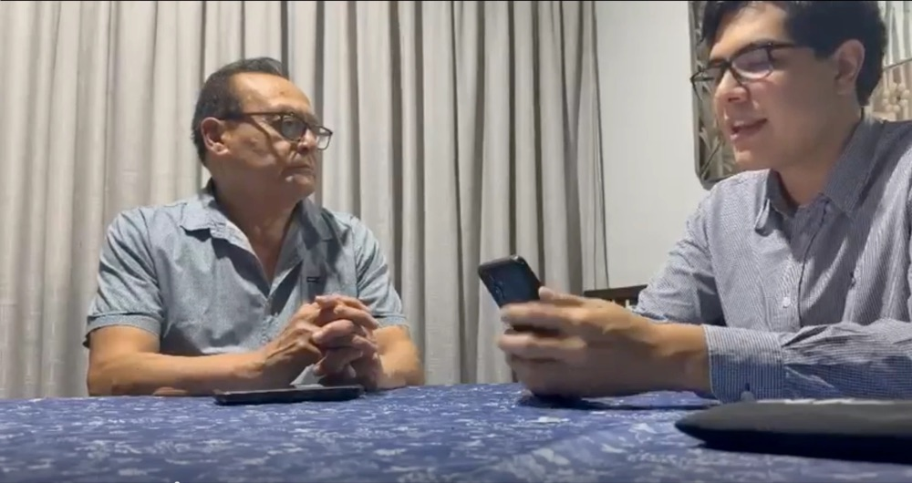
 |
| Fecha | 25/11/2026 |
| Timing | 00:00 min - 05:54 min |
| Enlace del video | [https://shorturl.at/JvP9s](https://shorturl.at/JvP9s) |
| Resumen (orientado al To-Be) | Desde el enfoque **To-Be**, el Dr. **Hugo Rojas Olivera** (pediatra y director ejecutivo de un hospital de emergencias) validó directamente los incrementos del Sprint 2 en *FerovaClinic* (`EC-02`) y su articulación con *FerovaFamily* (`EC-01`). Partiendo del problema clínico actual —pérdida de seguimiento tras el control de hemoglobina y recordatorios manuales por WhatsApp—, confirmó que los **porcentajes explícitos, el mapa de calor y la etiqueta `"Sin datos"`** (`US-TB02`) junto con las **alertas por valores atípicos** (`US-TB03`) agilizan la identificación temprana de pacientes en riesgo (`M-03`, `M-04`). Asimismo, valoró positivamente que la **racha diaria** de *FerovaFamily* (`US-TB01`) motive a las madres y que reflejar su adherencia en *FerovaClinic* permita actuar antes desde el establecimiento de salud. Como insumos de evolución *To-Be* posterior al experimento, sugirió incorporar **alertas de controles atrasados** y **exportación de la lista de pacientes**, señaló que la adopción institucional exige integración con la historia clínica electrónica (HCE), estandarización y consentimiento informado, y calificó con **4 de 5** la probabilidad de un piloto en un servicio pequeño. |

## 8.4. Experiment Aftermath & Analysis

### 8.4.1. Analysis and Interpretation of Results

Se realiza el análisis de los resultados de los tres experimentos definidos en la sección 8.1.5, comparando las condiciones de control y experimentales mediante las métricas establecidas en la sección 8.2.2 (Domain Business Metrics).

Para evaluar las diferencias se considera un nivel de significancia estadística de α = 0.05.

#### Experiment Card EC-01: FerovaFamily

**Objetivo:** Evaluar si la incorporación de una tarjeta de progreso en la pantalla de inicio de FerovaFamily mejora la confirmación diaria de dosis y la adherencia semanal de los cuidadores.

**Resultados:**

| Medida                               | Control | Experimental | Diferencia |
| ------------------------------------ | ------: | -----------: | ---------: |
| M-01: Daily Dose Confirmation Rate   |    60 % |         80 % |     +20 pp |
| M-02: Weekly Adequate Adherence Rate |    40 % |         70 % |     +30 pp |

**Análisis estadístico:**

| Medida | p-value | ¿Se rechaza H₀? |
| ------ | ------: | --------------- |
| M-01   |  0.0004 | Sí              |
| M-02   |   0.370 | No              |

**Interpretación:**

Los resultados muestran que el grupo experimental obtuvo una mayor tasa de confirmación diaria de dosis y adherencia semanal respecto al grupo de control. La métrica M-01 presenta una diferencia estadísticamente significativa, mientras que M-02 no alcanza el nivel de significancia establecido.

**Decisión: PERSEVERE.**

Se propone continuar con la tarjeta de progreso de FerovaFamily, manteniendo sus indicadores de racha diaria, avance hacia el 75 % y última hemoglobina registrada. Se recomienda ampliar la evaluación de la adherencia semanal para obtener mayor evidencia.

#### Experiment Card EC-02: FerovaClinic

**Objetivo:** Evaluar si la incorporación de porcentajes explícitos, etiquetas de disponibilidad de datos y alertas preventivas mejora la identificación de pacientes de alto riesgo y reduce los errores de registro clínico.

**Resultados:**

| Medida                                      |     Control | Experimental |   Diferencia |
| ------------------------------------------- | ----------: | -----------: | -----------: |
| M-03: High-Risk Patient Identification Time | 95 segundos |  70 segundos | -25 segundos |
| M-04: Clinical Control Entry Error Rate     |        30 % |         10 % |       -20 pp |

**Análisis estadístico:**

| Medida |  p-value | ¿Se rechaza H₀? |
| ------ | -------: | --------------- |
| M-03   | 0.000001 | Sí              |
| M-04   |    0.104 | No              |

**Interpretación:**

Los resultados indican que la versión experimental de FerovaClinic permitió reducir el tiempo de identificación de pacientes de alto riesgo y la tasa de errores en el registro de controles clínicos. La métrica M-03 presenta una diferencia estadísticamente significativa, mientras que M-04 muestra una mejora que todavía no alcanza significancia estadística.

**Decisión: PERSEVERE.**

Se propone continuar con las mejoras visuales del mapa de calor, la identificación explícita de datos faltantes y las alertas preventivas en el registro de hemoglobina. Se recomienda ampliar las pruebas para evaluar la reducción de errores clínicos.

#### Experiment Card EC-03: Landing Page

**Objetivo:** Evaluar si la incorporación de cifras institucionales citadas del INS/MINSA y botones CTA diferenciados para FerovaFamily y FerovaClinic incrementa la tasa de clics y la redirección correcta de los visitantes.

**Resultados:**

| Medida                                      | Control | Experimental | Diferencia |
| ------------------------------------------- | ------: | -----------: | ---------: |
| M-07: Landing Page CTA Click-Through Rate   |    20 % |         36 % |     +16 pp |
| M-08: Role-Specific Access Redirection Rate |    70 % |       94.4 % |   +24.4 pp |

**Análisis estadístico:**

| Medida | p-value | ¿Se rechaza H₀? |
| ------ | ------: | --------------- |
| M-07   |   0.118 | No              |
| M-08   |   0.116 | No              |

**Interpretación:**

Los resultados muestran que la variante experimental obtuvo mayores porcentajes de clics y redirecciones correctas en comparación con la versión de control. Sin embargo, las diferencias no alcanzan significancia estadística con el nivel establecido de 0.05.

**Decisión: PIVOT.**

Se propone modificar y optimizar los llamados a la acción de la Landing Page, reforzando la diferenciación visual entre los segmentos de madres/cuidadores y personal de salud. Posteriormente, se recomienda realizar una nueva evaluación para comprobar el impacto de los cambios.

### Resumen general de resultados

| Experiment Card     | Resultado principal                                                        | Decisión  |
| ------------------- | -------------------------------------------------------------------------- | --------- |
| EC-01: FerovaFamily | Mejora en la confirmación diaria de dosis.                                 | PERSEVERE |
| EC-02: FerovaClinic | Reducción del tiempo de identificación de pacientes de riesgo.             | PERSEVERE |
| EC-03: Landing Page | Incremento de CTR y redirecciones correctas sin significancia estadística. | PIVOT     |

### Conclusión general

El análisis de los resultados permite identificar oportunidades de mejora en los tres componentes de Ferova. En FerovaFamily, se destaca el potencial de la tarjeta de progreso para fortalecer el seguimiento del tratamiento. En FerovaClinic, las mejoras visuales y las alertas preventivas contribuyen a facilitar la identificación de pacientes de riesgo y reducir errores de registro. Finalmente, en la Landing Page, se identifica la necesidad de optimizar los llamados a la acción para mejorar la conversión de visitantes.

En consecuencia, se plantea continuar con las propuestas de FerovaFamily y FerovaClinic, mientras que la Landing Page requiere ajustes adicionales antes de una nueva evaluación. Estas decisiones son preliminares y deberán validarse mediante experimentos con datos reales.

### 8.4.2. Re-scored and Re-prioritized Question Backlog

El backlog de preguntas se vuelve a puntuar y priorizar considerando los resultados obtenidos en los experimentos EC-01, EC-02 y EC-03. Esta revisión permite actualizar el nivel de confianza del equipo, identificar las preguntas que requieren mayor investigación y añadir nuevas preguntas surgidas durante el análisis experimental.

**Criterio de puntuación:** Se mantiene la escala de 1 a 5 para cada dimensión. En **Confianza**, un puntaje bajo representa mayor desconocimiento y, por tanto, mayor prioridad mediante `(6 − Confianza)`. Se conserva la fórmula:

`Puntaje total = (6 − Confianza) + Riesgo + Impacto + Interés`

Los cambios de puntuación son preliminares y se basan en los resultados de la sección 8.4.1, por lo que deberán validarse con datos reales.

| Prioridad | ID | Pregunta | Confianza | Riesgo | Impacto | Interés | Puntaje | Cambio vs. 8.1.4 | Motivo del cambio |
|-----------|----|----------|----------:|-------:|--------:|--------:|--------:|-------------------|-------------------|
| 1 | Q-01 | ¿Mostrar en el inicio de *FerovaFamily* la racha diaria, el avance porcentual hacia ≥ 75 % y la última hemoglobina incrementa la tasa diaria de confirmación de dosis y la adherencia semanal frente a la pantalla actual? | 3 | 5 | 5 | 5 | **18** | ↑ Se mantiene en el primer lugar | La métrica M-01 presentó una mejora estadísticamente significativa. Sin embargo, M-02 requiere mayor validación. |
| 2 | Q-02 | ¿Incorporar porcentajes explícitos, etiqueta `"Sin datos"` en `/heatmap` y alertas por valores atípicos de edad/hemoglobina en *FerovaClinic* reduce el tiempo de identificación de pacientes de alto riesgo y la tasa de error en el control clínico frente a la vista actual? | 3 | 5 | 5 | 4 | **17** | ↑ Se mantiene entre las primeras posiciones | La reducción del tiempo de identificación de pacientes de alto riesgo fue significativa, aunque la reducción de errores todavía requiere evidencia adicional. |
| 3 | Q-09 | ¿Qué ajustes en el contenido, jerarquía visual y diferenciación de los botones CTA de la Landing Page permiten incrementar significativamente la conversión y la redirección correcta según el segmento de usuario? | 1 | 4 | 5 | 5 | **17** | Nueva | Surge del experimento EC-03, debido a que las mejoras observadas en CTR y redirección correcta no alcanzaron significancia estadística. |
| 4 | Q-03 | ¿Presentar cifras citadas de INS/MINSA y botones CTA diferenciados por rol (*FerovaFamily* vs. *FerovaClinic*) en la Landing Page incrementa la tasa de clics (CTR) y la redirección correcta según el segmento? | 2 | 4 | 4 | 4 | **16** | ↓ Baja una posición | La variante experimental mostró mejores porcentajes, pero no se obtuvo evidencia estadística suficiente para confirmar el efecto. |
| 5 | Q-05 | ¿Incluir una leyenda visual de disponibilidad en el calendario y una guía breve de asignación de enfermera/horario en *FerovaFamily* disminuye la indecisión percibida y aumenta la tasa de finalización al reservar citas? | 3 | 4 | 4 | 4 | **15** | = Sin cambio | Continúa pendiente de validación mediante pruebas específicas del flujo de reserva de citas. |
| 6 | Q-07 | ¿Dónde se concentran los principales cuellos de botella operativos que enfrenta el personal de salud al ejecutar de extremo a extremo el registro de paciente, control de hemoglobina y seguimiento en *FerovaClinic*? | 2 | 3 | 4 | 3 | **14** | = Sin cambio | Se mantiene como pregunta exploratoria debido a que todavía se requiere evidencia directa del personal de salud. |
| 7 | Q-06 | ¿En qué franjas del día y por qué motivos reales del entorno familiar omiten los cuidadores las dosis diarias de sulfato ferroso durante el tratamiento? | 1 | 2 | 3 | 3 | **13** | = Sin cambio | Continúa pendiente de investigación para identificar las causas reales de omisión de dosis. |
| 8 | Q-08 | ¿Los puntos y medallas de gamificación en `/achievement` logran por sí solos sostener la retención semanal de las madres/cuidadores más allá de las dos primeras semanas de uso? | 3 | 3 | 3 | 3 | **12** | = Sin cambio | No fue abordada directamente por los experimentos ejecutados y requiere una evaluación longitudinal de retención. |

**Interpretación de la repriorización:**

- **Q-01 y Q-02:** mantienen las primeras posiciones porque sus experimentos mostraron mejoras relevantes en las métricas principales, aunque todavía existen métricas secundarias que necesitan mayor validación.
- **Q-09:** se incorpora como nueva pregunta de investigación para profundizar en los elementos de conversión de la Landing Page, debido a que EC-03 no permitió confirmar estadísticamente las mejoras observadas.
- **Q-03:** permanece en el backlog, pero pierde una posición relativa porque los resultados no proporcionaron evidencia estadística suficiente.
- **Q-05, Q-06, Q-07 y Q-08:** conservan sus posiciones al no haber sido evaluadas directamente en los experimentos analizados.

**Resultado:** El backlog actualizado mantiene un enfoque **Broad**, ya que continúa distribuyendo la investigación entre los componentes de FerovaFamily, FerovaClinic y la Landing Page. Las preguntas con mayor incertidumbre y riesgo se mantienen como prioridad para los siguientes ciclos de experimentación.

## 8.5. Continuous Learning

### 8.5.1. Shareback Session Artifacts: Learning Workflow

> Artefactos de la sesión de shareback: agenda, participantes, hallazgos compartidos, decisiones tomadas y flujo de aprendizaje del equipo.

| Campo | Dato |
|-------|------|
| Fecha | [DD/MM/AAAA] |
| Participantes | [Nombres] |
| Experimentos revisados | [EC-01, EC-02] |
| Decisiones tomadas | [Decisiones] |

**Learning Workflow**

<!-- COMPLETAR -->

## 8.6. To-Be Software Platform Pre-launch

### 8.6.1. About-the-Product Intro Video

| Campo | Dato |
|-------|------|
| Enlace del video | [URL de Microsoft Stream] |
| Duración | [mm:ss] |

### 8.6.2. Resumen usando Gees Framework

> Resumen del ciclo experimental aplicando el **Gees Framework**.

<!-- COMPLETAR -->
